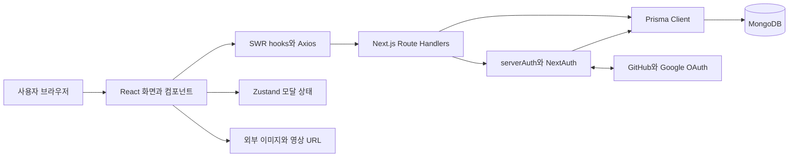
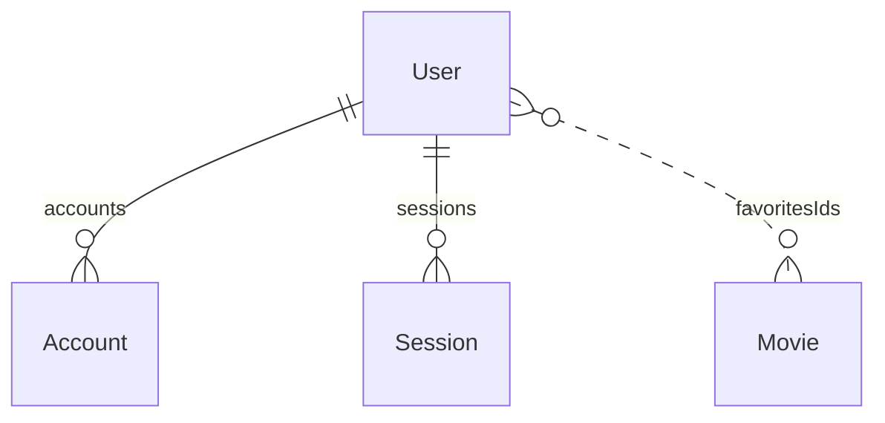
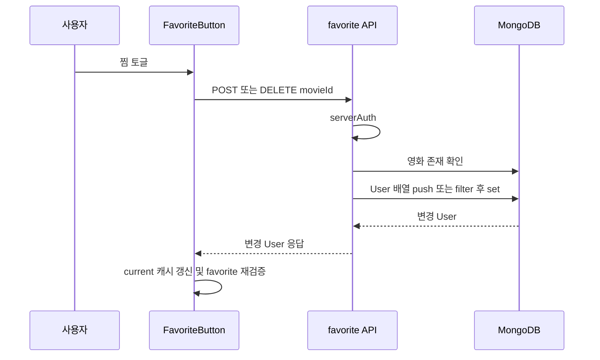
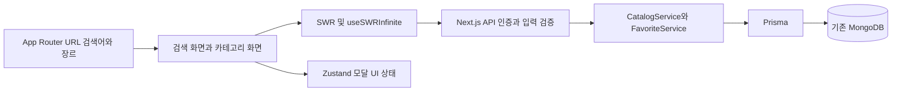
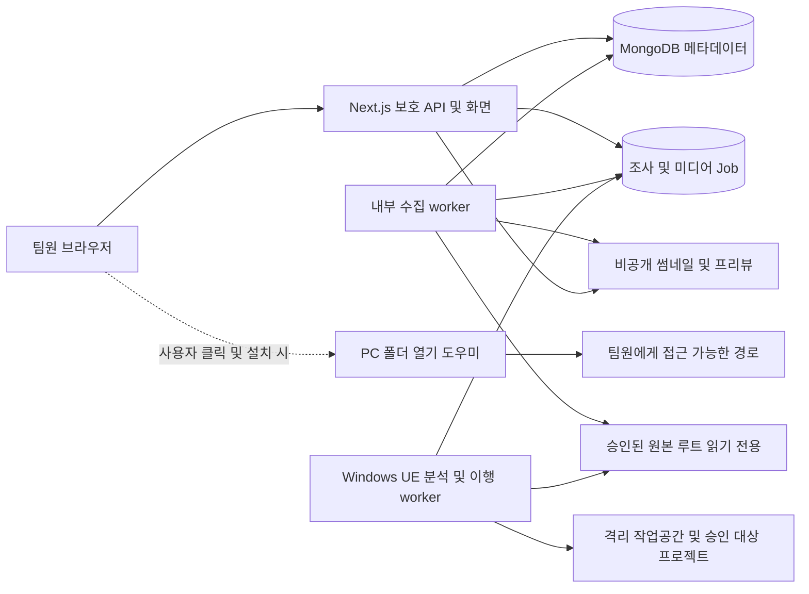

# 제작 콘텐츠 아카이브 소프트웨어 설계 문서 SDD

이 문서는 NextFlix를 기반으로 소규모 제작팀의 영상·프로젝트·에셋 아카이브를 설계하는 Software Design Document이다. 목표는 연도별 완성 영상에서 제작 정보와 원본 폴더를 찾아 과거 에셋·3D 파일·Unreal 프로젝트를 재사용하는 것이다. 현재 코드는 영화 탐색·찜·URL 재생 단계이며 제작 아카이브 기능은 아직 구현되지 않았다.

| 항목 | 기준 |
| --- | --- |
| 문서 버전 | 2.1 / 후속 답변 반영 초안 |
| 요구사항 갱신일 | 2026-10-17 (Asia/Seoul) |
| 분석일 | 2026-10-16 |
| 저장소 | https://github.com/LucasDaSilva96/NextFlix |
| 분석 커밋 | `5b67a0227640b95d8fd115b71c55f84a5cadbdf3` |
| 커밋 일시 | 2024-07-23 15:26:22 +02:00 |
| 분석 방식 | 해당 커밋의 애플리케이션·설정·스키마 정적 분석 |
| 연계 문서 | [TDD 테스트 설계](TDD.v2.1.ko.md) |
| 추가 비교 대상 | Fakeflix `2ef25d14a112e3c90e4b482b4c964b9404d436b6` (2024-01-16) |
| 두 번째 비교 대상 | karlhadwen/netflix `54ead17f6b8a240b4ab0d2eeff9d1c66c0a6c206` (2021-08-17) |

**읽기 순서와 우선순위:** 이번 제품의 요구사항·설계는 **20~29장**을 우선한다. 1~6장은 현재 코드 근거, 7~19장은 기존 영화 서비스 개선안과 참고 분석을 보존한 기록이다. 기존 장르·개봉일·외부 영화 카탈로그·단계 A~D가 신규 제작 아카이브의 필수 범위는 아니다. 인증·응답 DTO·접근성·실제 영상 재생 원칙은 이어받되, 신규 모델·API·단계 P0~P4는 후반부 계약을 따른다. TDD는 기존 문서와 동일하게 Test Design Document로 사용하며 기술 상세는 이 SDD에 둔다.

사용자 답변으로 Windows PC + 공용 NAS/SMB, 약 10명·10TB, 방송연도 분류, 기존 제작 프로젝트로의 에셋·의존성 추가를 확인했다. 엔진은 UE 5.3·5.4·5.6·5.8, Launcher와 UE 호환 커스텀 엔진, Blueprint 중심·일부 C++, 필수 플러그인 예시는 Actor Sequence다. 제작부조는 `TS-1~TS-D`, `홀`, `중계차`로 관리한다. TDD는 테스트 설계 문서다. 실제 엔진 build·추가 플러그인·TS 개별 명칭·폴더 구조·조사 주기는 남은 확인 사항이다. 이번 갱신은 문서만 변경한다.

버전 1.1은 Fakeflix의 탐색 경험을 선별하여 기존 기술 스택으로 구현하는 목표 설계를 추가한다. 1~6장은 NextFlix 현재 구현, 7~8장은 기존 개선 방향, 9~14장은 이번 권장 설계이다. 충돌하는 선택지는 9~14장의 구체적인 결정이 우선한다. 애플리케이션 코드·패키지·DB는 변경하지 않았다.

버전 1.2는 karlhadwen/netflix의 컴포넌트 구성과 테스트 방식을 평가하여 15~19장에 보완했다. 9~14장의 검색·cursor·Favorite 이행 계약을 유지하고 UI 책임, 인증 복귀, 테스트 데이터와 검증 방식을 구체화한다. 아래 비교 저장소의 구현 사실은 NextFlix에 이미 적용된 기능을 의미하지 않는다.

아래의 ‘현재 구현’은 코드에 존재하는 동작을 뜻한다. ‘개선 설계’는 아직 적용하지 않은 제안이다. 실제 DB, OAuth 공급자, 배포 환경을 연결한 실행 검증은 수행하지 않았다. 마지막 커밋 메시지는 당시 인증 관련 504 문제를 언급하지만, 현재 배포 상태나 원인을 확정하는 근거로 사용하지 않는다.

## 1 기능 범위와 요구사항

| ID | 기능 | 현재 구현과 경계 |
| --- | --- | --- |
| FR-01 | 회원가입 | 이름·이메일·비밀번호를 받고 bcrypt 비용 12로 해시 저장. 이메일 중복 조회. 이메일 인증 절차 없이 `emailVerified`를 현재 시각으로 기록 |
| FR-02 | 인증 | Credentials, GitHub, Google 제공자. JWT 세션. 로그아웃 지원 |
| FR-03 | 사용자 선택 | `/profiles`에서 현재 계정 하나를 표시하고 홈으로 이동. 별도 Profile 모델이나 다중 프로필 없음 |
| FR-04 | 영화 탐색 | 전체 영화와 무작위 대표 영화 표시. ‘Trending now’는 전체 조회 결과이며 순위 계산 없음 |
| FR-05 | 상세 보기 | 모달에 제목·설명·장르·재생시간과 재생·찜 버튼 표시 |
| FR-06 | 찜 관리 | 현재 사용자의 `favoritesIds`에 추가·삭제하고 My List 표시 |
| FR-07 | 영상 재생 | `/watch/[movieId]`에서 HTML video와 기본 controls 사용 |
| FR-08 | 반응형 화면 | Tailwind 반응형 클래스, 모바일 메뉴, 모바일 상세 버튼 사용 |
| FR-09 | 데모 로그인 | 빌드 설정으로 주입한 데모 이메일·비밀번호를 입력하여 Credentials 로그인 |

검색·알림 아이콘과 Series/Films 등의 메뉴에는 실제 검색·필터·이동 기능이 없다. 결제, 구독, 추천 알고리즘, 시청 이력, 콘텐츠 업로드·관리, 자막, DRM, 트랜스코딩 및 자체 스트리밍 서버는 분석 대상 구현에 없다. 영상 파일 접근 통제는 메타데이터 API의 인증과 별개이며, 외부 `videoUrl`에 대한 보호를 이 앱이 보장하지 않는다.

근거: [페이지 구성](https://github.com/LucasDaSilva96/NextFlix/tree/5b67a0227640b95d8fd115b71c55f84a5cadbdf3/app), [Navbar](https://github.com/LucasDaSilva96/NextFlix/blob/5b67a0227640b95d8fd115b71c55f84a5cadbdf3/components/Navbar.tsx), [NavbarItem](https://github.com/LucasDaSilva96/NextFlix/blob/5b67a0227640b95d8fd115b71c55f84a5cadbdf3/components/NavbarItem.tsx).

## 2 시스템 구조

Next.js App Router가 페이지와 API를 제공한다. `app/layout.tsx`와 `/profiles`는 서버에서 세션을 읽고, 홈·로그인·재생 화면은 Client Component로 동작한다. 따라서 전체 앱을 서버 렌더링 데이터 중심 구조로 설명하면 부정확하다. 영화 데이터는 브라우저의 SWR 요청으로 조회한다.

| 영역 | 책임 | 구현 위치 |
| --- | --- | --- |
| 화면 | 인증, 프로필 진입, 홈, 재생 | `app/**/page.tsx` |
| 표시 컴포넌트 | 배너, 카드, 모달, 목록, 메뉴 | `components/` |
| 서버 상태 | API 조회, 캐시 및 재검증 | `hooks/useCurrentUser.ts`, `useMovieList.ts`, `useMovie.ts`, `useFavorites.ts`, `useBillboard.ts` |
| 클라이언트 상태 | 모달 선택 ID와 열림 상태 | `hooks/useInfoModal.ts` |
| 인증 | 제공자 설정, 자격 증명 검증, 세션 사용자 조회 | `app/api/auth/[...nextauth]/route.ts`, `lib/serverAuth.ts` |
| 영속성 | 사용자·계정·영화 저장과 조회 | `lib/prismadb.ts`, `prisma/schema.prisma` |

Prisma Client는 전역 변수에 보관하여 같은 프로세스에서 재사용한다. 여러 서버리스 인스턴스 사이의 단일 연결을 보장하는 구조는 아니다. API가 Prisma를 직접 호출하며 별도의 서비스·리포지토리 계층은 없다.

선언된 주요 버전은 Next.js `14.2.5`, React `^18`, NextAuth `^4.24.7`, Prisma/Client `^5.16.2`, SWR `^2.2.5`, Zustand `^4.5.4`, Tailwind `^3.4.1`, TypeScript `^5`이다. 범위 표기는 설치 확정 버전이 아니며 재현 설치에는 lockfile을 사용한다. 근거: [package.json](https://github.com/LucasDaSilva96/NextFlix/blob/5b67a0227640b95d8fd115b71c55f84a5cadbdf3/package.json), [Prisma Client](https://github.com/LucasDaSilva96/NextFlix/blob/5b67a0227640b95d8fd115b71c55f84a5cadbdf3/lib/prismadb.ts).

## 3 데이터 설계

모든 모델의 기본키는 MongoDB `_id`에 매핑한 문자열 ObjectId이며 자동 생성된다.

| 모델 | 주요 필드 | 제약과 관계 |
| --- | --- | --- |
| User | name, email, image?, emailVerified?, hashedPassword?, createdAt, updatedAt, favoritesIds | email 고유. accounts·sessions 1:N. favoritesIds는 ObjectId 문자열 배열 |
| Account | userId, type, provider, providerAccountId, access_token?, refresh_token?, expires_at?, token_type?, scope?, id_token?, session_state? | provider와 providerAccountId 조합 고유. User 관계에 Cascade 선언 |
| Session | sessionToken, userId, expires | sessionToken 고유. User 관계에 Cascade 선언 |
| VerificationToken | identifier, token, expires | token 고유, identifier와 token 조합 고유 |
| Movie | title, description, videoUrl, thumbnailUrl, genre, duration | 필드 모두 필수 문자열. 장르 테이블·재생시간 숫자·생성 시각 없음 |

User와 Movie의 점선은 논리적 참조이다. Prisma relation이나 별도 찜 테이블이 아니므로 영화 삭제 시 참조 정리, 중복 방지, 순서 보존이 자동으로 해결되지 않는다. 찜 목록 조회는 `id in favoritesIds` 조건을 쓰며 저장 배열 순서와 같은 결과 순서를 보장하지 않는다. Session 모델이 있어도 현재 세션 전략은 JWT이다. VerificationToken 모델 존재만으로 이메일 인증 기능이 구현되었다고 볼 수 없다.

근거: [전체 스키마](https://github.com/LucasDaSilva96/NextFlix/blob/5b67a0227640b95d8fd115b71c55f84a5cadbdf3/prisma/schema.prisma), [찜 API](https://github.com/LucasDaSilva96/NextFlix/blob/5b67a0227640b95d8fd115b71c55f84a5cadbdf3/app/api/favorite/route.ts).

## 4 현재 API 계약

인증 필요 여부는 코드에서 `serverAuth()`를 호출하는지를 기준으로 한다. 오류 형식과 상태 코드는 통일되어 있지 않다. 아래는 목표 계약이 아니라 현재 코드의 분기이다.

| 메서드와 경로 | 인증 | 입력 | 성공 | 오류와 특이사항 |
| --- | --- | --- | --- | --- |
| POST `/api/auth/register` | 불필요 | JSON email, password, name | 201, 생성 User 전체 | 누락·중복·파싱·DB 오류 모두 400, 일반 오류 객체 |
| GET/POST `/api/auth/[...nextauth]` | 제공자 흐름에 따름 | NextAuth 요청 | NextAuth 관리 응답 | 앱 자체 고정 JSON 계약 아님 |
| GET `/api/current` | 필요 | 없음 | 200, User의 hashedPassword를 빈 문자열로 변경 | 인증 실패 등 400 |
| GET `/api/movies` | 필요 | 없음 | 200, Movie 배열 | 인증·DB 실패 500, JSON 문자열 |
| GET `/api/movies/[id]` | 일반 분기에서 필요 | URL 문자열을 `/`로 분리한 6번째 값 | 200, Movie | 정상 형식의 미존재 ID는 404. 잘못된 ObjectId는 500 가능. 문자열 `undefined`는 인증 없이 200 텍스트 |
| GET `/api/random` | 필요 | 없음 | 200, 임의 Movie | catch는 400. 빈 DB의 undefined 응답 직렬화 동작은 런타임 검증 필요 |
| GET `/api/favorite` | 필요 | 없음 | 200, 찜 Movie 배열 | 인증·DB 실패 500 |
| POST `/api/favorite` | 필요 | JSON movieId | 200, 변경 User 전체 | 영화 미존재 404 텍스트, 나머지 catch 500 |
| DELETE `/api/favorite` | 필요 | JSON movieId | 200, 변경 User 전체 | 영화 미존재 404 텍스트, 나머지 catch 500 |

Movie 응답은 `id`, `title`, `description`, `videoUrl`, `thumbnailUrl`, `genre`, `duration`을 포함한다. 회원가입과 찜 변경은 User 전체를 직렬화하므로 `hashedPassword`가 응답에 포함될 수 있다. `/api/current`만 별도 마스킹을 한다. 일부 Route Handler는 `new Response(JSON.stringify(...))`를 사용하면서 JSON Content-Type을 명시하지 않는다.

`/api/movies/[id]`는 라우트 params 대신 `req.url.split('/')[5]`를 사용한다. 정상적인 기본 URL에서는 ID를 얻지만 쿼리 문자열까지 ID에 붙거나 경로 접두어 변경으로 인덱스가 어긋날 수 있다.

근거: [API 소스](https://github.com/LucasDaSilva96/NextFlix/tree/5b67a0227640b95d8fd115b71c55f84a5cadbdf3/app/api).

## 5 주요 처리 흐름

### 5.1 회원가입과 로그인

1. 등록 화면이 필수 입력을 확인하고 register API를 호출한다.
2. API가 이메일 중복을 조회한 뒤 비밀번호를 해시하여 User를 생성한다.
3. 등록 성공 시 입력을 비우고 로그인 화면으로 바꾼다. 자동 로그인은 하지 않는다.
4. Credentials 로그인은 이메일로 User를 찾고 bcrypt 비교를 수행한다. 성공 시 id·email·name을 NextAuth에 반환한다.
5. 클라이언트는 `/profiles`로 이동한다. 프로필 화면은 서버 세션이 없으면 `/auth`로 이동한다.

`serverAuth()`는 `getServerSession()` 결과의 이메일로 DB User를 다시 조회한다. 인증 설정 객체를 인자로 전달하지 않으므로, 현재 구성이 배포 환경에서 세션을 올바르게 해석하는지는 통합 검증 대상으로 둔다. 특정 장애의 원인이라고 단정하지 않는다.

### 5.2 찜 목록 갱신

서버 성공 후 캐시를 갱신하므로 서버 요청 전 낙관적 갱신은 아니다. 추가는 배열 push로 중복이 가능하고, 삭제는 조회 시점 배열 전체를 덮어쓰므로 동시 변경을 잃을 수 있다. 요청 중 버튼 잠금도 없다.

### 5.3 상세와 재생

상세 버튼은 Zustand에 `movieId`와 `isOpen`을 저장한다. InfoModal은 `useMovie(movieId)`로 데이터를 읽으며 닫기 시 내부 표시를 즉시 끄고 300ms 후 외부 닫기 함수를 호출한다. 닫힌 상태에도 hook은 호출되므로 초기에는 `/api/movies/undefined` 요청이 발생할 수 있다.

Play 버튼은 `/watch/{id}`로 이동한다. 재생 화면은 videoUrl을 브라우저 video에 전달하며 재생·정지 이벤트에 따라 상단 바 투명도를 바꾼다. Movie가 없으면 로더를 표시하지만 조회 오류와 로딩을 구분하지 않아 실패가 계속 로딩으로 보일 수 있다. 페이지 자체에는 명시적 세션 리다이렉트가 없고 데이터 API가 인증을 검사한다.

근거: [인증](https://github.com/LucasDaSilva96/NextFlix/blob/5b67a0227640b95d8fd115b71c55f84a5cadbdf3/app/api/auth/%5B...nextauth%5D/route.ts), [serverAuth](https://github.com/LucasDaSilva96/NextFlix/blob/5b67a0227640b95d8fd115b71c55f84a5cadbdf3/lib/serverAuth.ts), [FavoriteButton](https://github.com/LucasDaSilva96/NextFlix/blob/5b67a0227640b95d8fd115b71c55f84a5cadbdf3/components/FavoriteButton.tsx), [InfoModal](https://github.com/LucasDaSilva96/NextFlix/blob/5b67a0227640b95d8fd115b71c55f84a5cadbdf3/components/InfoModal.tsx).

## 6 설정과 운영

| 설정 | 역할 및 주의점 |
| --- | --- |
| DATABASE_URL | Prisma MongoDB 연결. 테스트는 전용 DB 사용 |
| NEXTAUTH_URL, NEXTAUTH_SECRET | README의 인증 URL 및 비밀값 설정. 배포별 값 필요 |
| NEXTAUTH_JWT_SECRET | README에 있으나 앱 소스에서 직접 참조하지 않음. 별도 적용을 가정하지 않음 |
| GITHUB_ID, GITHUB_SECRET | GitHub 제공자 설정. 없으면 빈 문자열 전달 |
| GOOGLE_CLIENT_ID, GOOGLE_CLIENT_SECRET | Google 제공자 설정. 없으면 빈 문자열 전달 |
| DEMO_USER_EMAIL, DEMO_USER_PASSWORD | next.config의 env에 지정되어 클라이언트 사용 대상으로 노출. 비밀 계정으로 취급 불가 |

외부 Next Image 허용 호스트는 `upload.wikimedia.org` 하나다. 실제 OAuth 이미지 URL이 다른 호스트이면 렌더링 실패 가능성이 있어 검증해야 한다. video 태그의 URL 허용 정책과는 별개이다.

저장소에는 dev/build/start/lint 스크립트가 있으며 테스트 스크립트, 테스트 파일, CI 워크플로, 시드 스크립트는 추적 파일에서 확인되지 않았다. README의 배포 대상 설명은 Vercel이지만 실제 운영 설정·모니터링·백업 정책은 포함되지 않는다. README의 Node `>=14` 및 `prisma migrate dev` 안내는 그대로 실행 기준으로 삼지 않고 사용 프레임워크와 MongoDB 커넥터에 맞춰 검토해야 한다.

근거: [설정](https://github.com/LucasDaSilva96/NextFlix/blob/5b67a0227640b95d8fd115b71c55f84a5cadbdf3/next.config.mjs), [README](https://github.com/LucasDaSilva96/NextFlix/blob/5b67a0227640b95d8fd115b71c55f84a5cadbdf3/README.md).

## 7 개선 설계와 우선순위

P0는 배포 전 차단 결함, P1은 주요 정확성·신뢰성 문제, P2는 사용성·유지보수 개선으로 정의한다. 다음 항목은 미구현 제안이다.

| ID | 우선순위 | 근거와 영향 | 개선 설계 | TDD 연결 |
| --- | --- | --- | --- | --- |
| D-01 | P0 | 등록·찜 응답에 User 전체 반환 | 응답 DTO allowlist 적용. 비밀번호 해시·토큰 필드 제외 | SEC-01 |
| D-02 | P1 | 인증 실패가 400/500으로 분산 | 공통 인증 옵션 및 오류 변환. 비인증 401, 잘못된 입력 400, 미존재 404, 중복 409, 내부 오류 500 | AUTH-04, API-01 |
| D-03 | P1 | 문자열 분리 ID, undefined 요청 | Route params 사용, ObjectId 형식 검증. ID가 없으면 SWR key를 null로 설정 | MOV-03, MOV-04 |
| D-04 | P1 | 찜 중복 및 동시 삭제의 전체 배열 덮어쓰기 | DB 원자적 집합 추가·삭제 또는 사용자·영화 조합 고유 모델. 추가·삭제 멱등성 | FAV-03, FAV-04 |
| D-05 | P1 | 빈 영화 집합과 조회 실패 UI 미구분 | random의 빈 상태를 명시적 404로 정의. 화면에 오류·빈 상태·재시도 제공 | MOV-05, UI-03 |
| D-06 | P1 | 회원가입 입력 truthy 검사만 수행, 검증 없이 emailVerified 설정 | 타입·길이·이메일 검증, 중복 경쟁 처리. 실제 검증 전 emailVerified는 null | REG-03, REG-04 |
| D-07 | P1 | 데모 비밀번호를 클라이언트에 제공 | 데모 계정은 공개 전용 데이터·권한으로 격리. 비공개 자격 증명은 빌드 env에서 제거 | SEC-02 |
| D-08 | P2 | Billboard resize 등록·해제에 다른 함수 사용 | 동일 함수 참조로 이벤트 해제 | UI-04 |
| D-09 | P2 | 아이콘 클릭·모달에 키보드 의미 구조 부족 | 의미 있는 button, 접근 가능한 이름, dialog·초점 관리·Escape 지원 | A11Y-01 |
| D-10 | P2 | 전체 영화 조회, 무작위 skip, 관측은 console 중심 | 데이터 증가 시 페이지네이션·쿼리 계획 검토, 구조화 로그와 지연·오류 지표 | PERF-01 |
| D-11 | P1 | 외부 프로필 이미지 허용 범위 제한 | 실제 사용 공급자 이미지 호스트만 허용하고 대체 이미지 제공 | UI-05 |

개선 API는 `{ error: { code, message } }`로 오류를 통일하고 내부 예외 메시지를 외부에 그대로 내보내지 않는다. 사용자 응답은 필요한 id·name·email·image·favoritesIds 등만 선택한다. 찜 변경 응답은 `{ favoritesIds: string[] }`로 축소하고 클라이언트 계약도 함께 갱신한다. 비밀번호 정책, 요청 제한 수치, 성능 목표, 데모 권한은 제품 운영자가 확정해야 한다.

## 8 설계 검토 완료 기준

현재 구조와 개선 구조를 혼동하지 않고 각 요구사항을 TDD 사례와 연결한다. 구현 착수 전 오류 계약·데모 공개 정책·이메일 검증 정책을 확정한다. 배포 판정은 소스 검토만으로 내리지 않으며 인증 통합, DB 원자성, 응답 민감 필드 제거, 외부 미디어 재생을 실제 환경에서 검증한다.

## 9 Fakeflix 비교와 채택 결정

Fakeflix 기준 커밋은 `2ef25d14a112e3c90e4b482b4c964b9404d436b6`이다. 브라우저에서 TMDB를 조회하고 React Router, Redux 계열 상태 관리, Firebase 인증을 사용하는 별도 구조다. 기능 아이디어를 참고하되 NextFlix의 Next.js App Router, React, TypeScript, Tailwind, NextAuth, Prisma, MongoDB, Axios, SWR, Zustand를 유지한다. 패키지 버전 변경이나 신규 런타임 라이브러리 도입은 이번 설계의 전제 조건이 아니다.

| 비교 항목 | Fakeflix 코드에서 확인한 내용 | NextFlix 권장 결정 |
| --- | --- | --- |
| 카테고리 | dataConfig로 제목·조회 URL·selector를 연결 | 채택. 타입이 있는 카테고리 설정과 기존 genre 기반 서버 조회로 변환 |
| 목록 탐색 | Category, IntersectionObserver로 다음 페이지 로딩 | 수정 채택. 명시적 더 보기 버튼을 기본으로 하고 중복 요청·끝 페이지 보호 추가 |
| 검색 | 입력마다 multi 검색 요청, person 결과 제외 | 제목 검색부터 채택. 디바운스·URL 복원·응답 경쟁 차단 추가. 배우·감독 검색은 보류 |
| 가로 목록 | Swiper 기반 Row와 카테고리 링크 | 경험만 채택. CSS scroll-snap과 기본 스크롤 API·버튼으로 구현 |
| 로딩 표시 | 배너·카드·페이지 스켈레톤 | 채택. 최초 로딩, 추가 로딩, 빈 결과, 실패를 구분 |
| 상세 정보 | 개봉 연도·언어·평점·장르 표시 | 선택 채택. 검증된 데이터가 있는 필드만 표시하고 미상은 미상으로 유지 |
| 찜 저장 | redux-persist의 기본 storage, favourites만 영속화 | 채택하지 않음. MongoDB를 기준으로 하고 사용자별 캐시 분리 강화 |
| 인증 | Firebase 이메일·Google·익명 로그인 | Firebase 및 익명 로그인 도입 보류. 기존 NextAuth와 GitHub·Google 유지 |
| 재생 | PlayAnimation에서 소리·텍스트 후 browse로 이동 | 채택하지 않음. 기존 HTML video 실제 재생 유지 |
| 동작 효과 | Framer Motion·브랜드 인트로 | 필수 인트로·음향은 제외. Tailwind/CSS로 짧은 전환과 reduced-motion 지원 |
| 외부 카탈로그 | TMDB를 브라우저에서 직접 조회 | 기본 범위에서 제외. MongoDB 카탈로그 우선, 향후 서버 어댑터로만 검토 |

README는 찜 저장을 session storage로 설명하지만 실제 `rootReducer.js`는 `redux-persist/lib/storage`를 사용한다. 사용자 ID로 저장 공간을 나누거나 로그아웃 시 favourites를 초기화하는 처리는 읽은 reducer·saga에서 확인되지 않는다. `favourites.utils.js`는 숫자 id만 비교하므로 향후 서로 다른 미디어 유형을 합칠 때 동일 ID 충돌도 방지해야 한다.

검색은 `/search/multi` 결과에서 person을 제거할 뿐 인물의 출연작·연출작을 다시 조회하지 않는다. 따라서 ‘배우·감독으로 작품 검색 완성’을 보장하는 근거로 삼지 않는다. 카테고리 페이지는 page=2로 시작하고 기존 Redux 결과에 이어 붙이는 구조이므로 독립 URL 진입·응답 중복·마지막 페이지 처리를 별도로 설계한다. 이는 정적 분석이며 실행 장애를 확정한 것은 아니다.

## 10 추가 요구사항과 화면 설계

| ID | 추가 목표 | 구현 범위 |
| --- | --- | --- |
| FR-10 | 제목 검색 | `/search?q=...`, 공백 제거·유니코드 NFC 정규화, 1~100 Unicode 코드 포인트. 빈 검색어는 요청하지 않고 입력 안내 |
| FR-11 | 장르별 탐색 | `/categories/[slug]`, 서버 allowlist의 slug만 허용. 잘못된 slug는 404 |
| FR-12 | 점진적 목록 로딩 | 최초 24개, 더 보기, 끝 표시, 추가 실패 재시도. 자동 로딩은 선택 기능 |
| FR-13 | 가로 콘텐츠 행 | 제목·전체 보기 링크, 터치 스크롤, 이전·다음 button, 카드 키보드 접근 |
| FR-14 | 독립 My List | `/my-list`, 사용자 DB 기준 찜 표시, 비어 있을 때 탐색 링크 |
| FR-15 | 상태와 접근성 | 스켈레톤·빈 상태·오류·재시도 구분, 모달 초점·Escape, 모션 감소 |
| FR-16 | 상세 메타데이터 | 실제 값이 있는 개봉일·원어·평점·출처만 표시. 데이터가 없으면 숨기거나 ‘정보 없음’ |

홈은 대표 영화, 전체 영화, 데이터가 있는 장르 행, My List 요약으로 구성한다. 인기 집계나 공식 순위 데이터가 없으므로 기존 ‘Trending now’는 ‘영화 둘러보기’로 바꾸는 것을 권장한다. TV 시리즈, New & Popular, 언어별 분류, 검색되지 않는 인물 검색은 실제 데이터와 기능이 준비될 때까지 활성 메뉴로 노출하지 않는다.

SearchBar는 타이핑 중 300ms 디바운스를 적용하고 Enter에서는 즉시 확정한다. 한글 IME 조합 중에는 확정 요청하지 않는다. `URLSearchParams`로 인코딩하며 직접 URL 진입·새로고침·뒤로가기에서도 q를 복원한다. 타이핑은 URL replace, 명시적 검색 확정은 push를 사용해 과도한 방문 기록을 줄인다.

첫 조회에는 크기가 고정된 스켈레톤을, 추가 조회에는 기존 결과와 하단 로더를 표시한다. 목록의 오류는 해당 영역에서 처리해 다른 장르 행을 막지 않는다. 추가 실패 시 이미 읽은 결과를 유지하고 동일 cursor로 재시도한다. 자동 추가 로딩을 켜더라도 더 보기 버튼을 유지하고 요청 중·오류·마지막 페이지에서는 observer를 정지한다.

## 11 기존 스택을 사용하는 목표 구조

신규 `lib/catalog/categories.ts`는 slug·표시명·genre 매핑을 공유한다. `lib/catalog/service.ts`는 검색·장르·페이지 조건을 합치고 `lib/favorites/service.ts`는 찜 변경과 정합성을 담당한다. 작은 공통 DTO와 오류 변환만 분리하며 별도 서버나 범용 프레임워크 계층을 추가하지 않는다.

서버 데이터는 SWR, 선택 영화·모달 열림 등 UI 상태는 Zustand, 검색·필터는 URL을 기준으로 한다. 서버 영화 목록을 Zustand에 중복 저장하지 않는다. SWR key에는 사용자 식별, endpoint, 정규화된 q·category·cursor·limit을 포함한다. 세션 확정 전에는 보호 요청 key를 null로 설정한다. 계정 전환·로그아웃에서는 사용자 경계의 SWR provider를 재생성하고 모달을 닫는다. 늦게 도착한 이전 사용자의 응답이 새 캐시에 기록되지 않도록 요청 취소와 사용자 세대 식별을 적용한다.

장르나 검색어가 바뀌면 페이지 수를 초기화한다. 응답 순서가 뒤집혀도 현재 key의 데이터만 렌더링한다. 페이지 병합은 Movie ObjectId로 중복을 제거한다. 오류 재시도는 일시적 네트워크·서버 오류에 한해 제한하며 400·401·404를 반복 요청하지 않는다.

## 12 데이터와 API 확장 계약

### 12.1 기존 데이터 호환성

Movie ObjectId와 필수 필드, 기존 videoUrl 재생 구조를 유지한다. 최소 검색은 현행 `title`의 리터럴 부분 문자열 조건으로 시작한다. 정규식을 직접 받을 수 없게 하고 Prisma의 조건 생성으로 전달한다. 대소문자 무시와 한글 결합문자 동작은 실제 MongoDB 통합 테스트로 확인한다. 대규모 전체 검색 최적화나 인물 검색 엔진은 도입하지 않는다.

genre는 기존 문자열을 유지하며 카테고리 allowlist와 데이터 정리표로 대응시킨다. 복수 장르 배열 전환은 현 단계에서 하지 않는다. 탐색 순서는 `id` 오름차순으로 고정한다. `{genre: 1, _id: 1}` 인덱스를 후보로 검증하되 제목 부분 검색이 이 인덱스로 최적화된다고 주장하지 않는다.

선택적인 Movie 추가 필드는 `releaseDate: DateTime?`, `originalLanguage: String?`, `ratingValue: Float?`, `ratingScale: Float?`, `metadataSource: String?`이다. 평점은 값·척도·출처가 모두 유효할 때만 표시하고 0점과 누락을 구분한다. 연령 등급은 별도 신뢰 가능한 데이터가 없으면 추정하지 않는다. 기존 레코드는 null을 허용하며 오늘 날짜·현재 연도·전체 관람가로 채우지 않는다.

### 12.2 찜 원자성과 이행

D-04의 대안 중 **Favorite 별도 컬렉션과 복합 고유 제약**을 권장한다. Prisma·MongoDB는 그대로 유지하며 `Favorite(id ObjectId, userId ObjectId, movieId ObjectId, createdAt DateTime)`와 `@@unique([userId, movieId])`를 추가한다. 중복 추가는 고유 충돌을 처리한 후 현재 상태를 반환하고, 삭제는 해당 userId·movieId의 `deleteMany`로 멱등화한다. 다른 항목을 배열 통째로 덮어쓰지 않는다.

이행 전 DB 백업·복구 검증과 전용 환경 rehearsal을 수행한다. 짧은 찜 쓰기 중단 동안 기존 favoritesIds를 중복 제거하여 backfill하고, 존재하지 않는 영화 참조를 별도 집계한다. 사용자별 유효 고유 ID 집합을 대조한 뒤 서비스 읽기·쓰기를 Favorite로 전환한다. `/api/current`와 기존 찜 변경 응답의 favoritesIds는 Favorite에서 계산해 DTO로 반환하여 기존 화면 계약을 유지한다.

이전 배열은 한 릴리스 동안 읽기 전용으로 보존하되 두 저장소에 동시 쓰기는 하지 않는다. 전환 후 새 쓰기가 있으면 단순 구버전 배포로 롤백하지 않는다. 쓰기를 멈추고 Favorite의 최신 상태를 배열로 역변환·대조한 뒤 전환해야 한다. 이 결정은 D-01의 응답 DTO 축소와 함께 적용한다.

### 12.3 추가 API

기존 `/api/movies` 배열 응답을 갑자기 envelope로 바꾸지 않는다. 신규 `/api/catalog`를 추가하여 새 화면부터 전환하고, 기존 목록은 호환 기간 동안 유지한다. 아래 API는 모두 인증 후 입력을 검증한다.

| 경로 | 입력 | 성공 계약 | 예외 |
| --- | --- | --- | --- |
| GET `/api/catalog` | q?, category?, cursor?, limit? | 200 `{items: MovieSummary[], nextCursor: string|null}` | 잘못된 입력 400, 없는 category 404 |
| GET `/api/categories` | 없음 | 200 `{items:[{slug,label}]}` | 활성 카테고리만 반환 |
| GET `/api/favorite` | 기존 계약 유지 | 200 Movie 배열, Favorite 기준 조회 | 비인증 401 |
| POST/DELETE `/api/favorite` | movieId | 200 `{favoritesIds:string[]}` | 추가 대상 없음 404. 삭제는 영화가 없어도 잔여 찜을 제거하고 200 |
| GET `/api/movies/[id]` | 기존 ID | 기존 Movie 필드와 선택 메타데이터 | 잘못된 ID 400, 없음 404 |

`MovieSummary`는 id·title·thumbnailUrl·genre·duration만 포함한다. 상세와 재생은 기존 상세 API에서 videoUrl을 읽는다. 검색 결과 0건은 `200 {items:[],nextCursor:null}`이다. 잘못된 JSON·파라미터, 내부 오류는 D-02의 공통 오류 형식을 따른다.

limit 기본값은 24, 허용 정수 범위는 1~48이다. cursor는 `{v:1,lastId,q,category,limit}`를 인코딩한 불투명 토큰으로 정의하고 크기를 2KB로 제한한다. 서버는 모든 필드를 다시 검증하고 현재 필터·limit과 다르면 400을 반환한다. 토큰은 인증 수단이 아니며 사용자 데이터를 포함하지 않는다. 같은 조건에서 `id > lastId`, `id asc`, `limit+1`개를 조회해 다음 페이지 존재 여부를 결정한다. 마지막 cursor 대상 문서가 삭제되어도 ID 비교를 이용하므로 계속 탐색할 수 있다.

페이지 간 snapshot 일관성은 보장하지 않는다. 이미 지난 ID 범위에 추가되거나 필터가 변경된 콘텐츠는 새로고침 때 반영될 수 있다. 조회 중 변경에도 중복 ID를 화면에서 제거하며 정적인 fixture에서는 누락 없이 전부 읽혀야 한다.

## 13 보류 범위와 단계별 적용

| 단계 | 적용 내용 | 선행 조건과 완료 기준 |
| --- | --- | --- |
| A 기반 안정화 | DTO 해시 제거, 공통 인증·오류, undefined 요청 제거, 찜 원자성·이행 | 기존 P0/P1와 MIG-01~03 통과 |
| B 탐색 기능 | 로컬 제목 검색, 장르 경로, catalog cursor API, 독립 My List | SRCH·CAT·PAGE·LIST 사례 통과, 기존 API 호환 |
| C 화면 품질 | 가로 행, 스켈레톤, 상세 메타데이터, 접근성 | UX·META·A11Y 통과, 기존 실제 영상 재생 회귀 없음 |
| D 선택 확장 | TMDB 서버 어댑터, 시리즈, 인물 검색, 인기·신작 | 별도 범위 승인과 데이터·오류·권한 계약 확정 후 설계 |

단계 D는 이번 구현 권고의 필수 범위가 아니다. 추후 TMDB를 도입한다면 Route Handler 뒤의 어댑터에 자격 증명을 두고 외부 응답을 내부 DTO로 정규화한다. 외부 ID는 `provider + mediaType + externalId` 조합으로 구분하며 MongoDB ObjectId를 대체하지 않는다. TMDB 메타데이터가 있다고 실제 재생 권한이나 videoUrl이 생기는 것은 아니다. 타임아웃·429·캐시 만료·이미지 호스트 정책을 별도 검증한 후 연결한다.

## 14 Fakeflix 코드 근거

다음 링크는 모두 비교에 사용한 커밋으로 고정했다. 기능 자체는 참고하되 브랜딩·음원·영상 자산을 복제하는 작업은 포함하지 않는다.

- [기술 의존성과 스크립트](https://github.com/Th3Wall/Fakeflix/blob/2ef25d14a112e3c90e4b482b4c964b9404d436b6/package.json)
- [라우트](https://github.com/Th3Wall/Fakeflix/blob/2ef25d14a112e3c90e4b482b4c964b9404d436b6/src/App.js), [카테고리 설정](https://github.com/Th3Wall/Fakeflix/blob/2ef25d14a112e3c90e4b482b4c964b9404d436b6/src/dataConfig.js)
- [검색 입력](https://github.com/Th3Wall/Fakeflix/blob/2ef25d14a112e3c90e4b482b4c964b9404d436b6/src/components/Searchbar/Searchbar.jsx), [검색 응답 처리](https://github.com/Th3Wall/Fakeflix/blob/2ef25d14a112e3c90e4b482b4c964b9404d436b6/src/redux/search/search.actions.js)
- [카테고리 페이지](https://github.com/Th3Wall/Fakeflix/blob/2ef25d14a112e3c90e4b482b4c964b9404d436b6/src/pages/Category/Category.jsx), [추가 로딩 hook](https://github.com/Th3Wall/Fakeflix/blob/2ef25d14a112e3c90e4b482b4c964b9404d436b6/src/hooks/useLazyLoad.js)
- [가로 행과 로딩 표시](https://github.com/Th3Wall/Fakeflix/blob/2ef25d14a112e3c90e4b482b4c964b9404d436b6/src/components/Row/Row.jsx), [상세 모달](https://github.com/Th3Wall/Fakeflix/blob/2ef25d14a112e3c90e4b482b4c964b9404d436b6/src/components/DetailModal/DetailModal.jsx)
- [영속화 설정](https://github.com/Th3Wall/Fakeflix/blob/2ef25d14a112e3c90e4b482b4c964b9404d436b6/src/redux/rootReducer.js), [찜 중복 판정](https://github.com/Th3Wall/Fakeflix/blob/2ef25d14a112e3c90e4b482b4c964b9404d436b6/src/redux/favourites/favourites.utils.js)
- [인증과 로그아웃](https://github.com/Th3Wall/Fakeflix/blob/2ef25d14a112e3c90e4b482b4c964b9404d436b6/src/redux/auth/auth.sagas.js), [재생 애니메이션](https://github.com/Th3Wall/Fakeflix/blob/2ef25d14a112e3c90e4b482b4c964b9404d436b6/src/components/PlayAnimation/PlayAnimation.jsx)

## 15 karlhadwen netflix 비교와 채택 결정

기준 커밋은 `54ead17f6b8a240b4ab0d2eeff9d1c66c0a6c206`이다. React 16 계열, Firebase 7 계열, React Router 5, styled-components, Fuse.js를 선언한 프로젝트이며 이번 대상의 패키지 업그레이드 기준으로 사용하지 않는다.

| 비교 항목 | 확인한 구현 | 권장 결정 |
| --- | --- | --- |
| 컴포넌트 조합 | Card·Form·Accordion·Player가 하위 컴포넌트와 Context를 조합 | 개념 채택. 기존 React·TypeScript·Tailwind에서 의미 있는 구성 단위만 분리 |
| 컨테이너 | BrowseContainer가 데이터 선택·프로필·검색·화면 조립 수행 | 데이터 연결과 표시 분리를 채택하되 인증·검색·목록 상태를 하나의 대형 컨테이너에 모으지 않음 |
| Portal | Player.Video를 document.body에 createPortal | 상세 모달의 레이아웃 간섭 방지에 채택. 실제 재생은 기존 watch 경로 유지 |
| 폼 | form onSubmit, 필수값에 따른 submit 비활성, 화면 내 오류 | 채택·보완. 서버 검증, 요청 중 잠금, 접근 가능한 오류와 입력 보존 추가 |
| 경로 보호 | ProtectedRoute가 원래 location을 signin state에 저장 | 목적지 복귀 개념 채택. App Router와 NextAuth에서 안전한 내부 경로만 허용 |
| 콘텐츠 조회 | Firestore 컬렉션 전체 get 후 클라이언트 장르 필터 | 채택하지 않음. 기존 catalog 서버 조회·페이지 계약 유지 |
| 검색 | Fuse가 현재 slideRows를 검색하고 행 단위 결과를 반환 | 채택하지 않음. 전체 카탈로그의 서버 제목 검색, 0건 상태와 응답 경쟁 처리 유지 |
| 프로필 | 현재 계정 하나를 선택하여 로컬 profile 상태 설정 | 단일 계정 진입 흐름만 참고. 다중 프로필·사용자별 가족 계정 구현으로 간주하지 않음 |
| 로딩 | profile 변경 후 3초 타이머 | 제외. 실제 session·데이터 요청 상태 기준 |
| 재생 | 각 카드에서 동일 `/videos/bunny.mp4` 사용 | 제외. 선택 Movie의 videoUrl과 제목을 함께 검증 |
| 랜딩·FAQ | 정적 jumbotron·FAQ 데이터와 accordion | 필수 랜딩 페이지 도입은 보류. 실제 기능에 한정한 도움말을 선택 범위로 제공 |
| 테스트 | RTL·Jest 테스트와 snapshot, 커버리지 임계값 설정 | 행위 검증 구조를 채택. 임계값·snapshot만으로 통합 품질을 판정하지 않음 |

검색 코드에서는 길이가 3보다 크고 결과가 있을 때만 행을 축소하며, 결과가 없으면 원래 행을 복원한다. 따라서 NextFlix에 복사하면 ‘결과 없음’ 계약과 충돌한다. Portal의 overlay click은 내부 video에도 버블링될 수 있으므로 내부 클릭이 닫힘을 유발하지 않도록 별도 설계한다. 인증 hook의 localStorage 사용자 복원은 서버 인증 근거로 채택하지 않는다.

## 16 컴포넌트 경계와 모달 수명주기

### 16.1 권장 구성

| 단위 | 책임 | 소유하지 않는 상태 |
| --- | --- | --- |
| Catalog 화면 | URL 조건 해석, SWR 결과를 표시 컴포넌트에 전달 | 자체 영화 복제 저장소 |
| MovieRow·MovieCard | MovieSummary 표시, 상세·찜·재생 이벤트 전달 | 세션 판정·DB 쿼리 |
| AuthForm | 입력·제출 진행·필드 오류 표시 | 인증 세션 영속화 |
| InfoDialog | 접근 가능한 모달 틀·초점·배경 스크롤 관리 | 두 번째 선택 movieId |
| MovieDetails | 상세 DTO 표시, 기존 FavoriteButton·PlayButton 조합 | 별도 찜 원본 데이터 |
| CatalogService·FavoriteService | 조회·원자적 변경과 DTO 생성 | JSX·브라우저 상태 |

모든 요소를 `Component.Part` 형식으로 바꾸지 않는다. 기본은 명시적인 typed props와 children이며, 독립적으로 재사용되는 dialog·form 경계에서만 조합 방식을 사용한다. React Context가 필요해도 하위 UI 전달 범위로 한정한다. 전역 모달 선택은 기존 Zustand, 서버 데이터는 SWR, 세션은 NextAuth라는 단일 책임을 유지한다.

### 16.2 Portal과 이벤트 계약

InfoDialog는 Client Component로 두고 mount 이후 준비된 portal root에 렌더링한다. 서버 렌더 시 document에 접근하지 않으며 hydration 이전에는 닫힌 상태를 사용한다. Portal 자체는 초점 관리나 접근성을 제공하지 않으므로 `role=dialog`, `aria-modal`, 제목 연결, 진입 초점, Tab 순환, Escape, 트리거 복귀를 따로 구현한다.

닫기는 명시적인 닫기 버튼, Escape, backdrop의 `target === currentTarget` 클릭에만 반응한다. 내부 텍스트·찜·재생 버튼 클릭은 backdrop 닫기를 유발하지 않는다. 재생 버튼은 의도적으로 모달을 닫고 `/watch/{movieId}`로 이동한다. 인증 변경·페이지 이동 때에도 닫고 body 스크롤 잠금과 이벤트 리스너를 원복한다. 트리거가 사라졌다면 새 화면의 주 제목처럼 유효한 위치로 초점을 옮긴다.

기존 InfoModal의 300ms 지연 콜백은 **닫기 완료 대기 중 재열기 시 취소**하는 방식으로 보완한다. UI-01의 300ms는 일반 모션 조건에만 적용하고 reduced-motion에서는 즉시 닫는다. A를 닫은 직후 B를 열면 A의 지연 콜백이 B를 닫지 않아야 한다. 미디어가 모달에 포함된다면 닫기·이동·unmount 시 정지시킨다. 실제 전체 재생 화면을 두 번째 Portal 플레이어로 만들지는 않는다.

## 17 폼과 인증 복귀 계약

| ID | 추가 목표 | 세부 계약 |
| --- | --- | --- |
| FR-17 | 폼 상호작용 안정화 | form submit으로 Enter 지원, 요청 중 중복 제출 차단, label과 오류 연결, 진행 상태 안내 |
| FR-18 | 로그인 후 목적지 복귀 | 허용된 내부 목적지를 인증·프로필 진입 흐름에서 유지. 외부 이동과 순환 경로 차단 |
| FR-19 | 모달 수명주기 | 내부 조작과 닫기 구분, focus·scroll·timer 정리, 빠른 영화 전환 안전 |
| FR-20 | 재현 가능한 개발 데이터 | 전용 DB에서 고정 식별자와 멱등 seed, 검증 가능한 데이터·미디어 fixture |

AuthForm은 클라이언트 검증과 무관하게 서버 검증을 필수로 수행한다. 요청 진행 중 submit 및 동일 인증을 시작하는 버튼을 잠그고 완료·실패 시 해제한다. 실패 시 이름·이메일은 보존하며 비밀번호는 비운다. 오류를 토스트에만 의존하지 않고 폼 안에 표시하고 관련 필드 또는 오류 요약으로 초점을 안내한다. 저장 시 비밀번호·폼 전체를 로그·URL·브라우저 영속 저장소에 쓰지 않는다. 기존 등록 후 로그인 전환은 유지하며 가입과 자동 로그인을 새로 결합하지 않는다.

인증이 필요한 경로 진입 시 `/auth?returnTo=...`에 목적지를 전달한다. 인증 중 상태를 보여주고 서버/API 권한 검사는 별도로 유지한다. 클라이언트의 저장된 사용자 정보만으로 보호 화면을 허용하지 않는다. Credentials 성공과 OAuth callback 모두 `/profiles?returnTo=...`를 거쳐 프로필 선택 후 원래 목적지로 이동한다. 직접 인증 화면에 진입했거나 목적지가 잘못되었으면 기존 기본 경로 `/`로 이동한다.

`returnTo`는 동일 origin의 루트 상대 URL만 허용한다. 정규화한 pathname을 `/`, `/search`, `/my-list`, `/categories/{허용 slug}`, `/watch/{유효 ObjectId}` allowlist와 대조한다. `//`, 역슬래시, 스킴 포함 URL, 제어문자, 인증·프로필·API 경로를 거절하고 decode 오류를 안전하게 처리한다. 라우트별 허용 query만 다시 구성한다. 예를 들어 검색은 검증된 q·category만 남긴다. 검증은 전달·인증 완료·최종 이동 시 적용하며 NextAuth의 기존 redirect 검증을 우회하지 않는다. 복귀 후에도 Movie의 존재·세션 유효성은 API에서 다시 검사한다.

정적 도움말은 단계 C의 선택 항목으로 둔다. 도입할 경우 native details/summary 또는 button 기반 accordion으로 계정·검색·찜·재생 사용법만 안내한다. 구독·요금·취소·reCAPTCHA 등 구현하지 않은 기능을 문구로 약속하지 않는다. 기본 `/` 홈 구조를 마케팅 랜딩으로 교체하지 않는다.

## 18 데이터 준비와 검증 설계 보완

참고 저장소의 seed는 Firestore add와 생성 ID를 사용한다. NextFlix 개발·테스트 seed는 기존 MongoDB ObjectId 형식을 유지하는 고정 fixture ID와 upsert 방식으로 설계한다. 전용 DB 이름 allowlist와 명시적 seed 실행 옵션을 동시에 확인하고 조건 불충족 시 쓰기 전에 종료한다. 앱 시작 시 자동 seed하지 않으며 운영 DB 전체 삭제나 재초기화를 포함하지 않는다.

fixture는 현재 Movie 필수 필드, 선택 메타데이터, 서로 다른 두 videoUrl, 계정별 찜, 빈 카탈로그를 포함한다. 같은 seed를 반복해도 수가 늘지 않고, fixture 소유 ID 밖의 데이터를 바꾸지 않는다. 새 seed 필드는 기존 레코드 읽기를 깨뜨리지 않아야 하며 FR-20은 새로운 프로덕션 엔터티 추가를 요구하지 않는다.

추가 목표를 기존 단계에 통합한다. 단계 A에는 FR-17·18·20을, 단계 C에는 FR-19를 포함한다. 안전한 복귀와 민감 데이터 검사는 배포 차단 기준으로 검증한다. 단계 B의 검색·cursor 및 Favorite 이행 설계는 그대로 유지한다. 도움말·다중 프로필·퍼지 검색·신규 전체 화면 플레이어는 이번 필수 범위에 포함하지 않는다.

## 19 karlhadwen netflix 코드 근거

- [의존성·테스트 명령·커버리지 설정](https://github.com/karlhadwen/netflix/blob/54ead17f6b8a240b4ab0d2eeff9d1c66c0a6c206/package.json)
- [Browse 조립·검색·고정 영상·로딩](https://github.com/karlhadwen/netflix/blob/54ead17f6b8a240b4ab0d2eeff9d1c66c0a6c206/src/containers/browse.js)
- [Card 조합](https://github.com/karlhadwen/netflix/blob/54ead17f6b8a240b4ab0d2eeff9d1c66c0a6c206/src/components/card/index.js), [Form](https://github.com/karlhadwen/netflix/blob/54ead17f6b8a240b4ab0d2eeff9d1c66c0a6c206/src/components/form/index.js), [Player Portal](https://github.com/karlhadwen/netflix/blob/54ead17f6b8a240b4ab0d2eeff9d1c66c0a6c206/src/components/player/index.js)
- [로그인](https://github.com/karlhadwen/netflix/blob/54ead17f6b8a240b4ab0d2eeff9d1c66c0a6c206/src/pages/signin.js), [인증 hook](https://github.com/karlhadwen/netflix/blob/54ead17f6b8a240b4ab0d2eeff9d1c66c0a6c206/src/hooks/use-auth-listener.js), [보호 경로](https://github.com/karlhadwen/netflix/blob/54ead17f6b8a240b4ab0d2eeff9d1c66c0a6c206/src/helpers/routes.js)
- [콘텐츠 hook](https://github.com/karlhadwen/netflix/blob/54ead17f6b8a240b4ab0d2eeff9d1c66c0a6c206/src/hooks/use-content.js), [seed](https://github.com/karlhadwen/netflix/blob/54ead17f6b8a240b4ab0d2eeff9d1c66c0a6c206/src/seed.js)
- [단일 프로필](https://github.com/karlhadwen/netflix/blob/54ead17f6b8a240b4ab0d2eeff9d1c66c0a6c206/src/containers/profiles.js), [랜딩](https://github.com/karlhadwen/netflix/blob/54ead17f6b8a240b4ab0d2eeff9d1c66c0a6c206/src/pages/home.js), [Accordion](https://github.com/karlhadwen/netflix/blob/54ead17f6b8a240b4ab0d2eeff9d1c66c0a6c206/src/components/accordion/index.js)
- [Player 테스트](https://github.com/karlhadwen/netflix/blob/54ead17f6b8a240b4ab0d2eeff9d1c66c0a6c206/src/__tests__/components/player.test.js), [Browse 테스트](https://github.com/karlhadwen/netflix/blob/54ead17f6b8a240b4ab0d2eeff9d1c66c0a6c206/src/__tests__/pages/browse.test.js), [Accordion 테스트](https://github.com/karlhadwen/netflix/blob/54ead17f6b8a240b4ab0d2eeff9d1c66c0a6c206/src/__tests__/components/accordion.test.js)

## 20 제품 목적·범위와 요구사항

### 20.1 사용자 요구와 성공 경로

확인된 목적은 Netflix 형태의 탐색 화면에서 제작 영상을 연도별로 보고, 클릭하여 상세정보·여러 썸네일·제작 폴더를 확인하며, 과거 에셋·3D 파일·Unreal 프로젝트를 쉽게 찾아 재사용하는 것이다. ‘폴더 서베잉’은 승인된 제작 경로 아래의 파일·폴더를 읽어 카탈로그 후보를 만드는 조사로 해석한다(Q-04 확인 필요).

대표 흐름은 `2023년 영상 → 상세 → 제작 프로젝트 → 연결된 3D/Unreal 자료 → 버전·의존성 확인 상태·재사용 메모 → 원본 위치 확인/복사 → 제작 도구에서 재사용`이다. 에셋에서 사용 영상으로 역탐색도 제공한다. 영상·프로젝트·버전·에셋을 서로 다른 개념으로 관리한다.

| 구분 | 범위 | 상태 |
| --- | --- | --- |
| 제품 방향 | 연도별 영상, 상세, 복수 썸네일, 제작 위치, 폴더 조사, 에셋 재사용 탐색 | 사용자 요청으로 확인 |
| 1차 권장 | 한 팀의 중앙 카탈로그, 수동 등록, 읽기 전용 조사·후보 검토, 검색, 경로 복사, 권한 | 설계 제안 |
| 확인된 환경 | Windows PC + 공용 NAS/SMB, 약 10명·10TB | 사용자 답변 확인, 영상/파일 개수는 미확인 |
| 선택 | 탐색기에서 폴더 열기 도우미 | Q-02에서 결정 |
| 1차 필수 확장 | UE 프로젝트 분석, 선택 에셋과 의존성의 대상 프로젝트 이행 자동화 | 사용자 답변 확인, 세부 계약은 29장 |
| 후속 | 3D 뷰어, AI 유사도 검색, 편집 협업 | 별도 설계 |
| 제품에서 제외 | 원본 자동 삭제·이동·덮어쓰기, 파일명 기준 중복 제거 | 원본 보존 원칙 |

### 20.2 신규 기능 요구사항

기존 영화 서비스 FR과 분리하여 ARC 접두어를 쓴다. M은 1차 필수 권장, O는 선택이다.

| ID | 등급 | 요구사항·수용 조건 |
| --- | --- | --- |
| ARC-01 | M | 최신 방송연도부터 영상 행·연도 전체 보기 제공. 연도 미상 별도, 빈 연도 숨김. 카드에 제목·연도·대표 썸네일 |
| ARC-02 | M | 영상 상세에 설명·방송 제목·종류·프로젝트·버전·담당자·제작부조·방송연도·키워드·기술정보·원본 상태. 누락값은 미상 |
| ARC-03 | M | 대표 이미지·복수 프레임 썸네일·추출 시점. 프리뷰 명시적 재생, 미지원 원본은 상태 안내 |
| ARC-04 | M | 프로젝트 1:N 영상, 영상 1:N 버전, 복수 원본 위치. 납품/작업본과 대표 버전 수동 선택. 제목만으로 병합 금지 |
| ARC-05 | M | 승인한 제작 루트의 조사·dry-run·진행·취소·실패·이력·후보 검토 반영 |
| ARC-06 | M | 영상·프로젝트·에셋·Unreal 프로젝트·원본 위치 연결과 역탐색. 에셋의 복수 사용 프로젝트 지원 |
| ARC-07 | M | 제목·방송 제목·프로젝트명·파일명·태그/키워드·담당자·제작부조·고객사 검색, 연도·종류·담당자·제작부조·에셋 유형·UE 버전 필터 |
| ARC-08 | M/O | 저장소 기준 경로 복사(M), 지원 도우미와 사용자 클릭으로 폴더 열기(O). 연결 불가·매핑 없음 안내 |
| ARC-09 | M | 에셋 유형·도구/엔진 버전·의존성 확인 상태·재사용 메모·출처/사용 제약 상태. 미확인은 미확인으로 표시 |
| ARC-10 | M | 관리자·편집자·조회자와 프로젝트 접근 범위. 검색·건수·경로·미디어도 서버에서 권한 검사 |
| ARC-11 | M | 원본 읽기 전용 수집, 반복 실행 멱등성, 쓰기 중 파일 보류, 단절과 누락 구분 |
| ARC-12 | M | 수동 보완·관계 수정·변경 이력·중복 후보 검토·백업 복구. 조사값이 수동 확정값을 덮어쓰지 않음 |
| ARC-13 | M | UE 5.3/5.4/5.6/5.8 및 등록된 Launcher/커스텀 build worker로 프로젝트·패키지 의존성 분석. Blueprint·일부 C++·Actor Sequence의 엔진/모듈/플러그인·미해결 의존성 보고 |
| ARC-14 | M | 에셋 선택 → 의존성/충돌/용량 계획 → **기존 제작 프로젝트**에 추가 → 실제 UE 검증 → 결과·복구 이력. 원본과 대상 기존 자료 보존 |
| ARC-15 | M | 방송 제목·방송연도·예능/교양 등 종류·담당자·제작부조·UE 버전·키워드를 표시·편집·검색/필터 |

## 21 화면과 업무 규칙

| 경로 제안 | 화면·동작 |
| --- | --- |
| `/archive` | 어두운 배경, 검색·연도 이동, 연도별 가로 카드 행, 전체 보기·더 보기. 근거 없는 인기 순위 없음 |
| `/archive/years/[year]` | 해당 방송연도 전체 영상. `unknown`은 미상. 검색·필터·페이지 상태를 URL로 복원 |
| `/archive/videos/[id]` | 공유·새로고침 가능한 상세. 프리뷰·갤러리·정보·버전·제작 폴더·에셋·UE 프로젝트·관련 영상 |
| `/archive/projects/[id]` | 프로젝트 정보, 복수 영상·에셋·폴더·UE 프로젝트, 담당자·메모·조사 상태 |
| `/archive/assets` 및 `/archive/assets/[id]` | 유형별 검색, 원본·재사용 정보, 연결된 허용 영상·프로젝트 역참조 |
| `/archive/admin/sources` 및 `/archive/admin/scans/[id]` | 관리자 루트 등록·제외 규칙·연결 점검·조사 진행·후보·오류·재실행 |

카드 클릭은 상세이며 재생·경로 복사·폴더 열기는 구분된 버튼이다. 요약 모달을 사용해도 상세 URL을 제공한다. 자동 음향은 없고 키보드·터치·초점 복귀·목록 위치 복원을 지원한다. 개인 찜은 선택 유지이며 핵심 업무 완료 조건은 아니다.

**연도 기준은 사용자가 선택한 방송연도**다(Q-03 확정). `broadcastYear`는 1900~9999 정수 또는 null이다. 제작완료일·납품일·파일 수정일·수집일·폴더명 숫자를 방송연도로 자동 대체하지 않는다. 미상은 현재 연도로 채우지 않는다. 프로젝트는 여러 해에 걸칠 수 있고 영상마다 방송연도를 가진다. 새 버전이나 재수집으로 방송연도를 자동 변경하지 않는다. 방송일이 확인되면 선택 `broadcastDate`와 출처를 저장하고 연도 불일치는 검토 대상으로 표시한다. 여러 해 재방송은 현재 논리 영상의 대표 방송연도 하나를 기준으로 표시하는 초안이며, 복수 방송 이력이 필요하면 별도 확장한다.

제작부조는 독립 관리 용어 `ProductionFacility`로 둔다. `kind=studioControlRoom/hall/obVan`, `code`, `displayName`, `active`, `sortOrder`로 구분한다. 사용자 표기 `TS-1~TS-D`는 TS 계열 범위의 원문 근거이며 하나의 실제 선택값으로 seed하지 않는다. 그 사이의 TS 명칭을 임의 생성하지 않고 실제 목록을 받은 뒤 등록한다. `홀`·`중계차`는 각각 초기 선택값으로 두고 세부 호/차량이 필요하면 관리자가 추가한다. 한 영상은 복수 제작부조를 연결할 수 있는 설계안으로 두며, 미연결은 미상이다. 부조 이름 변경은 ID를 유지하고 비활성화해도 과거 연결은 보존한다.

홈은 논리적 영상 하나당 대표 버전 하나를 표시한다. 세로/가로·언어본을 별도 영상으로 볼지는 Q-05에서 결정하며 그전 자동 병합하지 않는다. 대표 버전은 같은 영상에 속한 버전만 지정한다.

검색 q는 NFC·앞뒤 공백 제거 후 1~100 코드 포인트의 리터럴 검색이다. 빈 q는 필터 탐색을 허용한다. 제목·방송 제목·프로젝트명·파일명·키워드·담당자·제작부조·고객사 q 필드는 OR, 연도·콘텐츠 종류·담당자·제작부조·에셋 유형·UE 버전 필터는 AND이다. 300ms 디바운스·IME·이전 요청 차단·필터 변경 시 페이지 초기화 원칙을 적용한다. 허용되지 않은 프로젝트의 검색 결과·건수·연도·연관 프로젝트명은 노출하지 않는다.

## 22 제작 폴더 등록·조사와 미디어 생성

### 22.1 입력·관계 확정

(1) 편집자의 수동 프로젝트/영상 등록과 승인 루트 내 위치 연결, (2) 관리자의 루트 등록 후 수집기 조사로 후보 생성의 두 경로를 제공한다. 조사 후보는 편집자 검토 후 카탈로그에 반영한다. 폴더명·인접 경로·확장자만으로 실제 영상 사용 관계를 확정하지 않는다. 관계는 `candidate/confirmed/rejected`와 근거·확인자·시각을 저장하고, 확정 관계만 사용 이력으로 표시한다.

예시는 실제 구조에 대한 가정이 아니다: `\\nas\production\2023\ProjectA\delivery\film.mp4`, `source\models\building.fbx`, `unreal\ProjectA.uproject`를 같은 프로젝트 후보로 제안한 뒤 사람이 확인한다. 하나의 폴더에 여러 제작 건이 있거나 한 프로젝트가 여러 루트에 분산된 경우 수동 분리·연결을 지원한다.

영상 mp4/mov/mxf, 이미지 jpg/png, 3D fbx/obj/blend/max/ma/mb, UE `.uproject/.uasset/.umap` 등을 후보로 분류한다. 확장자는 형식 힌트이며 디코딩·재사용 가능성의 보증이 아니다. 프로젝트 전체를 하나의 재사용 단위로 등록할 수 있다. 문서 본문·소스 코드 인덱싱과 UE 바이너리 내부 분석은 기본 범위 밖이다.

### 22.2 조사 계약

1. 상태는 `queued → running → completed | partial | failed | cancelled`. 모든 대상 디렉터리를 정상 열거했을 때만 completed다. 경로별 접근 거절·파싱 오류·단절은 원인과 범위를 기록한다. 전체 개수를 모르면 처리 파일/바이트 카운트를 보여주며 임의 백분율을 만들지 않는다.
2. 최초는 dry-run으로 후보·제외·오류를 검토한다. 같은 루트의 동시 조사는 하나로 제한한다. Job lease·fencing token으로 만료 worker의 늦은 반영을 차단한다. checkpoint 재개 또는 전체 재조사를 지원하며 결과는 위치 키로 upsert한다.
3. `(sourceId, canonicalRelativePath)`를 위치 고유 키로 사용한다. 원문 경로 보존·대소문자 처리 정책은 저장소별로 둔다. 파일 크기·mtime·읽기 전후 stat이 안정된 파일만 분석하며 쓰기 중 파일은 보류한다. 루트와 경로 정규화 후 범위 이탈을 다시 검사한다.
4. 크기·mtime 일치는 내용 동일성 증명이 아니다. 전체 해시는 기본 수행하지 않고 필요 시 비동기로 계산한다. 동일 해시라도 파일 위치는 따로 보관하며 자동 삭제·병합하지 않는다. 이동·이름 변경은 근거와 검토 없이 확정하지 않는다.
5. `DerivedDataCache/Intermediate/Saved/Binaries`, VCS·캐시는 기본 제외 후보다. 실제 필요한 자료가 있을 수 있어 루트별 dry-run으로 확인한다. symlink/junction/reparse point는 기본 미추적이며 순환·루트 탈출을 차단한다.
6. 전체 범위를 읽은 completed 조사 두 번에서 연속 미발견했을 때만 `missingCandidate`로 표시한다(권장값). partial·단절·제외 규칙 변경은 누락 횟수를 올리지 않는다. 자동 삭제하지 않고 원본 복귀 시 같은 위치로 복원한다. 삭제/보관 확정은 사람의 검토 대상이다.
7. 후보 반영은 명시적 검토 작업이며 재실행으로 영상·관계가 중복되지 않는다. 수동 설명·연도·대표 이미지는 수집 정보와 출처를 나누고, 충돌은 보완 후보로 남긴다. 원본 파일에 manifest나 썸네일을 쓰지 않는다.

### 22.3 프리뷰·썸네일

별도 worker에서 길이·해상도·코덱·프레임률·크기를 추출하고 기본 10%·50%·90% 지점의 최대 세 프레임을 썸네일 후보로 만든다. 짧은 영상 중복 프레임은 제거하며 대표 이미지·추가 이미지는 편집자가 선택/등록한다. 실패해도 메타데이터 카드를 열 수 있다.

프리뷰는 별도 파생 저장소에 만들고 원본에 덮어쓰지 않는다. `pending/ready/unsupported/failed`를 구분하며 MOV/MXF라는 확장자만으로 브라우저 재생 가능을 표시하지 않는다. 디코더 시간·메모리·출력 크기를 제한하고 원본은 읽기 전용으로 연다. 경로를 셸 명령 문자열에 결합하지 않는다. 일반 폴더 수집기는 UE·DCC를 실행하지 않고, UE 분석·이행은 29장의 별도 승인된 엔진 worker에서 수행한다.

## 23 구조·배치·권한과 폴더 열기

기존 Next.js·React·NextAuth·Prisma/MongoDB를 출발점으로 하되 장시간 조사를 Route Handler 수명에 묶지 않는다. 초기 DB Job/lease로 시작하고 측정 후 전용 큐를 검토한다. 운영 도입 시 지원 버전·보안 업데이트·DB 구성을 별도 확인한다. 현행 패키지 버전이 운영에 적합하다는 보증은 아니다.

| 환경 | 수집·배치 선택안 |
| --- | --- |
| 공용 NAS/서버 | 해당 공유를 읽는 내부 worker 한 개, 읽기 전용 서비스 계정. 1차 권장 |
| 개인 PC/외장디스크 분산 | 등록 collector·장치 식별·오프라인 상태·등록 취소·동기화가 추가로 필요 |
| 외부 웹 + 내부 원본 | 내부 collector의 인증된 송신과 별도 보호 미디어 경로. 외부 웹이 내부 공유에 직접 접근한다고 가정하지 않음 |

브라우저 `showDirectoryPicker()`는 지원 범위·보안 컨텍스트·사용자 동작 제약이 있어 무인 정기 조사 전제로 삼지 않는다. 근거: [MDN 폴더 선택](https://developer.mozilla.org/en-US/docs/Web/API/Window/showDirectoryPicker). 서버의 로컬 경로가 팀원 PC에서도 같은 위치라는 가정도 금지한다.

파일 위치는 `sourceId + relativePath`, 서버 물리 루트는 관리자 설정으로 분리한다. source를 worker의 마운트 경로와 팀원 PC의 UNC/드라이브 경로에 매핑한다. 기본 복사는 공용 기준 경로이고 검증된 PC 매핑이 있으면 해당 경로도 제공한다. worker의 online 상태와 팀원 PC의 접근 가능 여부는 별도다.

폴더 열기는 일반 웹 링크만으로 보장하지 않는다. 1차 필수는 경로 복사와 연결 안내다. 도우미를 채택하면 사용자 클릭으로 짧게 만료되는 일회성 불투명 토큰을 넘기고 도우미가 보호 API에서 사용자·장치·행위·루트 범위를 검증한 뒤 폴더만 연다. 원시 경로·명령을 URI에 넣지 않고 셸 문자열·임의 파일 실행·UE 실행을 제공하지 않는다. 만료·재사용·다른 사용자/장치·루트 이탈을 거절한다. 등록·토큰 교환 상세는 Q-02 채택 시 확정한다.

| 행위 | 조회자 | 편집자 | 관리자 |
| --- | --- | --- | --- |
| 허용 프로젝트 탐색·프리뷰·경로 복사 | 허용 | 허용 | 허용 |
| 메타데이터·대표 이미지·관계 수정·후보 반영 | 불가 | 허용된 프로젝트 | 허용 |
| UE 분석·이행 계획·실행 | 불가 | 원본 조회와 대상 쓰기 권한 범위 | 허용 |
| 루트·규칙·조사 실행·역할·장치 관리 | 불가 | 불가 | 허용 |
| 원본 이동·삭제·덮어쓰기 | 제품 기능 없음 | 제품 기능 없음 | 제품 기능 없음 |

앱 권한과 NAS/OS ACL은 독립적이며 자동 동기화를 가정하지 않는다. 수집 계정이 읽을 수 있어도 모든 사용자가 볼 수 있다는 뜻은 아니다. 에셋 공유 관계는 허용된 프로젝트만 표시하고 비허용 프로젝트명·루트를 역노출하지 않는다. 로그인 없음 401, 작업 역할 부족 403, 숨긴 객체는 404다. 팀 운영에서는 공개 가입·데모 로그인을 비활성화하고 관리자 등록 계정을 우선 제안한다. SSO/계정 공급자는 Q-07 결정 대상이다.

## 24 목표 데이터와 Unreal 재사용 경계

아래는 논리 모델이며 Prisma 스키마 변경이 아니다. 업무 객체에 teamId·생성/수정 시각을 두고 모든 관계의 같은 팀 조건을 서버에서 검사한다. 원본 경로를 엔터티 ID로 사용하지 않는다.

| 모델 | 주요 필드·제약 |
| --- | --- |
| Team / Membership / ProjectAccess | 사용자·역할·프로젝트 접근. team/user 고유, 클라이언트 teamId만 신뢰하지 않음 |
| ProductionProject | title, description, client?, ownerId?, tags, status |
| Video | projectId, title, broadcastTitle?, broadcastYear?, broadcastDate?, yearSource, contentTypeId?, assigneeIds, productionFacilityIds, description, keywords, tags, representativeVersionId?, revision |
| ContentType / ProductionFacility | 예능/교양 등 종류 / TS 계열·홀·중계차 제작부조. kind·code·displayName·active·sortOrder, 팀 내 code 고유. 실제 TS 목록은 미확인 |
| VideoVersion | videoId, label, kind(delivery/work/alternative), sourceFileId, 기술정보, previewState. 대표 버전은 같은 Video |
| MediaDerivative | videoVersionId 또는 assetId, kind(poster/frame/preview), managedStorageKey, sourceFingerprint, timestampSeconds?, state |
| StorageSource | label, collectorId, privateRootConfig, casePolicy, exclusions, availability. 비밀값·물리 루트는 일반 DTO 제외 |
| SourceLocation / FileRecord | sourceId, canonicalRelativePath, originalRelativePath, kind(file/folder), sizeBytes?, mtime?, fingerprint?, availability, lastSeenScanId. source/path 고유 |
| ProjectLocation | projectId, locationId, role(delivery/source/unreal/other). 관계 쌍 고유 |
| Asset | type, title, fileId 또는 projectLocationId, format?, toolVersion?, reuseNotes, provenance, usageConstraintStatus(unknown/restricted/confirmed), dependencyStatus(unknown/manual/verified) |
| ProjectAssetLink / VideoAssetLink | 관계 쌍 고유, candidate/confirmed/rejected, evidence, confirmedBy?, confirmedAt?. 한 에셋 복수 관계 |
| UnrealProject | projectId, uprojectFileId, engineAssociationRaw?, resolvedEngineVersion?, pluginsMetadata?, metadataStatus, reuseNotes |
| ScanJob / ScanCandidate | sourceId, scope, state, lease/fencing, checkpoint, counts, errors / 후보 유형·근거·검토·반영 ID |
| AuditEvent | actor 또는 collector, action, targetId, requestId, at, 안전한 변경 요약. 자격 증명·토큰 제외 |

수동 변경은 revision 기반 동시성 검사로 오래된 편집을 409 처리한다. 조사값에는 파서 버전·발견 시각·근거를 보관하며 수동 확정값과 충돌하면 보완 후보를 만든다. 관계 생성은 대상 존재·같은 팀·프로젝트 접근을 검사한다.

UE의 폴더 조사 단계는 `.uproject` 탐지, 읽을 수 있는 JSON의 EngineAssociation 원문·플러그인 목록, 연결 위치·메모다. 1차 제품 완료에는 29장의 엔진 분석·의존성 이행까지 포함한다. 커스텀 EngineAssociation을 실제 버전으로 단정하지 않는다. `.uasset/.umap` 존재만으로 사용 여부·단독 복사 가능·다른 엔진 버전 호환을 판정하지 않는다.

[Epic Migrate 문서](https://dev.epicgames.com/documentation/en-us/unreal-engine/migrating-assets-in-unreal-engine)는 참조·의존성을 포함한 프로젝트 간 에셋 이행을 설명한다. 이를 기반으로 29장의 자동화 어댑터·버전/플러그인 사전 검사·실제 대상 개방 검증을 설계한다. 특정 버전 간 호환을 보증하지 않는다.

## 25 신규 API·미디어·이행 계약

### 25.1 API 초안

기존 Movie·Favorite·watch·catalog와 분리해 `/api/archive/*`를 사용한다. 아래는 미구현 목표 API다. 모든 요청에 세션·역할·객체 권한 검사를 적용하며 collector는 별도 최소 권한 인증을 사용한다.

| 메서드와 경로 | 계약 |
| --- | --- |
| GET `/api/archive/years` | 허용된 논리 영상의 연도·건수, `{items:[{year:number|null,count:number}]}` |
| GET `/api/archive/videos` | q?, year?(방송연도 정수/unknown), projectId?, contentTypeId?, assigneeId?, productionFacilityId?, assetType?, engineVersion?, engineInstallationId?, cursor?, limit?. `{items:VideoSummary[],nextCursor}` |
| GET `/api/archive/production-facilities` | 허용된 제작부조 ID·code·명칭·종류·active·정렬. 관리자 사전 등록/수정은 POST/PATCH, 비활성화 시 과거 관계 보존 |
| GET `/api/archive/videos/[id]` | 상세·버전·갤러리·허용 프로젝트/에셋 요약. 비밀 경로·공개 원본 URL 제외 |
| POST `/api/archive/projects`, POST `/api/archive/videos` | 편집자, 메타데이터와 승인 위치 ID. 201·생성 ID |
| PATCH `/api/archive/videos/[id]` | 허용 필드·대표 버전·revision. 성공 200, 경쟁 409 |
| GET `/api/archive/projects/[id]` | 프로젝트·허용 관계·위치 |
| GET `/api/archive/assets`, GET `/api/archive/assets/[id]` | 필터 목록과 허용된 역참조 상세 |
| PUT `/api/archive/videos/[id]/assets/[assetId]` | 관계 상태·근거, 반복해도 중복 없는 200 |
| GET `/api/archive/locations/[id]` | 허용된 표시 경로·복사값·가용성·확인시각, PC 매핑 상태 |
| POST `/api/archive/sources`, POST `/api/archive/scans` | 관리자, 루트 설정은 201 / sourceId·범위·dryRun으로 202 `{jobId,state}`. 활성 중복 조사 409 |
| GET `/api/archive/scans/[id]`, POST `/api/archive/scans/[id]/cancel` | 관리자, 진행·오류 / 멱등 취소 요청 202 |
| POST `/api/archive/scans/[id]/apply` | 편집자/관리자, 허용 프로젝트 후보 IDs·멱등 키. 202 작업 ID·항목별 성공/충돌 |
| GET `/api/archive/media/[id]` | 부모 권한 확인 후 관리 미디어만 제공. 영상 byte range 206·잘못된 범위 416·Content-Type |

폴더 열기 endpoint는 도우미 채택 전 활성화하지 않는다. 임의 경로나 외부 URL을 받아 읽는 범용 endpoint를 두지 않는다. 수동 대표 이미지 업로드는 보호 endpoint에서 허용 JPEG/PNG/WebP·기본 10MiB 상한을 검사하고 managed storage에 저장한다. 이 상한은 운영 협의로 조정한다.

### 25.2 목록·오류·보호 미디어

VideoSummary는 id·title·broadcastYear·대표 썸네일 ID·대표 버전 길이·project 요약·원본 상태만 반환한다. limit 기본 24·허용 1~48. 신규 정렬은 `(broadcastYear DESC NULLS LAST, id DESC)`다. cursor는 마지막 연도/null 구분·ID·모든 정규화 필터·limit·버전·사용자/팀 접근 범위에 바인딩한 2KB 이하 불투명 토큰으로 검증한다. cursor는 권한을 대신하지 않으며 기존 catalog의 id 오름차순 토큰과 교환하지 않는다. 연도/권한 변경 중 snapshot은 보장하지 않고 화면은 ID 중복을 제거한다. 정적 데이터에서는 누락 없이 전부 열거해야 한다.

오류 형식은 `{error:{code,message,requestId}}`. 400 입력 오류, 401 비인증, 403 역할 부족, 404 없음/비공개, 409 경쟁/작업 충돌, 500 내부 오류, 503 일시적 저장소 불가다. 저장소가 끊겨도 이미 저장된 상세 메타데이터는 200과 availability로 열람한다. stack·자격 증명·내부 물리 경로를 오류에 넣지 않는다.

썸네일도 프로젝트 정보를 드러내므로 비공개 저장소와 보호 API를 사용한다. 보호 응답은 `private, no-store`를 기본으로 하며 다른 사용자와 공유 캐시를 섞지 않는다. 후속 range마다 권한을 검사하지만 이미 전달한 바이트를 회수한다고 약속하지 않는다. 1차 원본 다운로드는 제외한다.

### 25.3 기존 데이터

Movie를 즉시 이름 변경하지 않는다. 관리자 검토 import가 고유 `legacyMovieId`로 새 모델에 매핑한다. 기존 레코드에는 연도·원본 위치가 없어 null/미연결로 시작한다. 외부 videoUrl/thumbnailUrl은 출처로 보존하되 수집기가 자동 fetch하지 않는다. 허용 소스 연결과 보호 미디어 적재를 거쳐야 신규 프리뷰로 제공한다.

기존 Favorite는 기존 Movie에 유지한다. 신규 찜 전환이 필요하면 명시적 매핑을 별도 설계한다. import는 dry-run·멱등 실행·건수 대조 후 수행하며 기존 데이터는 보존한다. 롤백은 신규 화면/API 비활성화이고 원본이나 기존 Movie 삭제를 포함하지 않는다.

## 26 비기능·운영 기준

| ID | 요구 | 수용 기준 또는 제안값 |
| --- | --- | --- |
| ANF-01 | 응답성 | 팀 약 10명·원본 약 10TB 확인. 영상 5,000·파일 100,000·동시 10명은 임시 시험값, 실제 개수는 미확인. 내부망 metadata API p95 ≤1초·첫 카드 p95 ≤2초 제안. 하드웨어·캐시/콜드·미디어 생성 제외 기록 |
| ANF-02 | 원본·부하 | 원본 생성/수정/삭제 0건. 루트별 조사 1개·미디어 변환 1개 기본, I/O 제한·취소 지원. 처리량 측정 후 조정 |
| ANF-03 | 권한 | 목록·건수·관계·위치·미디어의 비허용 노출 0건 |
| ANF-04 | 복구 | DB·수동 정보·관계·미디어 manifest·source 설정 백업과 복구 rehearsal. 제안 RPO 24시간/RTO 1영업일, Q-10 확정. 원본 백업은 별도 책임 |
| ANF-05 | 관측 | jobId/requestId, 처리/오류 카운트·마지막 정상 조사·연결 확인시각. 비밀값·원시 토큰·민감 경로 로그 제외 |
| ANF-06 | 접근성·한국어 | 한글·공백·유니코드 경로/검색·IME·키보드·초점·모션 감소, 단절 중 메타데이터 확인 |

파일명·상대 경로 원문과 검색 정규화 값을 나눈다. UTC 저장 조사시각은 Asia/Seoul로 표시하며 방송연도는 업무 정수다. 제품 효과는 팀이 고른 대표 과제 5개에서 탐색 시간 전후·오연결 건수·누락 원본을 측정한다. 목표 탐색 시간은 기존 업무를 확인한 뒤 정한다.

## 27 단계별 실행·완료 기준

| 단계 | 산출물 | 완료 기준 |
| --- | --- | --- |
| P0 요구 협의·UE 기술 검증 | 남은 질문·폴더 표본·필드 합의·사용 엔진별 분석/이행 spike | 저장·연도·영상 단위·권한·UE 버전/플러그인·대상 확정, 실제 자동 이행 가능성 증거 |
| P1 수동 카탈로그 | 연도 홈·상세·프로젝트/영상/버전/에셋 연결·검색·경로 복사·권한 | 자동 조사 없이 대표 영상 수동 등록, 핵심 흐름과 권한 검증 통과 |
| P2 읽기 전용 조사 | 루트·dry-run·후보·검토 반영·재조사·미디어 worker | 재실행·취소·단절·누락·수동값 보존·원본 불변·보호 미디어 검증 통과 |
| P3 UE 자동화·팀 시험 운영 | 29장 분석/이행·검증·복구, 실제 접근·대표 과제·성능·백업 | 대표 과제 5개 오연결 0건, UE 필수 테스트와 합의 성능·복구 목표 충족. **1차 릴리스 필수** |
| P4 선택 확장 | 폴더 열기 도우미, 3D 뷰어·유사도 검색 | 별도 계약과 실제 환경 시험 |

자동 UE 분석·이행은 사용자 요청으로 1차 필수다. P1/P2는 중간 산출물이며 1차 제품 완료로 보고하지 않는다. 대상·충돌·용량·실패·의존성·사용 제약 계약은 29장을 따른다. 이전 SDD 단계 A~D는 참고 계획이며 이번 제품의 실행 순서는 위 P0~P4다.

## 28 협의 질문·결정 기록·갱신 상태

첫 답변과 후속 답변을 함께 반영했다. UE 버전군·엔진 형태·프로젝트 구성·Actor Sequence, 기존 제작 프로젝트 대상, 방송연도·제작부조 유형은 확인됐다. 아래에서 ‘확인’ 이외의 기본안은 사용자 결정이 아니다. 아직 폴더 구조 표본·전체 플러그인/엔진 build·TS 개별 명칭을 받지 않았다.

| ID | 확인 내용 | 권장 기본안과 영향 |
| --- | --- | --- |
| Q-01 | OS, 저장소, 경로 예시 | **확인:** Windows PC + 팀 공용 NAS/SMB. 실제 경로·분산 범위 미정 |
| Q-02 | 재사용 자동화·이행 대상 | **확인:** UE 분석·의존성 이행까지 1차 필수, **기존 제작 프로젝트에 추가**. 새 프로젝트 생성은 1차 제외. 탐색기 도우미는 별도 미정 |
| Q-03 | 연도 기준 | **확인:** 방송연도. 제작완료/납품/수정일과 분리 |
| Q-04 | 실제 폴더 표본·제외 규칙·수동/예약/실시간 조사 선호 | 수동 조사부터. 후보 매핑·부하 결정 |
| Q-05 | 영상/버전 단위, 세로·가로·언어본·한 폴더의 여러 납품본 | 프로젝트 1:N 영상 1:N 버전, 대표 수동. 카드 병합 결정 |
| Q-06 | 인원·동시 사용자·영상/파일 수·총용량·증가량·네트워크 | **확인:** 약 10명·10TB. 파일/영상 수·증가량·동시 사용·회선 미정 |
| Q-07 | 전원 전체 열람인지 프로젝트별 제한인지, 계정·관리 담당자 | 세 역할·프로젝트 접근·관리자 계정 등록. 노출·운영 정책 결정 |
| Q-08 | 필수 정보·UE 환경 | **확인:** 방송연도·종류·담당자·제작부조·방송 제목·키워드, UE 5.3/5.4/5.6/5.8, Launcher/호환 커스텀 엔진, Blueprint 중심·일부 C++, Actor Sequence 등. 부조 `TS-1~TS-D`·홀·중계차. 실제 build·전체 플러그인·TS 개별 목록은 미정 |
| Q-09 | 프리뷰 생성·썸네일 자동/수동·원본 다운로드 | 보호 프리뷰·자동 후보+대표 수동, 원본 다운로드 제외 |
| Q-10 | 내부망/VPN/외부 접속, 설치·서비스 계정·디스크 예산·백업 책임 | 내부망·원본 읽기 전용·파생 저장소. 운영 가능성 결정 |
| Q-11 | TDD 의미 | **확인:** 기존 Test Design Document(테스트 설계 문서) 유지 |

결정 기록 양식은 `질문 ID / 답변 날짜 / 답변 요약 / 채택 결정 / 영향 요구사항·모델·API·테스트 / 남은 쟁점`이다. 미답변은 합의 완료로 기록하지 않고 답변 도착 시 SDD와 TDD를 함께 수정한다.

| 결정 | 날짜 | 사용자 답변에 따른 반영 | 남은 쟁점 |
| --- | --- | --- | --- |
| DEC-01 | 2026-10-17 | Windows·NAS/SMB, 약 10명·10TB → 내부 수집/UE worker·대용량 증분 처리 | 실제 경로·파일 수·네트워크·worker 사양 |
| DEC-02 | 2026-10-17 | UE 자동화 → ARC-13/14·29장·P3 필수·TDD UE 사례 | 세부 build·전체 플러그인·설치 위치 |
| DEC-03 | 2026-10-17 | 필수 정보 → ARC-15·Video 필드·검색 필터·테스트 | TS 개별 목록·실제 입력 표본 |
| DEC-04 | 2026-10-17 | TDD는 테스트 설계 → 기존 의미·회귀 보존 | 없음 |
| DEC-05 | 2026-10-17 | 연도는 방송연도 → broadcastYear·연도 API/정렬·일치성/재수집 테스트 | 복수 방송 이력이 필요한지는 미확인 |
| DEC-06 | 2026-10-17 | UE 5.3/5.4/5.6/5.8 + Launcher/커스텀, Blueprint·일부 C++, Actor Sequence → 버전/build별 검증표 | build·커스텀 식별자·추가 플러그인 |
| DEC-07 | 2026-10-17 | 이행은 기존 제작 프로젝트 추가 → 기존 자료 보존·target revision·잠금·검증·복구 필수, 새 프로젝트 생성 제외 | 실제 대상·VCS/체크아웃 방식 |
| DEC-08 | 2026-10-17 | 제작부조는 TS 계열·홀·중계차 → ProductionFacility·필터·선택값 관리 | `TS-1~TS-D`의 개별 코드 목록 |

2026-10-17 v2.1 상태: 2차 답변으로 방송연도·기존 프로젝트 이행·UE 버전/형태·Actor Sequence·제작부조 유형을 반영했다. 현행 코드와 기존 문서를 바탕으로 한 설계이며 실제 루트 조사·미디어 생성·자동 테스트·DB 이행·배포는 수행하지 않았다. 브라우저 접근·UE 이행·ActorSequence 근거는 연결한 개발자 문서로 확인했다.

## 29 1차 필수 Unreal 분석·의존성 이행 자동화

### 29.1 실행 구조와 지원 범위

사용자 요청에 따라 자동화는 1차 필수이며 **기존 제작 프로젝트에 에셋과 의존성을 추가**한다. ‘이동’은 원본을 보존하는 대상 복사·이행이고 새 재사용 프로젝트 생성은 1차 범위에서 제외한다. UE 5.3·5.4·5.6·5.8, Launcher와 UE 호환 커스텀 엔진, Blueprint 중심·일부 C++, Actor Sequence 등을 요구 지원 범위로 등록한다. 사용자 원문의 `5,8`은 문맥상 `5.8`로 정규화해 기록했다. 각 설치/build의 검증 완료를 뜻하지 않으며 P0에서 실제 지원 검증표를 채운다.

NAS 접근 가능한 Windows UE worker는 승인된 엔진 설치 ID와 버전별 어댑터를 사용한다. 웹/API는 작업을 예약하고 일반 수집기는 파일 목록만 조사한다. UE 실행은 원본이 아닌 격리 workspace/snapshot에서 수행하며 원본은 읽기 전용이다. 편집자가 대상 쓰기 권한을 가진 경우만 이행을 실행한다. 대상 프로젝트는 관리자 등록 루트 안에 있어야 한다.

엔진 로딩은 C++ 모듈·플러그인·초기화 코드를 실행할 수 있다. 자동 분석 대상은 등록·신뢰한 팀 프로젝트와 엔진/플러그인으로 제한하고, 전용 서비스 계정·분리 작업공간·리소스 제한을 적용한다. 브라우저에서 임의 코드·실행파일·Python 문자열을 받지 않는다. 원본의 startup script를 무조건 실행하지 않고 사전 검사·관리 정책으로 차단/허용한다. C++ 소스나 모듈이 필요한데 빌드 환경이 없으면 blocked이며 자동으로 컴파일했다고 간주하지 않는다.

| 요구 엔진군 | 설치 형태 | 분석·기존 대상 이행 검증 상태 |
| --- | --- | --- |
| UE 5.3 | 실제 Launcher/커스텀 설치별 등록 | 요구 범위 / 미검증 |
| UE 5.4 | 실제 Launcher/커스텀 설치별 등록 | 요구 범위 / 미검증 |
| UE 5.6 | 실제 Launcher/커스텀 설치별 등록 | 요구 범위 / 미검증 |
| UE 5.8 | 실제 Launcher/커스텀 설치별 등록 | 요구 범위 / 미검증 |

실제 사용 중인 설치 조합마다 `engineInstallationId, distribution(launcher/custom), version, buildId/changelist, customBuildFingerprint, pluginSetFingerprint, toolchainProfileId, adapterVersion`을 등록한다. 각 행이 모든 형태의 설치를 실제 보유한다는 뜻은 아니다. 검색용 UE 버전과 실행 엔진 ID는 구분한다. ‘호환 커스텀’도 버전 숫자만으로 Launcher build와 동일하게 취급하지 않는다.

호환성은 source/target 설치 ID 쌍과 어댑터·플러그인 집합별 `unverified/qualified/blocked`로 관리한다. 기본 ready는 검증된 같은 build 조합이며 그 밖의 버전 간·Launcher/커스텀 간 조합은 별도 시험 후 qualified로 허용한다. 네 버전의 분석 요구가 모든 버전 사이의 자동 변환을 의미하지는 않는다. 판정 근거와 차단 사유를 계획 화면에서 보여준다.

Actor Sequence는 최소 필수 플러그인 프로필에 포함하고 실제 프로젝트의 `.uproject/.uplugin`과 설치 모듈을 조사해 전체 플러그인을 보완한다. [Epic ActorSequence API](https://dev.epicgames.com/documentation/en-us/unreal-engine/API/Plugins/ActorSequence)는 해당 플러그인의 공식 근거다. Actor Sequence를 포함한 Actor Blueprint는 컴포넌트·시퀀스·참조 대상·키/바인딩을 fixture로 만들고, 이행 후 대상에서 Blueprint 컴파일과 실제 시퀀스 재생을 확인한다. 필요한 플러그인/모듈이 대상에 없으면 자동 활성화·설정 덮어쓰기 없이 계획을 blocked로 표시한다. 일부 C++ 클래스 의존 에셋도 `/Script` 모듈·빌드 확인까지 성공해야 하며 단순 패키지 복사로 완료 처리하지 않는다.

### 29.2 분석 → 계획 → 실행 → 검증

1. **분석:** 프로젝트 스냅샷·엔진 build·플러그인 버전을 고정하고 registry 로딩 완료 후 패키지·클래스·오브젝트 경로·참조/역참조를 추출한다. 파일 경로와 `/Game/...` 패키지 경로는 구분한다. hard/soft package 및 management 의존성 범주를 별도로 기록하고 선택 에셋에서 전이 폐포를 계산한다. 순환·공유 의존성은 방문 집합으로 한 번만 처리한다.
2. **누락 표시:** `/Engine`, 플러그인 mount, `/Script` 모듈, 외부 미디어·문자열 기반 동적 로딩·reimport source를 구분한다. registry는 저장된 참조 중심이며 모든 런타임·외부 파일 의존성을 증명하지 못한다. 확실한 범위만 verified로 표시하고 미해결 항목·검토 과제를 보고한다. 월드/외부 actor 패키지도 버전별 fixture로 지원을 검증한다.
3. **계획:** 선택 에셋·의존성 목록·총 바이트·대상·엔진/플러그인 일치·충돌·사용 제약·디스크 여유를 보고한다. 기본 자동 허용은 검증된 동일 엔진 build/필수 플러그인 조합이다. 다른/미상 버전은 blocked 또는 별도 검증 정책 대상이며 자동 업/다운그레이드하지 않는다. 미해결 필수 의존성이 있으면 ready 계획을 만들지 않는다.
4. **계획 확정:** UI에서 선택 집합·대상·영향을 확인하고 실행한다. planId·manifest hash·원본 fingerprint·대상 revision·권한을 다시 검사한다. 변경된 계획은 409/needsReplan이며 승인된 계획과 다른 파일을 조용히 포함하지 않는다.
5. **이행:** 기존 대상의 고정 revision/snapshot으로 staging 대상을 구성한 뒤 승인된 엔진 어댑터의 Migrate 계열 기능으로 패키지·의존성을 추가한다. 빈 프로젝트만 검증하고 기존 대상 검증으로 간주하지 않는다. 기본은 경로 보존·기존 파일 덮어쓰기 금지다. 같은 경로/같은 hash는 no-op 재사용, 다른 내용이면 conflict로 중단한다. 단순 파일 rename으로 UE 참조를 깨뜨리지 않으며 경로 변경은 후속 별도 엔진 검증 기능이다. 플러그인/엔진 콘텐츠를 무조건 `/Game`으로 복사하지 않는다.
6. **대상 처리:** 등록된 기존 프로젝트의 snapshot/revision을 기준으로 편집 종료·VCS 사용 시 체크아웃·작업 잠금·백업 또는 checkpoint 확인 후 staging 검증 결과를 반영한다. 소스 관리 미사용 시 파일 manifest·백업으로 변경을 대조한다. 기존 map·Blueprint·설정·플러그인 활성 상태·C++ 모듈을 무단 변경하지 않는다. 원본과 대상이 같거나 경로가 중첩되면 거절한다. 여러 대상 파일의 복사가 원자적이라고 주장하지 않고 변경 journal·commit checkpoint를 사용한다.
7. **검증:** 대상 엔진에서 registry 재조사·선택 패키지 로드·해결 가능한 참조·Blueprint 컴파일·관련 map smoke test를 수행한다. 결과 파일 개수/크기/해시 대조도 수행한다. 복사 프로세스 종료코드 0만으로 성공하지 않는다. 미지원 fixture나 unresolved 항목이 남으면 failed/needsReview이고 검증 범위를 표시한다.
8. **복구:** 단절·용량 부족·취소·검증 실패 시 staging을 격리하고 대상 변경 journal로 작업 소유 변경만 되돌린다. 기존 파일은 덮어쓰지 않는 정책을 유지한다. 다른 편집자의 새 변경을 삭제하지 않고 rollbackConflict로 중단·보고한다. 같은 idempotency key 재시도는 작업 중복 생성 없이 조회/재개한다. 원본 변경은 모든 경우 0건이다.

### 29.3 작업·데이터·API

| 구성 | 계약 |
| --- | --- |
| EngineInstallation / WorkerCapability | engine build·경로 ID·adapter 버전·plugins·지원 작업. 비밀/실행 경로는 관리자 전용 |
| UEAnalysis / DependencyEdge | project snapshot·fingerprint·package ID·참조 종류·해결 상태·근거·engine/parser 버전. 결과가 오래됐으면 stale |
| MigrationPlan | source/target IDs, 선택 packages, 의존성 closure, manifest hash·크기·충돌, 정책, 원본/대상 revision, 만료·작성자 |
| MigrationJob / MigrationItem | 상태, lease/fencing, plan ID, staging, journal·checkpoint, validationReport, 항목별 복사/재사용/실패·복구 |
| POST `/api/archive/unreal/projects/[id]/analyses` | 허용 편집자, 엔진 설치 ID·범위, 202 job ID |
| GET `/api/archive/unreal/analyses/[id]` | 같은 프로젝트 권한 확인, 진행·패키지/의존성·미해결·stale 정보 |
| POST `/api/archive/migration-plans` | source 분석 ID·선택 packages·등록된 기존 targetProjectId·targetRevision 필수. 202 계획 생성 작업, 완료 결과 ready/blocked. 새 프로젝트 생성 옵션은 거절 |
| GET `/api/archive/migration-plans/[id]` | 계획·용량·충돌·검증 가능 범위·hash. 양쪽 프로젝트 접근 검사 |
| POST `/api/archive/migrations` | planId·manifestHash·idempotency key, 원본 조회+대상 쓰기 확인, 202 job ID. stale 409 |
| GET `/api/archive/migrations/[id]`, POST `/api/archive/migrations/[id]/cancel` | 양쪽 접근 검사, 상태/보고서 / 멱등 취소 요청 |

이행 상태는 `queued → preflight → staging → migrating → validating → committing → succeeded`이며 `blocked/needsReplan/failed/cancelled/rollingBack/rolledBack/rollbackConflict/needsReview` 분기를 둔다. 반영 중 취소는 안전 checkpoint에서 처리하며 즉시 취소 완료로 표시하지 않는다. 분석/이행 worker는 staging에만 쓰고 대상 반영은 단일 commit coordinator가 맡는다. coordinator는 OS 잠금과 현재 fencing/revision을 확인하고, 만료 worker가 대상에 직접 쓸 수 없도록 권한을 분리한다. 대상 잠금은 작업 중 유지하며 원본 경로 쓰기는 허용하지 않는다.

### 29.4 10TB 환경의 부하와 용량

10TB 전체를 매번 복제·전체 해시·프리뷰 변환하지 않는다. 메타데이터 증분 조사와 선택 프로젝트 단위 snapshot을 사용하고 workspace를 만들 여유가 없으면 대상 쓰기 전에 blocked로 종료한다. snapshot의 일관성 확보 방식(VCS revision/저장소 snapshot/안정 구간 복제)은 실제 운영 도구 확인 후 결정한다. 캐시는 snapshot·엔진·어댑터·플러그인 조합으로 식별하고 수명/용량을 제한한다. 임의 최소 파일만 복제해 완전한 프로젝트로 오인하지 않는다.

동시 UE 작업은 worker당 1개로 시작하고 조사·프리뷰와 별도 자원 예산을 둔다. NAS 처리량·작업 파일 수·staging 공간·대상 백업 공간을 측정한다. 10TB는 원본 규모이며 DB/파생파일/작업공간 용량과 동일하지 않다. 프로젝트 소유자의 작업 중 변경은 snapshot·재계획으로 다룬다.

### 29.5 근거와 기술 검증 범위

설계의 API 후보는 Epic [AssetRegistry.get_dependencies](https://dev.epicgames.com/documentation/en-us/unreal-engine/python-api/class/AssetRegistry?application_version=5.4), [AssetRegistryDependencyOptions](https://dev.epicgames.com/documentation/en-us/unreal-engine/python-api/class/AssetRegistryDependencyOptions?application_version=5.4), [AssetTools.migrate_packages](https://dev.epicgames.com/documentation/en-us/unreal-engine/python-api/class/AssetTools?application_version=5.4), [Python/commandlet 실행](https://dev.epicgames.com/documentation/en-us/unreal-engine/scripting-the-unreal-editor-using-python) 문서다. 5.4 문서는 기능 존재를 확인한 예시이며 실제 요구 범위인 5.3/5.4/5.6/5.8과 각 커스텀 build에 그대로 적용된다고 가정하지 않는다.

API의 존재가 모든 엔진에서 무인 이행·world partition·플러그인·C++ 검증까지 보장하지 않는다. P0 spike에서 실제 사용 버전으로 Python 또는 C++ commandlet 어댑터를 선택하고 unattended 동작·종료·오류 보고·source 불변·실제 대상 로드를 검증한다. commandlet에서 지원되지 않으면 같은 기능의 승인된 editor worker를 사용한다. 자동화가 불가능한 범위는 지원표와 차단 사유로 명시하고 필수 요구를 조용히 제외하지 않는다.
