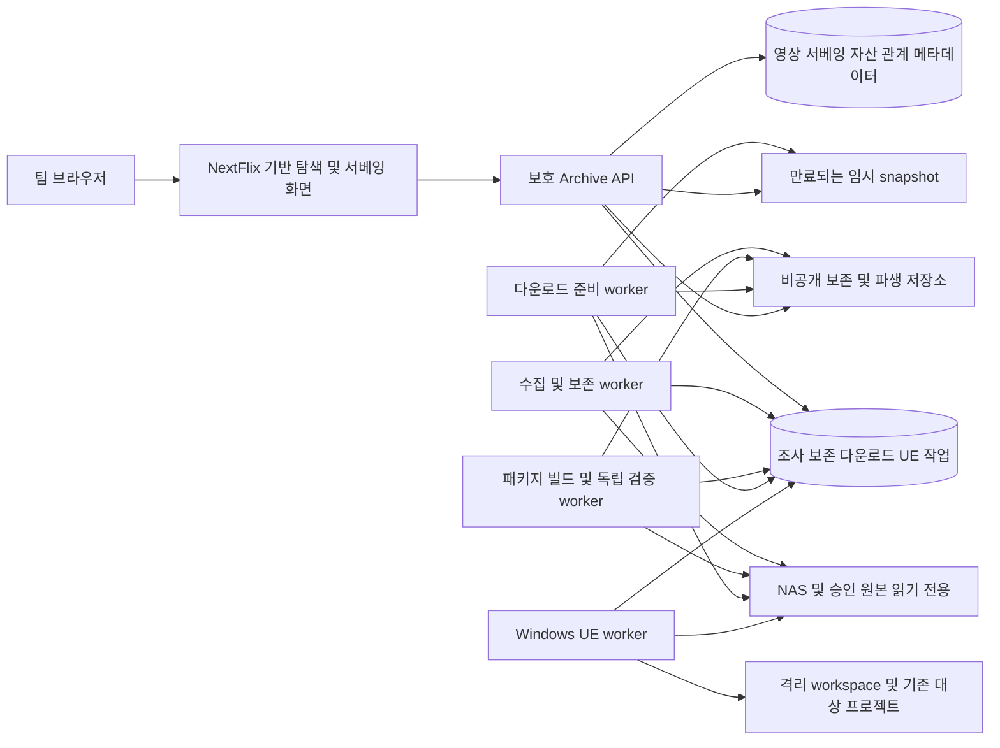

# 팀 전용 Fab · 방송 제작 자산 라이브러리 소프트웨어 설계 문서 SDD

NextFlix를 기반으로 **방송 제작 자산을 모아 두고 필요한 것만 꺼내 쓰는 팀 전용 Fab**을 설계한다. 과거 영상의 전체 설명·키워드·메모에서 인사이트를 얻고, 인공위성 같은 재사용 단위와 필요한 의존성을 독립 패키지로 보존한다. 핵심 경로는 **영상 또는 라이브러리에서 발견 → 재사용 패키지·버전 확인 → 웹 다운로드 → 다른 제작 프로젝트에 추가 → 실제 재사용**이다. 보존 패키지는 원본 방송 프로젝트에 접근하지 않고도 사용할 수 있어야 한다.

| 항목 | 기준 |
| --- | --- |
| 버전·갱신일 | 4.0 / 2026-10-17 (Asia/Seoul), 팀 전용 Fab·독립 재사용 패키지 계약 반영 |
| 구현 기준 | NextFlix `5b67a0227640b95d8fd115b71c55f84a5cadbdf3`, 현재 코드 정적 확인 |
| 확인된 환경 | Windows PC + 팀 NAS/SMB, 약 10명·10TB |
| 연계 문서 | [TDD 테스트 설계](TDD.v4.0.ko.md) |
| 이전 분석·합의 | [SDD v3.0](SDD.v3.0.ko.md), [TDD v3.0](TDD.v3.0.ko.md), [SDD v2.1](SDD.v2.1.ko.md), [TDD v2.1](TDD.v2.1.ko.md) |
| 상태 | 목표 설계. 코드·DB·실제 원본 변경과 실행 테스트는 이번 문서 검토에 포함하지 않음 |

## 1 재검토 결론과 제품 범위

v3.0의 영상 서베잉·단일 파일 서비스와 UE 직접 이행을 유지하면서, **선택 자산을 원본 프로젝트와 분리해 보존·게시·다운로드하는 재사용 패키지**를 1차 필수로 추가한다. v4.0과 현행 TDD가 보존본보다 우선한다. ‘팀 전용 Fab’은 내부 자산 카탈로그·버전·패키지·프로젝트 추가 경험을 뜻하며 외부 Fab 연동, 구매/결제·공개 판매 기능은 범위에 포함하지 않는다.

사용자는 3차 답변에서 **영상 전체에 대한 설명·키워드·메모 중심**, **웹에서 자산 원본 파일 다운로드**를 선택했다. 이에 따라 장면 구간별 주석·AI 자동 분석·참고 보드·일반 파일의 제작 폴더 자동 복사를 1차 필수로 추가하지 않는다. 앞서 확인한 **UE 분석·의존성 포함 기존 프로젝트 이행 자동화**는 필수 요구로 유지한다.

| 축 | 제품에서 제공할 결과 |
| --- | --- |
| 영상 탐색 | 방송연도·방송 제목·예능/교양·담당자·제작부조·키워드로 과거 영상을 찾고 실제 프리뷰 시청 |
| 영상 서베잉 | 영상 전체의 설명·분류 키워드·팀 메모·참고할 점을 작성·검색·공유하여 다음 제작의 판단 근거 축적 |
| 사용 자산 연결 | 해당 영상/버전에 실제 사용한 FBX·이미지·UE 에셋의 출처·확인 근거·버전과 역참조 |
| 자산 아카이브 | 파일 발견·목록화와 관리 저장소 보존을 구분하고 원본/메타데이터/관계를 장기 유지 |
| 자산 서비스 | 허용된 원본 버전을 웹 다운로드. UE 패키지는 등록된 기존 프로젝트에 의존성과 함께 이행 |
| 독립 재사용 라이브러리 | 인공위성 등 대표 에셋·의존성·구성·호환 환경을 하나의 불변 패키지로 보존, 게시 버전을 검색·다운로드·프로젝트 추가 |

‘인사이트’는 팀이 남긴 참고할 점·연출/구성/재사용 아이디어·주의사항을 의미한다. 사용자 메모와 객관적 기술정보의 출처를 구분하며 조회수나 자동 추천 점수를 인사이트로 대체하지 않는다. AI 생성은 미채택 후속 기능이다.

## 2 사용자·핵심 업무와 수용 결과

1. 제작자가 `2024년/교양/키워드`로 영상 검색 → 프리뷰·전체 설명·팀 메모를 읽고 참고할 점을 파악한다.
2. 영상의 ‘사용 자산’에서 확인된 FBX 또는 이미지를 선택 → 적용 영상 버전·미리보기·원본 버전·출처·사용 제약·의존성을 확인 → 웹에서 원본을 다운로드한다.
3. 편집자가 제작 프로젝트/원본을 등록 → 조사 후보를 검토 → 사용 자산을 확인하고 서베잉 설명·키워드·메모를 보완한다. 파일 발견만으로 실제 사용 관계를 확정하지 않는다.
4. UE 재사용 담당자가 연결된 UE 에셋 선택 → 엔진·플러그인·의존성·충돌 계획 → 기존 제작 프로젝트에 추가 → 실제 UE 검증·결과 이력 확인한다.
5. 제작자는 로켓·인공위성·지구·발사대가 있는 프로젝트에서 **인공위성 재사용 단위**를 지정한다. 필요한 모델·재질·텍스처·Blueprint·관련 시퀀스를 모아 패키지 v1을 검증·게시한다. 다른 팀원은 원본 프로젝트가 오프라인인 상태에서 라이브러리의 인공위성 v1을 다운로드해 별도로 준비한 호환 프로젝트에 추가한다. 불필요한 로켓·지구·발사대는 제외하고 필요한 참조는 숨기지 않는다.

조회자는 허용 자료의 탐색·시청·서베잉·패키지 열람을 한다. 편집자는 허용 프로젝트의 메타데이터·서베잉·관계와 패키지를 작성한다. 관리자는 계정·저장소·조사·사전·보존 정책을 관리한다. 단건 다운로드는 `downloadOriginal`, 패키지 다운로드는 `downloadPackage`, 패키지 게시는 `publishPackage`와 포함 자료의 배포 범위를 검사한다. UE 직접 이행은 원본 조회+대상 쓰기, 게시 패키지 이행은 패키지 조회/이용+대상 쓰기 권한을 검사한다. 게시 패키지는 원본 파일을 열어 권한/내용을 확인하는 방식에 의존하지 않고 서버의 명시적 패키지 ACL·사용 정책을 따른다. 세부 역할별 기본 부여는 팀 정책으로 확정한다.

팀이 고른 대표 과제 5개에서 ‘관련 과거 영상 발견 → 참고 근거 확인 → 정확한 자산 원본 확보’를 수행한다. 탐색 시간·서베잉 보완율·확인된 사용 관계 비율·다운로드 파일 일치·재사용 성공/실패를 기록하고, 잘못된 자산 연결·버전 오다운로드·비허용 노출은 0건이어야 한다. 시간 절감 목표는 현재 업무를 측정한 뒤 정한다.

## 3 기능·비기능 요구사항

이전 ARC-01~20·ANF-01~06 ID를 유지하고 ARC-21~26을 추가한다. 모두 1차 필수이며 ARC-08의 OS 폴더 열기만 선택이다.

| ID | 요구사항·수용 조건 |
| --- | --- |
| ARC-01 | 방송연도 내림차순 영상 행·연도 전체 보기. 미상 별도, 빈 연도 숨김 |
| ARC-02 | 상세에 전체 설명·방송 제목·종류·담당자·부조·키워드·원본/서베잉/자산 상태 표시 |
| ARC-03 | 대표/복수 썸네일·명시적 프리뷰 재생, 지원/실패/미상 상태 구분 |
| ARC-04 | 프로젝트 1:N 영상 1:N 버전. 대표 버전 수동 선택, 제목 기준 자동 병합 금지 |
| ARC-05 | 승인 루트 조사·dry-run·후보 검토·진행·취소·실패·재조사 |
| ARC-06 | 프로젝트·영상/버전·자산 원본 버전·UE·위치 연결과 허용된 역탐색 |
| ARC-07 | 제목·전체 설명·서베잉 키워드·메모·프로젝트·파일명 검색, 방송연도·종류·담당자·부조·자산 유형·UE 필터 |
| ARC-08 | 원본 위치 확인·경로 복사. OS 폴더 열기는 도우미 채택 시 제공 |
| ARC-09 | 유형·도구/엔진·출처·사용 제약·의존성·사용 확인 상태를 표시. 미확인을 사용 가능으로 단정하지 않음 |
| ARC-10 | 목록·건수·서베잉·관계·경로·미리보기·원본 다운로드·작업 결과에 일관된 서버 권한 검사 |
| ARC-11 | 원본 읽기 전용·반복 조사 멱등·쓰기 중 파일 보류·단절과 누락 구분 |
| ARC-12 | 수동 정보·관계 수정·이력·중복 후보·백업 복구, 수집 결과의 수동값 덮어쓰기 금지 |
| ARC-13 | UE 5.3/5.4/5.6/5.8·실제 Launcher/커스텀 build의 프로젝트/의존성 분석, Blueprint·일부 C++·Actor Sequence 포함 |
| ARC-14 | 선택 UE 에셋·의존성을 기존 프로젝트에 추가, 실제 로드·시퀀스 검증·실패 복구. 원본/대상 기존 자료 보존 |
| ARC-15 | 방송 제목·방송연도·예능/교양·담당자·제작부조·UE 버전·키워드 사전/편집·검색 |
| ARC-16 | 영상 전체 서베잉 설명·키워드·메모·참고할 점 작성/열람/검색, 작성자·근거 영상 버전·수정시각 보존 |
| ARC-17 | 실제 사용 관계의 candidate/confirmed/rejected·근거·확인자 관리. 같은 폴더/프로젝트 소속과 영상 사용을 구별 |
| ARC-18 | FBX·이미지 등 허용 원본의 버전 고정 웹 다운로드·준비/실패·크기·체크섬·제약·감사 이력 |
| ARC-19 | 목록화(indexed)와 보존(managed) 구분, 버전별 보존·무결성·가용성·복구와 원본 불변 |
| ARC-20 | 다운로드 제공·UE 이행과 실제 후속 제작 사용의 이력을 구별하고 수동 재사용 결과·대상 프로젝트를 기록 |
| ARC-21 | 재사용 패키지 카탈로그·대표 이미지·설명·키워드·출처 영상·게시 버전·검증된 호환 환경으로 탐색 |
| ARC-22 | 선택 root 에셋/Actor 구성·재사용 목표를 명시하고 전이 의존성·구성·외부 요구사항을 패키지로 추출. 미해결 필수 참조가 있으면 게시 불가 |
| ARC-23 | 패키지 버전/엔진 variant·파일 manifest·checksum·검증 보고서·사용 설명을 불변 보존하고 원본 프로젝트 단절/제거 후에도 제공 |
| ARC-24 | 게시된 정확한 패키지 variant를 웹 다운로드하고 내용·구조·버전을 검증. 단일 파일 다운로드와 구별 |
| ARC-25 | 다운로드한 패키지를 호환되는 기존 제작 프로젝트에 추가, 기존 자료 보존·충돌/전제조건 확인·실제 UE 검증·복구 |
| ARC-26 | 패키지 게시/회수·명시적 접근 범위·구성 파일/제약 검사·감사/복구. 비허용 포함 파일·private 원본 경로 노출 금지 |

| ID | 요구·기준 |
| --- | --- |
| ANF-01 | 약 10명·10TB 확인. 영상 5,000/파일 100,000/동시 10명은 임시 시험값. metadata API p95≤1초·첫 카드 p95≤2초 제안, 파일 준비/다운로드/UE 시간 별도 |
| ANF-02 | 원본 생성/수정/삭제 0. 루트별 조사 1개·미디어 변환 1개·UE worker당 1개 기본, I/O·용량 제한·취소 |
| ANF-03 | 비허용 제목·메모·파일명·경로·미디어·원본·작업 결과 노출 0, 역할/팀/프로젝트 경계 |
| ANF-04 | DB·서베잉·관계·보존 manifest·설정·관리 파일 복구. RPO 24시간/RTO 1영업일 제안. indexed 원본 백업은 별도 NAS 책임 |
| ANF-05 | requestId/jobId·진행·오류·마지막 정상 조사·다운로드 발급/전송 상태·검증 근거. 비밀값·원시 토큰·민감 경로 로그 제외 |
| ANF-06 | 한글/공백/유니코드·IME·키보드·초점·모션 감소, 단절 시에도 저장된 설명·메모·자산 목록 확인 |

## 4 화면·탐색·서베잉 규칙

| 화면 | 구성·동작 |
| --- | --- |
| `/archive` | Netflix 형태의 카드·가로 행, 방송연도·종류·키워드 탐색. 인기 데이터 없는 순위 문구 없음 |
| `/archive/videos/[id]` | 프리뷰·전체 설명·키워드·팀 메모·참고할 점, 사용 자산 탭, 버전·프로젝트·위치 |
| `/archive/years/[year]` | 방송연도 전체 영상, unknown=미상. 필터/페이지 URL 복원 |
| `/archive/assets` 및 `/archive/assets/[id]` | 유형별 카드, 썸네일·원본/버전·출처·사용 영상·제약·의존성·보존 상태·다운로드 |
| `/archive/library` | 게시된 재사용 패키지 카드, 유형·키워드·UE/플러그인·검증 환경 필터. 원본 프로젝트를 먼저 찾지 않고 진입 |
| `/archive/packages/[id]` | 인공위성 등 패키지의 대표 이미지·구성/제외 항목·출처 영상·버전·variant·의존성/필요 환경·검증 결과·다운로드/프로젝트 추가 |
| `/archive/packages/[id]/edit` | 허용 편집자의 재사용 범위/root 선택·의존성 검토·패키지 빌드·검증·게시·회수 |
| `/archive/projects/[id]` | 영상/버전·자산·UE·여러 폴더·참여자·서베잉 진입·재사용 이력 |
| `/archive/downloads/[id]` | 원본 준비·크기·준비 완료/실패/만료·재요청, 다운로드. 다른 사용자 작업은 노출하지 않음 |
| 관리자 sources/scans/archive-jobs | 루트·규칙·dry-run·후보·사용 관계 검토·보존 작업·실패·재조사 |

카드 클릭은 상세다. 전체 설명과 메모는 영상 전체에 귀속하며 프레임/장면별 주석을 필수 입력으로 두지 않는다. 공유 설명·키워드는 편집자가 revision 검사를 거쳐 수정하고, 메모는 작성자·작성시각을 갖는 별도 항목으로 누적한다. 허용 편집자/관리자만 수정하며 변경 이력을 남긴다. 메모에 외부 주소나 마크업이 있어도 실행하지 않는 안전한 텍스트로 표시한다.

서베잉은 근거 `videoVersionId`를 보존한다. 대표 버전이 바뀌면 이전 버전의 메모를 새 버전에서 작성한 것처럼 재지정하지 않고 ‘이전 버전 참고’로 표시한다. 설명·키워드·메모는 수집기가 자동 덮어쓰지 않는다. 인사이트 내용과 자동 기술정보를 구별한다. AI 요약·의미 기반 추천·장면 검출은 미채택이다.

연도는 **방송연도** `broadcastYear`(1900~9999 정수/null)이며 제작/납품/수정/수집일로 대체하지 않는다. 선택 방송일과 연도 불일치는 검토한다. 여러 해 재방송은 대표 방송연도 하나라는 초안이며 복수 이력은 미확인이다. 부조는 TS 계열·홀·중계차 `ProductionFacility`로 관리하고 코드/명칭/유형/active를 분리한다. `TS-1~TS-D` 범위의 개별 명칭을 임의 생성하지 않는다. 복수 부조 연결은 설계안이다.

검색은 NFC·공백 정리·1~100 코드 포인트의 리터럴 q, 빈 q는 필터 탐색이다. 검색 대상 필드 OR·필터 AND. 접근 가능한 현재/이전 버전의 서베잉을 검색하며 결과는 영상 ID로 중복 제거한다. 메모 검색 결과는 근거 영상 버전과 작성자/메모 요약을 함께 보여주고 상세에서 해당 기록을 찾을 수 있어야 한다. 허용된 영상·서베잉만 검색·집계한다. 300ms 디바운스·IME·이전 응답 차단·필터 변경 시 cursor 초기화를 적용한다. 고급 전문/유사도 검색은 규모 측정 후 검토한다.

## 5 데이터 모델·사용 증거·버전

모든 업무 객체는 teamId·생성/수정시각을 가지며 관계의 팀·권한·대상 존재를 서버에서 검사한다. 아래는 목표 논리 모델이며 현재 Prisma 변경이 아니다.

| 모델 | 핵심 필드·제약 |
| --- | --- |
| Team / Membership / ProjectAccess | 사용자·역할·프로젝트 권한, downloadOriginal 등 권한. team/user 고유 |
| ProductionProject / ProjectLocation | 제목·고객사·담당자·상태 / 승인 위치·역할, 관계 쌍 고유 |
| Video | projectId, title, broadcastTitle?, broadcastYear?, broadcastDate?, contentTypeId?, assigneeIds, productionFacilityIds, representativeVersionId?, revision |
| VideoVersion | videoId, label, kind, sourceFileId, durationSeconds?, 기술정보·sourceFingerprint, previewState. 대표 버전은 같은 영상 |
| VideoSurvey | videoVersionId 고유, overview, keywords, referencePoints?, editorId, revision. 대표 설명은 현재 대표 버전의 survey |
| SurveyMemo | surveyId, authorId, body, revision, createdAt, updatedAt, 상태·수정 이력. 팀 공유 텍스트 |
| Asset | 논리 자산의 제목·유형·검색 키워드·대표 원본 버전, 재사용 메모 |
| AssetRevision | assetId, revisionLabel, fileRecordId, format, sizeBytes, contentHash?, archiveState, managedObjectId?, sourceFingerprint, usageConstraintStatus, dependencyStatus. ready 이후 파일 내용 불변 |
| AssetDependency | fromRevisionId, toRevisionId 또는 unresolvedReference, 종류·required·근거. 외부 이미지/텍스처·UE 패키지 등 분리 |
| ReusePackage / ReusePackageVersion | 인공위성 등 논리 카탈로그 항목·설명·대표 이미지·ACL / 고유 versionLabel·고정 roots/재사용 목표·출처·게시 상태. 내용 변경은 새 버전 |
| PackageVariant / PackageFile | 엔진/플러그인 프로필별 불변 artifact·manifestHash·artifactHash·검증 보고서 / 보존 객체·payload 상대 경로·해시·크기·포함 근거. variant/path 고유 |
| PackageBuildJob / PackageValidation | snapshot·roots·전이 의존성·구성/외부 요구·공간·lease/fencing·진행/오류 / 원본 접근 차단 검증·UE/시퀀스·충돌·fixture/engine/adapter 증거 |
| ProjectAssetLink | projectId/assetRevisionId 고유. 프로젝트 내 존재/사용 범위, 영상 사용을 자동 확정하지 않음 |
| VideoAssetUsage | videoVersionId/assetRevisionId 고유, candidate/confirmed/rejected, evidence, confirmedBy?, confirmedAt?. 영상 전체 사용 근거 |
| StorageSource / FileRecord | 비공개 물리 루트·collector·case/제외 정책 / sourceId+canonicalRelativePath 고유, 원문·크기·mtime·fingerprint·가용성 |
| ManagedObject / MediaDerivative | 관리 저장소 키·해시·크기·무결성 / poster/frame/preview·부모 revision/version·시점·파서 버전 |
| ArchiveJob / DownloadJob | 고정 revision·예상 fingerprint·단계·결과 객체·용량·만료·오류·권한/요청자. DownloadJob은 subjectKind에 따라 assetRevisionId 또는 packageVariantId 중 정확히 하나를 참조 |
| ReuseRecord | actor, subjectKind, assetRevisionId 또는 packageVariantId, sourceVideoVersionId?, targetProjectId?, downloadJobId/migrationJobId?, outcome(planned/used/failed), note. 다운로드와 실제 사용을 구분 |
| ContentType / ProductionFacility | 예능/교양 등 / TS 계열·홀·중계차, code·displayName·kind·active·sortOrder. 비활성화해도 과거 관계 보존 |
| UnrealProject / UEAnalysis / MigrationPlan / MigrationJob | 엔진 설치·프로젝트 snapshot·의존성·계획·journal·검증·복구. 12장 상세 |
| ScanJob / ScanCandidate / AuditEvent | lease/fencing·checkpoint·카운트/후보·근거·검토/행위·대상·requestId·시각, 비밀 제외 |

FBX v1을 사용한 영상에는 AssetRevision v1을 연결한다. 새 FBX v2가 발견되어도 과거 사용 관계와 다운로드를 v2로 자동 교체하지 않는다. 이미지·FBX·UE 패키지는 유형이 다르고 동일 이름만으로 한 자산에 병합하지 않는다. 없는 원본 FBX를 UE 에셋의 원본인 것처럼 생성·표시하지 않는다.

같은 폴더에서 발견했다는 것은 후보 근거다. confirmed는 담당자 검토, 제작 기록 또는 분석 보고서 등 근거를 요구한다. UE 프로젝트 참조 분석은 프로젝트 의존성의 근거이며 완성 영상에 실제 노출/사용됐다는 자동 증거가 아니다. 허용된 확인 관계를 사용 영상으로 표시하고 후보는 별도 표시한다.

## 6 원본 조사와 아카이브 보존

**폴더 조사**는 파일 목록·기술정보를 수집하는 처리이고, **영상 서베잉**은 시청 후 설명·키워드·메모를 축적하는 업무다. 각각 ScanJob과 VideoSurvey로 분리한다.

수동 등록과 승인 루트 조사 두 경로를 지원한다. 확장자·파일명·인접 경로는 후보이며 지원 형식/사용 사실을 보증하지 않는다. 영상 mp4/mov/mxf, 이미지 jpg/png, FBX 등 3D, UE `.uproject/.uasset/.umap`을 유형별로 분류한다. 원본·소스 코드 본문을 무차별 인덱싱하지 않는다.

1. 조사 상태 `queued/running/completed/partial/failed/cancelled`, 전체 대상 열거 성공만 completed. 알 수 없는 전체 개수 대신 실제 카운트를 표시한다.
2. dry-run·루트당 동시 1개·lease/fencing·checkpoint·위치 키 upsert. 읽기 전후 stat이 바뀌는 작업 중 파일은 보류한다.
3. 원문 경로와 정규화 키를 분리하고 source별 case 정책·루트 범위를 확인한다. symlink/junction/reparse point는 기본 미추적, 순환/탈출 거절.
4. UE 캐시·VCS·`DerivedDataCache/Intermediate/Saved/Binaries`는 기본 제외 후보이며 루트별 검토. 크기/mtime만으로 내용 동일성·이동을 확정하지 않는다.
5. 같은 범위 completed 조사 두 번에서 연속 미발견하면 missingCandidate 제안, partial·단절·규칙 변경은 누락 카운트 제외. 자동 삭제 없음, 복귀하면 위치 복원.
6. 후보 검토/반영 멱등·출처 기록·수동값 보존. 영상별 사용 관계는 별도 확인한다.

`indexed`는 원본 위치·정보만 등록한 상태이며 보존 완료가 아니다. `archiving → managed`는 선택 원본을 별도 관리 저장소에 복사하고 byte 수·checksum을 대조한 상태다. `failed/unavailable/integrityFailed`를 구분한다. 전체 10TB를 자동 복제하지 않고 선택 자산/프로젝트·우선순위·디스크 예산으로 보존한다. 보존 대상·기간·운영 책임은 팀과 확정한다.

managed 파일은 revision 단위 불변 객체로 저장한다. 원본 변경 시 새 revision 후보를 만들고 기존 보존본·과거 관계는 유지한다. 원본 NAS가 끊겨도 managed 원본과 설명/메모는 보호 정책 내에서 서비스할 수 있고, indexed 원본은 이용 불가로 표시한다. 관리 파일도 백업·무결성 재검사·manifest 복구가 필요하며 단순 복사 완료를 백업 전체로 간주하지 않는다. 자동 보존본 파기·고아 삭제는 1차 기능으로 두지 않는다.

## 7 미리보기·원본 다운로드·재사용 서비스

### 7.1 보기와 원본 구분

영상 프리뷰·썸네일은 별도 관리 파생물이다. 기본 10%/50%/90% 최대 세 프레임 후보·짧은 영상 중복 제거·대표 수동 선택. pending/ready/unsupported/failed 구분, 실패해도 설명·자산 목록은 열람한다. 이미지 파생 미리보기와 원본을 구분하며 FBX는 메타데이터·등록 썸네일을 기본으로 제공한다. 웹 3D 뷰어·FBX 자동 변환을 1차 필수로 약속하지 않는다.

### 7.2 원본 다운로드 계약

자산 상세에서 **원본 버전·원래 파일명·형식·크기·checksum·출처 영상/버전·보존/제약/의존성 상태**를 보고 다운로드한다. preview 파일을 원본 대신 반환하지 않는다. 일반 자산 제공은 웹 원본 다운로드가 필수이며 임의 PC/NAS 제작 폴더 복사 기능은 추가하지 않는다. UE 이행은 12장의 별도 작업이다. 완성 영상 원본 다운로드는 이번 확인 대상이 아니며 프리뷰 재생을 기본으로 둔다.

사용 제약 unknown/restricted/confirmed는 업무 기록이다. 다운로드는 팀/프로젝트·downloadOriginal과 팀이 정한 자료별 사용 제약 정책을 함께 검사한다. 미확인 상태를 확인 완료로 바꾸거나 사용 가능으로 단정하지 않는다. unknown 자료의 처리와 restricted 자료의 허용 조건은 운영 정책으로 설정하며 이번 답변이 일괄 허용/차단의 합의를 뜻하지 않는다. 정책이 막는 이유를 상태로 제공하고 프런트 버튼 숨김만으로 통제하지 않는다.

1. 요청은 assetRevisionId와 예상 fingerprint를 고정하고 권한·가용성을 확인한 뒤 DownloadJob을 만든다. 동일 idempotency key 재요청은 중복 생성하지 않는다.
2. managed 원본은 검증된 불변 객체를 이용한다. indexed 원본은 준비 worker가 읽기 전후 stat·fingerprint·해시/크기 확인 후 별도 임시 snapshot을 완성해 제공한다. 준비 중 원본이 바뀌면 stale/needsRefresh로 중단하며 다른 버전을 조용히 반환하지 않는다.
3. 상태 `queued/preparing/ready/failed/stale/expired/cancelled`. 준비 실패·용량 부족·원본 단절 시 잘린 파일을 ready로 제공하지 않는다. 임시 snapshot은 정책상 만료·정리하되 영구 보존본과 구분한다.
4. 보호된 content endpoint는 요청자·자료 권한·정책을 재검사하고 안전한 다운로드 파일명·Content-Type·Content-Disposition attachment·byte range 206/잘못된 범위 416을 적용한다. arbitrary path/URL 입력 없이 작업 ID만 사용한다. 사용자 사이 공유 캐시 금지, private/no-store 기본.
5. 전송 중단 후 재개는 같은 불변 객체/validator에 대해서만 허용한다. 원본 위치 변경이나 토큰 재발급이 버전을 바꾸지 않는다. 전송 바이트·중단/완료를 기록하되 서버의 전송 완료를 사용자 PC 저장·제작 사용 성공으로 단정하지 않는다.

단건 원본 다운로드는 유지한다. 별도로 **재사용 패키지 다운로드는 1차 필수**이며 선택한 패키지 variant의 manifest·사용 설명·payload를 하나의 ZIP으로 제공한다. UI와 API에서 ‘원본 파일’과 ‘재사용 패키지’를 구분하고 단건 응답을 ZIP으로 바꾸지 않는다. 패키지는 일회성 임시 압축이 아닌 검증·보존된 불변 배포물이다. 임의 파일을 무제한 모으는 일반 대량 ZIP 기능은 후속이며 등록 재사용 패키지의 배포와 구별한다. 상세는 7.3절이다.

다운로드 발급/전송과 실제 재사용은 구별한다. 편집자가 후속 제작 프로젝트·사용 결과·메모를 ReuseRecord로 기록하며 다운로드 횟수만으로 ‘실제 사용’ 관계를 만들지 않는다.

### 7.3 팀 전용 Fab · 독립 재사용 패키지 계약

**제품 완료 기준:** 원본 방송 프로젝트와 원본 NAS 공유의 접근을 차단한 상태에서, 게시된 인공위성 패키지를 웹에서 내려받아 별도로 준비한 호환 UE 프로젝트에 추가하고 외형·재질·선언한 동작을 재현한다. 해당 패키지에 명시된 엔진/플러그인·모듈 전제조건은 준비되어 있어야 한다. 여기서 ‘독립’은 원본 프로젝트 파일·숨은 설정·서비스 중인 원본 경로에 의존하지 않는다는 뜻이다. 게시/다운로드 서버와 보존 저장소의 오프라인 동작까지 요구하는 것은 아니다.

UE의 `.uasset` 등 네이티브 package와 라이브러리의 재사용 bundle은 구분한다. ReusePackage는 ‘인공위성’이라는 논리 항목이고, 버전 아래 variant가 엔진 환경별 배포 artifact다. 단건 AssetRevision 여러 개와 구성·의존성·검증 결과를 하나의 재사용 단위로 묶는다. FBX+텍스처 원본 패키지(`sourceFiles`)와 UE 콘텐츠 패키지(`ueContent`)를 구별하며 어느 형식인지 명시한다.

#### 7.3.1 인공위성의 재사용 범위와 구성

제작 프로젝트에 로켓·인공위성·지구·발사대가 있다고 해서 네 항목을 무조건 함께 압축하지 않는다. 편집자가 대표 root를 선택하고 재사용 목표를 `modelOnly / actorAssembly / animatedAssembly`로 선언한다. 예를 들어 `BP_Satellite`를 root로 지정하고 태양전지판·본체·재질/텍스처·Actor Sequence까지 동작하는 animatedAssembly를 만든다. 목표와 포함 파일을 패키지 상세에서 확인할 수 있어야 한다.

인공위성이 여러 레벨 Actor의 배치·속성·서로의 위치 관계로만 구성돼 있으면, 원본을 변경하지 않는 작업 복제본에서 담당자가 독립 Blueprint 또는 검증 가능한 구성 자산으로 정리한다. 일반 파일 수집기가 이름/모양만 보고 인공위성 범위를 자동 결정하지 않는다. 구성 정리도 버전·변경 근거를 기록하며 자동 변환 성공을 가정하지 않는다. UE의 재사용 Blueprint 구성 근거는 [Epic Blueprint 생성 문서](https://dev.epicgames.com/documentation/unreal-engine/creating-blueprint-classes-in-unreal-engine)다.

root에서 hard/soft/management 의존성의 전이 폐포와 관련 파일을 수집한다. 시퀀스의 Actor 바인딩·부모 Blueprint·재질·외부 텍스처·`/Script` 모듈·필수 플러그인·프로젝트 설정도 구분해 보고한다. 각 항목은 `included / environmentPrerequisite / unresolved`로 표시한다. 캐시·VCS·비밀값·로그·무관한 소스 파일을 폴더 통째로 넣지 않는다. 포함 파일마다 원본 버전·포함 근거·출처를 유지한다.

필수 unresolved가 남거나 인공위성 동작이 원본 레벨/지구/방송 전체 시퀀스를 직접 요구하면 ready/published로 만들지 않는다. 필요한 지구/로켓 참조를 숨겨 제외하지 않고 이유와 예상 범위를 제시한다. 담당자는 작업 복제본에서 참조를 분리하거나, 필요한 항목을 패키지 범위로 명시하고 다시 검증한다. 공유 재질/텍스처는 포함될 수 있으며 같은 파일을 한 variant 안에 중복 저장하지 않는다. 설정·코드·플러그인을 대상에 무단 복사/활성화하는 방식으로 미해결을 덮지 않는다.

#### 7.3.2 불변 보존·manifest·variant

패키지 versionLabel은 package 안에서 고유하다. 동일 버전의 roots·구성·payload는 수정하지 않고 변경 시 새 버전을 만든다. 5.4용 통과 결과를 5.3/5.6/5.8 또는 다른 커스텀 build의 지원으로 표시하지 않는다. 각 PackageVariant는 engineInstallation/qualified profile·pluginSet·adapter·payload·검증 결과를 고정한다. 검증되지 않은 조합은 미지원/미검증으로 표시한다. 이전 게시 버전·과거 영상 사용 관계·다운로드는 새 버전으로 자동 교체하지 않는다.

배포 artifact는 `manifest.json`, `README.ko.md`, payload를 포함하는 ZIP이다. UE payload의 예시는 `Content/<원래 패키지 경로>`이며 기존 mount/패키지 경로를 보존한다. ZIP 최상위 폴더를 임의로 바꿔 UE 참조 경로를 깨뜨리지 않는다. 경로 재구성이 필요하면 엔진에서 별도 정리·참조 검증한 새 버전으로 만든다. 필요한 동반 파일·플러그인 콘텐츠는 어댑터가 검증한 실제 배포 목록으로 확정한다. 독립 파일 수집기가 `.uasset`만 골라 완료로 처리하지 않는다.

manifest 필수 내용:

| 영역 | 기록할 값 |
| --- | --- |
| 식별 | schemaVersion, packageId/versionId/variantId, versionLabel, contentType, reuseGoal, roots |
| 내용·무결성 | 정규화된 payload 상대 경로·각 파일 size/hash·고정 sourceRevision·포함 근거, 전체 payloadDigest, 서버에 보관한 manifestHash·최종 artifactHash |
| 요구 환경 | 엔진 버전/build/커스텀 fingerprint·필요 플러그인/모듈·검증된 adapter·호환 profile. 엔진/필수 플러그인은 무조건 payload에 복제하지 않음 |
| 의존성·설정 | included/prerequisite/unresolved와 required 여부·이유, 필요한 설정과 수동 준비 단계. 원본 절대 경로·자격 증명 제외 |
| 출처·증거 | 허용된 영상/assetRevision 참조·작성자·빌드/검증 작업 ID·보고서 digest·검증 범위/시각·사용 제약 |

자기 자신의 artifactHash를 ZIP 안 manifest에 순환 삽입하지 않는다. 서버의 variant 레코드와 검증 보고서에 최종 ZIP hash를 보관하고 다운로드 정보로 제공한다. ZIP 내부 manifest의 내용 digest와 서버 manifestHash·최종 artifactHash를 대조한다.

보존 artifact·manifest·검증 결과는 영구 관리 저장소에 같이 저장한다. DownloadJob 임시 snapshot 만료/정리가 패키지 보존본을 삭제하지 않게 한다. 원본 프로젝트가 이동/변경/미접속이어도 게시 버전은 동일 bytes를 제공한다. 무결성 불일치·보존 파일 분실은 제공 차단과 복구 상태로 표시하고 원본에서 다른 내용으로 재생성해 같은 버전으로 위장하지 않는다. 복구에는 DB·ACL·manifest·보고서·payload 전체의 checksum 대조가 필요하다.

#### 7.3.3 빌드·독립 검증·게시

버전 상태는 `draft → building → validating → ready → published`, 실패/필수 의존성 누락은 `failed/blocked`, 빌드 취소는 `cancelled`다. 게시 후 배포 중단은 `withdrawn`이며 artifact 내용은 불변으로 보존한다. variant별 빌드/검증 상태를 따로 기록하고 게시 버전은 최소 한 개의 ready variant가 있어야 한다. 실패 variant는 다운로드/호환 목록에 섞지 않는다. 검증 증거 없이 상태 필드를 PATCH해 ready/published로 만드는 것은 거절한다.

1. roots·source snapshot·포함 파일의 접근/사용 정책·출력 환경·공간을 고정해 빌드한다. 같은 입력/멱등 키 재실행은 중복 버전을 만들지 않고 만료 lease worker의 결과 반영을 fencing으로 막는다.
2. 엔진 어댑터로 필요한 콘텐츠를 작업공간에 추출하고 manifest·파일 해시·경로·필수 의존성을 대조한다. 원본에는 변경하지 않는다.
3. 원본 프로젝트/공유 접근을 차단한 독립 작업환경에서 깨끗한 검증 프로젝트를 준비한다. 이 프로젝트는 내부 테스트 fixture이며 사용자용 새 프로젝트 생성 기능을 추가하는 것이 아니다.
4. **최종 배포 ZIP을 실제로 내려받아 검사·해제·추가**하고 패키지 로드·참조·Blueprint 컴파일·재질/텍스처·Actor Sequence 재생·선언한 동작을 시험한다. 빌드 workspace를 직접 열어 통과한 결과로 대체하지 않는다. sourceFiles 형식은 동일한 방식으로 해시·파일 세트·문서와 검증 대상 도구의 재사용 범위를 확인한다.
5. 외형 검증은 팀이 지정한 기준 썸네일/검증 장면과 비교해 누락 재질·잘못된 메시를 확인하고, 동작은 시퀀스 시간 진행에 따른 태양전지판/부품의 기대 변화처럼 관측값으로 판정한다. 목표가 modelOnly면 애니메이션 지원을 표시하지 않는다.
6. 편집자가 게시 버튼을 누르면 서버가 publishPackage·모든 구성물의 배포 범위·manifest/artifact hash·독립 검증 보고서를 재검사한다. 복수 프로젝트의 자산을 묶어 원래 허용 범위보다 넓게 배포하지 않는다. 원본 위치 접근 가능 여부를 게시 이후의 서비스 전제조건으로 삼지 않는다.

게시 패키지 ACL·자료별 이용 정책은 서버가 유지한다. 출처 프로젝트의 제목/메모가 비공개이면 패키지 페이지에서도 그 참조 내용을 숨긴다. 게시 회수/권한 변경 이후의 상세·다운로드·range·이행 요청을 재검사한다. 메타데이터·변경 이력을 남기고 물리 파기를 자동 수행하지 않는다. 결제·판매자 등록·공개 스토어·Fab 계정 연동은 요구하지 않는다.

#### 7.3.4 다운로드·프로젝트 추가·API

패키지 상세에서 형식·버전·지원 variant·크기·포함/제외·의존성·검증 범위를 보고 **패키지 다운로드** 또는 **프로젝트에 추가**를 선택한다. 다운로드는 단일 불변 ZIP이고, 프로젝트 추가는 이 ZIP/보존 payload를 입력으로 12장의 계획·충돌·staging·검증·journal 복구를 수행한다. 사용자가 ZIP만 받아 수동 추가하는 경우 README에 원래 Content 경로·필요 환경·추가 방법을 제공한다. 버튼 클릭을 실제 UE 추가 성공으로 표시하지 않는다.

서버/등록 UE worker는 임의 업로드 ZIP·경로·외부 URL 대신 신뢰할 수 있는 packageVariantId·artifactHash를 받는다. 해제 전에 상대 경로·중복/case 충돌·절대/상위 이탈·symlink·압축 해제 크기/파일 수·checksum을 검사한다. ZIP에 들어 있는 임의 스크립트를 실행하지 않고 등록 adapter만 사용한다. 대상의 기존 map·Blueprint·설정·C++·플러그인 상태는 기존 이행 정책대로 보존한다.

| API | 계약 |
| --- | --- |
| GET `/api/archive/packages`, GET `/api/archive/packages/[id]` | 게시된 허용 패키지 검색/상세. q/type/qualifiedEngineProfile/cursor/limit, 버전·variant·호환 근거·출처/구성·검증 보고서 요약. 편집 draft 조회는 별도 권한 |
| POST `/api/archive/packages` | 허용 편집자, 이름·설명·출처·대상 ACL·reuseGoal, 201 draft 항목 |
| POST `/api/archive/packages/[id]/versions` | versionLabel·root assetRevision/UE object paths·고정 분석/snapshot·reuseGoal·출력 profile, 201 draft 버전. 같은 label 충돌409 |
| POST `/api/archive/package-builds`, GET `/api/archive/package-builds/[id]` | versionId·예상 revision·출력 profile·idempotency key, 202 작업 / 진행·포함/차단·검증 결과. UI 임의 ready 값 거절 |
| POST `/api/archive/package-versions/[id]/publish`, POST `.../[id]/withdraw` | publishPackage·내용 배포 권한·ready variant/hash·보고서 검사, 200. 중복 행위 멱등·revision 경쟁409 |
| POST `/api/archive/downloads` | 기존 subjectKind=assetRevision 또는 신규 subjectKind=packageVariant 중 정확히 하나. 패키지는 packageVariantId·expectedArtifactHash, 요청자 범위 멱등·권한 검사 후202 |
| GET `/api/archive/downloads/[id]/content` | 해당 고정 variant의 불변 ZIP·파일명·크기/hash·attachment·range, 게시/권한/무결성 재검사. 원본 프로젝트 읽기 없음 |
| POST `/api/archive/migration-plans` | sourceKind=projectAnalysis 또는 packageVariant 중 하나. 패키지는 packageVariantId·artifactHash·등록된 기존 targetProjectId/targetRevision, 202. 원본 분석 ID는 요구하지 않음 |

라이브러리 목록은 패키지 ID 내림차순·limit24/1~48, endpoint·필터·권한 바인딩 cursor를 사용한다. 영상 카드는 영상 단위, 라이브러리는 ReusePackage 단위이며 포함 파일 수만큼 카드를 중복 생성하지 않는다. 재사용 이력은 packageVersion/variant/hash·출처·대상·다운로드/이행 작업을 고정하고 실제 사용 결과와 전송을 구별한다.

## 8 서비스 구조·저장소·권한

현행 Next.js·React·NextAuth·Prisma/MongoDB를 출발점으로 두고 SWR은 서버 상태, Zustand는 UI 상태, URL은 필터/페이지 상태를 관리한다. API와 장기 작업을 분리하고 DB Job/lease로 시작한다. 현재 패키지의 운영 적합성·지원 버전은 배포 전에 재확인한다. 일반 수집기/다운로드 worker는 프로젝트 코드·엔진·스크립트를 실행하지 않는다.

Source+relativePath로 위치를 식별하고 내부 물리 루트/자격 증명은 관리자 설정이다. Windows/SMB 서비스 계정과 브라우저 사용자 권한을 구별한다. NAS ACL과 앱 권한 자동 동기화를 가정하지 않는다. 도우미 폴더 열기는 채택 시 일회성·짧은 만료·사용자/장치/행위 바인딩 토큰으로 허용 폴더만 열고 raw path/명령/파일 실행을 받지 않는다. 미설치 환경에서도 원본 다운로드는 가능해야 한다.

서베잉·공유 에셋 역참조·검색 건수·다운로드 작업·미디어 모두 동일 팀/프로젝트 접근을 적용한다. 숨긴 객체는 404·비인증 401·작업 역할 부족 403. 공유 에셋에서 비허용 프로젝트명을 역노출하지 않는다. 계정 전환 시 캐시/열린 모달/작업 조회를 초기화하고 이전 응답을 새 계정에 반영하지 않는다. 보호 미디어는 공개 static 디렉터리에 두지 않는다.

worker는 원본 읽기 전용, 관리/임시 저장소만 쓰기 가능하다. 디코더의 시간/메모리/출력·job 동시성·공간 예산을 제한한다. 경로를 셸 문자열에 결합하지 않는다. 다운로드와 UE 작업이 메타데이터 탐색을 장시간 막지 않도록 자원 예산을 분리한다.

## 9 API·페이지·오류 계약

아래는 신규 목표 API이며 아직 구현되지 않았다. 기존 `/api/movies`·Favorite·watch를 갑자기 변경하지 않고 `/api/archive/*`로 분리한다. 모든 mutation은 입력 allowlist·역할·객체 권한·같은 팀 검사를 수행한다.

| API | 주요 계약 |
| --- | --- |
| GET `/api/archive/years`, GET `/api/archive/videos` | 허용 방송연도/건수 및 q·year·contentType·assignee·facility·assetType·engine·cursor·limit 필터, `{items,nextCursor}` |
| GET `/api/archive/videos/[id]`, GET `/api/archive/projects/[id]` | 영상·버전·survey 요약·사용 자산 상태 / 프로젝트·허용 관계·위치 |
| POST `/api/archive/projects`, POST `/api/archive/videos`, PATCH `/api/archive/videos/[id]` | 생성 201 / 메타데이터·대표 버전·revision, 오래된 수정 409 |
| GET/PATCH `/api/archive/video-versions/[id]/survey` | 전체 overview·keywords·referencePoints·작성 근거/시각·revision. 없으면 GET 200 `{survey:null}`, 최초 PATCH expectedRevision=0, 동시 생성/수정 409 |
| POST `/api/archive/surveys/[id]/memos`, PATCH `/api/archive/memos/[id]` | body·revision·작성자·수정 이력, 201/200. 권한 없는 작성 거절 |
| GET `/api/archive/assets`, GET `/api/archive/assets/[id]` | 자산 카드·원본 revision·미리보기·확인/후보 사용 영상·출처·제약·의존성·보존 상태 |
| PUT `/api/archive/video-versions/[id]/asset-usages/[revisionId]` | candidate/confirmed/rejected·근거·revision, 같은 관계 중복 없이 200 |
| POST `/api/archive/assets/[id]/revisions` | 등록된 FileRecord·fingerprint로 원본 버전 후보 등록 201, 다른 팀/임의 경로 입력 거절 |
| POST `/api/archive/archive-jobs`, GET `/api/archive/archive-jobs/[id]` | 허용 관리자/편집자의 선택 revision 보존 202 / 상태·검증 결과 |
| POST `/api/archive/downloads` | 단건 subjectKind=assetRevision·assetRevisionId·expectedFingerprint 또는 패키지 subjectKind=packageVariant·packageVariantId·expectedArtifactHash 중 하나, 요청자 범위 idempotency key·권한 검사 후202 |
| 패키지 카탈로그·버전·빌드·게시·다운로드 API | 7.3절. 다운로드 subjectKind=packageVariant이면 고정 variant의 보존 artifact를 사용하고 원본 파일을 다시 읽지 않음 |
| GET `/api/archive/downloads/[id]`, GET `/api/archive/downloads/[id]/content` | 요청자/권한 확인한 준비 상태 / ready 불변 원본·attachment·range. 준비 중 409·만료 410 |
| POST `/api/archive/reuses`, GET `/api/archive/assets/[id]/reuses` | 근거 원본/작업·선택 대상·수동 결과·메모, 201 / 허용 결과만 조회 |
| GET `/api/archive/media/[id]`, GET `/api/archive/locations/[id]` | 부모 권한 파생 미디어·영상 range / 허용 경로·확인시각·가용성 |
| GET `/api/archive/production-facilities`, POST/PATCH 사전 관리 | 부조 ID·코드·명칭·종류·active, 관리자 변경·과거 관계 보존 |
| POST sources/scans, GET scans/[id], POST scans/[id]/cancel 또는 /apply | 승인 루트·dry-run·작업 202/활성 충돌 409·후보 반영 멱등 |
| Unreal 분석·migration API | 12장의 등록된 source/기존 target·plan·작업 계약 유지 |

VideoSummary는 id/title/broadcastYear/대표 썸네일/길이/프로젝트/서베잉 유무·상태만 포함한다. 원본 내용·메모 전체·내부 경로를 모든 카드에서 선조회하지 않는다. limit 기본24·1~48, 영상 정렬 `(broadcastYear DESC NULLS LAST,id DESC)`. asset 목록은 id DESC 기본이다. cursor는 endpoint·마지막 키·정규화 필터·limit·사용자/팀 권한 범위·버전에 바인딩한 2KB 이하 토큰이다. 필터·endpoint·권한 범위가 다른 토큰은 400, 권한은 매 요청 재검사한다. snapshot을 보장하지 않되 정적 fixture 누락/중복 0, 화면은 ID 중복 제거한다.

오류는 `{error:{code,message,requestId}}`. 400 잘못된 입력, 401 비인증, 403 역할/다운로드 정책 부족, 404 없음/비공개, 409 경쟁·stale·준비 미완료, 410 만료된 임시 다운로드, 416 range 오류, 500 내부 오류, 503 저장소 일시 불가. 메타데이터는 원본 단절 중에도 200+가용성으로 조회한다. stack·원시 토큰·서비스 계정·내부 루트를 반환하지 않는다.

수동 이미지는 별도 보호 업로드로 JPEG/PNG/WebP·기본10MiB 상한·실제 형식 검사를 적용한다. 원본 자산은 승인된 저장소 등록을 기본으로 하며 임의 실행파일·외부 URL fetch를 받지 않는다. 다운로드 원본 허용 형식/상한은 관리자 사전과 자원 정책으로 정하고 FBX·이미지를 1차 수용 형식으로 검증한다.

## 10 기존 NextFlix와의 차이·이행

현행 Movie는 title/description/videoUrl/thumbnailUrl/genre/duration이며 방송연도·제작 원본·자산 버전·서베잉·보존/다운로드 모델이 없다. InfoModal은 영화 정보·재생/찜 중심이고 목록 API는 인증 후 Movie 전체 배열을 반환한다. package.json에는 테스트 runner·스크립트가 없다. 이 사실은 [스키마](../../prisma/schema.prisma), [상세](../../components/InfoModal.tsx), [목록 API](../../app/api/movies/route.ts), [설정](../../package.json)에서 확인했다.

| 현행 기반 | 아카이브 서비스의 적용 |
| --- | --- |
| 카드·목록·상세·재생 UI | 영상 발견·서베잉·사용 자산 상세로 확장 |
| Movie·장르·찜 | Project/Video/Version/Survey/AssetRevision으로 업무 모델 추가. 찜은 선택 기능 |
| 외부 영상·이미지 URL | 비공개 프리뷰·보존/준비 원본을 보호 API로 제공 |
| 상세 모달 | 공유 가능한 상세 URL·버전·전체 메모·다운로드 작업 상태 |
| 인증 helper·API | 응답 DTO allowlist·비밀번호/토큰 제외·공통 오류·프로젝트/자료 권한·캐시 격리 보강 |

Movie를 즉시 이름 변경하지 않고 관리자 검토 import로 고유 legacyMovieId를 매핑한다. 없는 방송연도·위치·실사용 관계·서베잉은 미상/미연결로 두며 기존 설명은 provenance와 함께 가져온다. 외부 URL을 worker가 자동 fetch하지 않는다. 기존 Favorite는 Movie에 남기고 전환은 별도 명시적 매핑을 사용한다. import dry-run·재실행 멱등·건수 대조, 이전 데이터 보존·새 기능 비활성화 롤백을 마련한다. 현행 결함을 새 서비스의 합격 조건으로 유지하지 않는다.

## 11 단계·검증과 릴리스 기준

| 단계 | 산출물 | 완료 판단 |
| --- | --- | --- |
| P0 표본·기술 확인 | 실제 폴더·대표 영상/FBX/이미지·권한/제약 정책·디스크 예산·UE build별 spike | 사용 관계 근거·다운로드 파일 일치·기존 대상 UE 이행 검증 방법 확정 |
| P1 영상 서베잉·수동 자산 서비스 | 방송연도 탐색·재생·전체 설명/키워드/메모·확인 사용 관계·자산 버전·웹 원본 다운로드 | 수동 등록 자료로 핵심 업무 E2E·권한·원본 일치 통과 |
| P2 조사·보존·패키지 라이브러리 | 조사·보존·패키지 구성/빌드·게시/회수·카탈로그·불변 ZIP 다운로드 | 미해결 참조/비허용 파일 차단·버전 보존·원본 오프라인 다운로드·무결성/복구 |
| P3 UE 자동화·독립 재사용 시험 | 버전/build별 분석·패키지의 원본 독립 로드·기존 대상 추가·복구·인공위성 대표 과제 | 원본 방송 프로젝트 접근0으로 인공위성 외형/재질/동작 재현 및 기존 기능 통과, **1차 완성 필수** |
| P4 선택 확장 | 장면별 주석·AI 검색/요약·3D 뷰어·일반 묶음 다운로드·OS 폴더 도우미 | 별도 채택/계약·실제 환경 검증 |

P1/P2는 중간 산출물이며 사용자 요청 전체 완료로 보고하지 않는다. B0(원본/권한/잘못된 대상)·B1(핵심 기능) 테스트는 해당 단계 전부 통과해야 한다. UE 작업이나 다운로드 수만 성공으로 세지 않고 영상 서베잉 내용·정확한 원본 버전·실제 이행 결과를 함께 평가한다. 실제 자료에서 실패를 주입하지 않고 전용 공유/DB/엔진 fixture를 사용한다. 실행 결과 없는 성능·엔진 지원은 미검증으로 기록한다.
## 12 1차 필수 Unreal 분석·의존성 이행 자동화

### 12.1 실행 구조와 지원 범위

사용자 요청에 따라 자동화는 1차 필수이며 **기존 제작 프로젝트에 에셋과 의존성을 추가**한다. ‘이동’은 원본을 보존하는 대상 복사·이행이고 새 재사용 프로젝트 생성은 1차 범위에서 제외한다. UE 5.3·5.4·5.6·5.8, Launcher와 UE 호환 커스텀 엔진, Blueprint 중심·일부 C++, Actor Sequence 등을 요구 지원 범위로 등록한다. 사용자 원문의 `5,8`은 문맥상 `5.8`로 정규화해 기록했다. 각 설치/build의 검증 완료를 뜻하지 않으며 P0에서 실제 지원 검증표를 채운다.

NAS 접근 가능한 Windows UE worker는 승인된 엔진 설치 ID와 버전별 어댑터를 사용한다. 웹/API는 작업을 예약하고 일반 수집기는 파일 목록만 조사한다. UE 실행은 원본이 아닌 격리 workspace/snapshot에서 수행하며 원본은 읽기 전용이다. 편집자가 대상 쓰기 권한을 가진 경우만 이행을 실행한다. 대상 프로젝트는 관리자 등록 루트 안에 있어야 한다.

입력은 `sourceKind=projectAnalysis`와 `sourceKind=packageVariant`를 구분한다. 전자는 기존 프로젝트 분석/snapshot에서, 후자는 7.3절의 게시된 불변 artifact와 manifest에서 시작한다. 패키지 입력의 분석·의존성/파일 확인·대상 계획은 보존본만 사용하며 원본 프로젝트·분석 DB의 live 재실행을 요구하지 않는다. 읽기 권한도 패키지 ACL/사용 정책을 기준으로 검사한다. 기존 대상 잠금·충돌·검증/복구 조건은 두 입력 모두 동일하다.

엔진 로딩은 C++ 모듈·플러그인·초기화 코드를 실행할 수 있다. 자동 분석 대상은 등록·신뢰한 팀 프로젝트와 엔진/플러그인으로 제한하고, 전용 서비스 계정·분리 작업공간·리소스 제한을 적용한다. 브라우저에서 임의 코드·실행파일·Python 문자열을 받지 않는다. 원본의 startup script를 무조건 실행하지 않고 사전 검사·관리 정책으로 차단/허용한다. C++ 소스나 모듈이 필요한데 빌드 환경이 없으면 blocked이며 자동으로 컴파일했다고 간주하지 않는다.

| 요구 엔진군 | 설치 형태 | 분석·기존 대상 이행 검증 상태 |
| --- | --- | --- |
| UE 5.3 | 실제 Launcher/커스텀 설치별 등록 | 요구 범위 / 미검증 |
| UE 5.4 | 실제 Launcher/커스텀 설치별 등록 | 요구 범위 / 미검증 |
| UE 5.6 | 실제 Launcher/커스텀 설치별 등록 | 요구 범위 / 미검증 |
| UE 5.8 | 실제 Launcher/커스텀 설치별 등록 | 요구 범위 / 미검증 |

실제 사용 중인 설치 조합마다 `engineInstallationId, distribution(launcher/custom), version, buildId/changelist, customBuildFingerprint, pluginSetFingerprint, toolchainProfileId, adapterVersion`을 등록한다. 각 행이 모든 형태의 설치를 실제 보유한다는 뜻은 아니다. 검색용 UE 버전과 실행 엔진 ID는 구분한다. ‘호환 커스텀’도 버전 숫자만으로 Launcher build와 동일하게 취급하지 않는다.

호환성은 source/target 설치 ID 쌍과 어댑터·플러그인 집합별 `unverified/qualified/blocked`로 관리한다. 기본 ready는 검증된 같은 build 조합이며 그 밖의 버전 간·Launcher/커스텀 간 조합은 별도 시험 후 qualified로 허용한다. 네 버전의 분석 요구가 모든 버전 사이의 자동 변환을 의미하지는 않는다. 판정 근거와 차단 사유를 계획 화면에서 보여준다.

Actor Sequence는 최소 필수 플러그인 프로필에 포함하고 실제 프로젝트의 `.uproject/.uplugin`과 설치 모듈을 조사해 전체 플러그인을 보완한다. [Epic ActorSequence API](https://dev.epicgames.com/documentation/en-us/unreal-engine/API/Plugins/ActorSequence)는 해당 플러그인의 공식 근거다. Actor Sequence를 포함한 Actor Blueprint는 컴포넌트·시퀀스·참조 대상·키/바인딩을 fixture로 만들고, 이행 후 대상에서 Blueprint 컴파일과 실제 시퀀스 재생을 확인한다. 필요한 플러그인/모듈이 대상에 없으면 자동 활성화·설정 덮어쓰기 없이 계획을 blocked로 표시한다. 일부 C++ 클래스 의존 에셋도 `/Script` 모듈·빌드 확인까지 성공해야 하며 단순 패키지 복사로 완료 처리하지 않는다.

### 12.2 분석 → 계획 → 실행 → 검증

1. **분석:** 프로젝트 스냅샷·엔진 build·플러그인 버전을 고정하고 registry 로딩 완료 후 패키지·클래스·오브젝트 경로·참조/역참조를 추출한다. 파일 경로와 `/Game/...` 패키지 경로는 구분한다. hard/soft package 및 management 의존성 범주를 별도로 기록하고 선택 에셋에서 전이 폐포를 계산한다. 순환·공유 의존성은 방문 집합으로 한 번만 처리한다.
2. **누락 표시:** `/Engine`, 플러그인 mount, `/Script` 모듈, 외부 미디어·문자열 기반 동적 로딩·reimport source를 구분한다. registry는 저장된 참조 중심이며 모든 런타임·외부 파일 의존성을 증명하지 못한다. 확실한 범위만 verified로 표시하고 미해결 항목·검토 과제를 보고한다. 월드/외부 actor 패키지도 버전별 fixture로 지원을 검증한다.
3. **계획:** 선택 에셋·의존성 목록·총 바이트·대상·엔진/플러그인 일치·충돌·사용 제약·디스크 여유를 보고한다. 기본 자동 허용은 검증된 동일 엔진 build/필수 플러그인 조합이다. 다른/미상 버전은 blocked 또는 별도 검증 정책 대상이며 자동 업/다운그레이드하지 않는다. 미해결 필수 의존성이 있으면 ready 계획을 만들지 않는다.
4. **계획 확정:** UI에서 선택 집합·대상·영향을 확인하고 실행한다. planId·manifest hash·원본 fingerprint·대상 revision·권한을 다시 검사한다. 변경된 계획은 409/needsReplan이며 승인된 계획과 다른 파일을 조용히 포함하지 않는다.
5. **이행:** 기존 대상의 고정 revision/snapshot으로 staging 대상을 구성한 뒤 승인된 엔진 어댑터의 Migrate 계열 기능으로 패키지·의존성을 추가한다. 빈 프로젝트만 검증하고 기존 대상 검증으로 간주하지 않는다. 기본은 경로 보존·기존 파일 덮어쓰기 금지다. 같은 경로/같은 hash는 no-op 재사용, 다른 내용이면 conflict로 중단한다. 단순 파일 rename으로 UE 참조를 깨뜨리지 않으며 경로 변경은 후속 별도 엔진 검증 기능이다. 플러그인/엔진 콘텐츠를 무조건 `/Game`으로 복사하지 않는다.
6. **대상 처리:** 등록된 기존 프로젝트의 snapshot/revision을 기준으로 편집 종료·VCS 사용 시 체크아웃·작업 잠금·백업 또는 checkpoint 확인 후 staging 검증 결과를 반영한다. 소스 관리 미사용 시 파일 manifest·백업으로 변경을 대조한다. 기존 map·Blueprint·설정·플러그인 활성 상태·C++ 모듈을 무단 변경하지 않는다. 원본과 대상이 같거나 경로가 중첩되면 거절한다. 여러 대상 파일의 복사가 원자적이라고 주장하지 않고 변경 journal·commit checkpoint를 사용한다.
7. **검증:** 대상 엔진에서 registry 재조사·선택 패키지 로드·해결 가능한 참조·Blueprint 컴파일·관련 map smoke test를 수행한다. 결과 파일 개수/크기/해시 대조도 수행한다. 복사 프로세스 종료코드 0만으로 성공하지 않는다. 미지원 fixture나 unresolved 항목이 남으면 failed/needsReview이고 검증 범위를 표시한다.
8. **복구:** 단절·용량 부족·취소·검증 실패 시 staging을 격리하고 대상 변경 journal로 작업 소유 변경만 되돌린다. 기존 파일은 덮어쓰지 않는 정책을 유지한다. 다른 편집자의 새 변경을 삭제하지 않고 rollbackConflict로 중단·보고한다. 같은 idempotency key 재시도는 작업 중복 생성 없이 조회/재개한다. 원본 변경은 모든 경우 0건이다.

### 12.3 작업·데이터·API

| 구성 | 계약 |
| --- | --- |
| EngineInstallation / WorkerCapability | engine build·경로 ID·adapter 버전·plugins·지원 작업. 비밀/실행 경로는 관리자 전용 |
| UEAnalysis / DependencyEdge | project snapshot·fingerprint·package ID·참조 종류·해결 상태·근거·engine/parser 버전. 결과가 오래됐으면 stale |
| MigrationPlan | sourceKind와 sourceAnalysisId 또는 packageVariantId/artifactHash 중 하나, target ID, 선택 UE roots·의존성 closure·manifest·크기·충돌·정책·대상 revision·만료·작성자. project 입력만 source snapshot/fingerprint 요구 |
| MigrationJob / MigrationItem | 상태, lease/fencing, plan ID, staging, journal·checkpoint, validationReport, 항목별 복사/재사용/실패·복구 |
| POST `/api/archive/unreal/projects/[id]/analyses` | 허용 편집자, 엔진 설치 ID·범위, 202 job ID |
| GET `/api/archive/unreal/analyses/[id]` | 같은 프로젝트 권한 확인, 진행·패키지/의존성·미해결·stale 정보 |
| POST `/api/archive/migration-plans` | sourceKind별 project 분석/roots 또는 packageVariantId/artifactHash, 기존 targetProjectId·targetRevision 필수. 202 ready/blocked 계획 작업. 패키지에 원본 분석 ID를 요구하지 않음. 사용자용 새 프로젝트 생성 옵션 거절 |
| GET `/api/archive/migration-plans/[id]` | 계획·용량·충돌·검증 가능 범위·hash. sourceKind별 원본 프로젝트 또는 패키지 ACL/이용 정책과 대상 접근 검사 |
| POST `/api/archive/migrations` | planId·manifestHash·idempotency key, project 입력의 원본 조회 또는 package 입력의 게시/ACL/이용 정책 + 대상 쓰기 확인, 202 job ID. stale409 |
| GET `/api/archive/migrations/[id]`, POST `/api/archive/migrations/[id]/cancel` | sourceKind별 원본 또는 패키지 + 대상 접근 검사, 상태/보고서 / 멱등 취소 요청 |

이행 상태는 `queued → preflight → staging → migrating → validating → committing → succeeded`이며 `blocked/needsReplan/failed/cancelled/rollingBack/rolledBack/rollbackConflict/needsReview` 분기를 둔다. 반영 중 취소는 안전 checkpoint에서 처리하며 즉시 취소 완료로 표시하지 않는다. 분석/이행 worker는 staging에만 쓰고 대상 반영은 단일 commit coordinator가 맡는다. coordinator는 OS 잠금과 현재 fencing/revision을 확인하고, 만료 worker가 대상에 직접 쓸 수 없도록 권한을 분리한다. 대상 잠금은 작업 중 유지하며 원본 경로 쓰기는 허용하지 않는다.

### 12.4 10TB 환경의 부하와 용량

10TB 전체를 매번 복제·전체 해시·프리뷰 변환하지 않는다. 메타데이터 증분 조사와 선택 프로젝트 단위 snapshot을 사용하고 workspace를 만들 여유가 없으면 대상 쓰기 전에 blocked로 종료한다. snapshot의 일관성 확보 방식(VCS revision/저장소 snapshot/안정 구간 복제)은 실제 운영 도구 확인 후 결정한다. 캐시는 snapshot·엔진·어댑터·플러그인 조합으로 식별하고 수명/용량을 제한한다. 임의 최소 파일만 복제해 완전한 프로젝트로 오인하지 않는다.

동시 UE 작업은 worker당 1개로 시작하고 조사·프리뷰와 별도 자원 예산을 둔다. NAS 처리량·작업 파일 수·staging 공간·대상 백업 공간을 측정한다. 10TB는 원본 규모이며 DB/파생파일/작업공간 용량과 동일하지 않다. 프로젝트 소유자의 작업 중 변경은 snapshot·재계획으로 다룬다.

### 12.5 근거와 기술 검증 범위

설계의 API 후보는 Epic [AssetRegistry.get_dependencies](https://dev.epicgames.com/documentation/en-us/unreal-engine/python-api/class/AssetRegistry?application_version=5.4), [AssetRegistryDependencyOptions](https://dev.epicgames.com/documentation/en-us/unreal-engine/python-api/class/AssetRegistryDependencyOptions?application_version=5.4), [AssetTools.migrate_packages](https://dev.epicgames.com/documentation/en-us/unreal-engine/python-api/class/AssetTools?application_version=5.4), [Python/commandlet 실행](https://dev.epicgames.com/documentation/en-us/unreal-engine/scripting-the-unreal-editor-using-python) 문서다. 5.4 문서는 기능 존재를 확인한 예시이며 실제 요구 범위인 5.3/5.4/5.6/5.8과 각 커스텀 build에 그대로 적용된다고 가정하지 않는다.

API의 존재가 모든 엔진에서 무인 이행·world partition·플러그인·C++ 검증까지 보장하지 않는다. P0 spike에서 실제 사용 버전으로 Python 또는 C++ commandlet 어댑터를 선택하고 unattended 동작·종료·오류 보고·source 불변·실제 대상 로드를 검증한다. commandlet에서 지원되지 않으면 같은 기능의 승인된 editor worker를 사용한다. 자동화가 불가능한 범위는 지원표와 차단 사유로 명시하고 필수 요구를 조용히 제외하지 않는다.

## 13 합의 기록·남은 확인 사항

| 결정 | 확인된 내용과 반영 |
| --- | --- |
| DEC-01 | Windows PC + NAS/SMB, 약 10명·10TB → 내부 worker·증분 조사·작업 공간 예산 |
| DEC-02 | UE 분석·의존성 이행 자동화는 1차 필수 → ARC-13/14·12장·P3 유지 |
| DEC-03 | 방송 제목·방송연도·종류·담당자·제작부조·UE 버전·키워드 → 검색/편집 사전 |
| DEC-04 | TDD는 Test Design Document → 테스트 설계 의미 유지 |
| DEC-05 | 방송연도 기준 → broadcastYear·미상/수정일 구분 |
| DEC-06 | UE 5.3/5.4/5.6/5.8·Launcher/호환 커스텀·Blueprint 중심/일부 C++·Actor Sequence → 설치/build별 검증 |
| DEC-07 | 기존 제작 프로젝트에 UE 에셋/의존성 추가 → 원본/기존 대상 보존·새 프로젝트 생성 제외 |
| DEC-08 | 제작부조 TS 계열·홀·중계차 → 관리 사전. TS-1~TS-D 개별 코드 목록은 미수령 |
| DEC-09 | **영상 전체 설명·키워드·메모 중심** → VideoSurvey/SurveyMemo·전체 텍스트 검색. 장면 주석/AI 필수화 안 함 |
| DEC-10 | **웹 원본 파일 다운로드** → AssetRevision·DownloadJob·정확한 원본/권한·전송 검증. 일반 제작 폴더 자동 복사는 미채택 |
| DEC-11 | 영상 참고로 인사이트를 얻고 과거 자산을 아카이브·서비스 → 본문 재구성·확인된 사용 관계·보존 상태·재사용 이력 |
| DEC-12 | **팀 전용 Fab 설계로 갱신** → 독립 재사용 패키지·라이브러리·불변 버전/variant·웹 ZIP·원본 프로젝트 없는 재사용을 ARC-21~26/7.3절에 필수화 |

위 결정은 2026-10-17 대화에서 확인했다. 서버/도구 구현을 완료했다는 의미는 아니다. 남은 사항은 실제 경로/폴더 표본·영상/파일 수·증가량·회선·원본/관리/임시 저장소 용량·보존/백업 책임, TS 개별 코드, 계정·프로젝트 권한/다운로드 기본 권한·사용 제약 검토자, 전체 엔진 build/플러그인·VCS/기존 대상 표본이다. 조사 주기·내용 보완 담당·서베잉 메모 공개 범위는 팀 운영에서 확정한다.

영상 전체 기록·웹 다운로드는 확정 요구이고, 예시 용량/응답시간/복구시간·임시파일 만료·자료별 사용 제약 처리·복수 부조·대표 방송연도 정책은 아직 설계 제안이다. 미답변을 합의로 기록하지 않는다. 변경은 결정/영향 요구사항/모델/API/테스트를 함께 수정한다.

## 14 근거와 이번 문서 검증 상태

현행 코드 근거는 10장의 로컬 링크, 엔진 의존성·Migrate·ActorSequence·commandlet 근거는 12장의 Epic 문서다. 재사용 단위 구성은 7.3절의 Blueprint 문서, 이용 경험 비교는 [Epic Fab 내보내기 설명](https://dev.epicgames.com/documentation/en-us/fab/exporting-assets-from-fab-in-launcher)을 참고한다. 본 설계는 Fab 서비스 자체를 연결한 것이 아니다. 참고 저장소 분석·기존 회귀는 보존본에 남긴다. 신뢰할 수 있는 근거가 없는 사용 관계·버전 호환·권리 상태를 생성하지 않는다.

2026-10-17 v4.0은 팀 전용 Fab·선택 재사용 단위·불변 버전/variant·독립 보존·웹 ZIP·패키지 기반 기존 프로젝트 추가·인공위성 독립 재현을 필수로 반영한 설계다. v3.0은 이력으로 보존했다. 문서 ID·상대 링크·구조·확정 요구와 계약의 정합성을 점검하며 앱 코드·의존성·DB·실제 NAS·다운로드·UE 실행·배포는 변경/실행하지 않았다. 기능과 성능·엔진 지원은 실제 검증 전까지 미실행이다.
