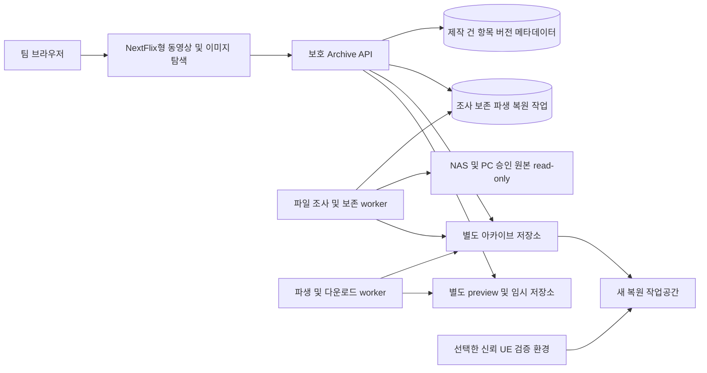

# 제작 결과물·제작 소스 아카이브 소프트웨어 설계 문서 SDD

NextFlix의 카드·가로 행·상세 보기 경험을 바탕으로 **제작 동영상과 제작 이미지를 Netflix 형태로 탐색하고, 해당 제작에 필요한 3D·이미지·기타 파일·Unreal 프로젝트를 별도 저장소에 보존하는 아카이브**를 설계한다. 핵심은 **보존 → 찾기 → 열람 → 필요한 소스 확보 → 복원**이다.

| 항목 | 기준 |
| --- | --- |
| 버전·갱신일 | 5.2 / 2026-10-29 (Asia/Seoul), 제작 결과물·재편집 프로젝트 보존 확정 |
| 확인 환경 | Windows PC + 팀 NAS/SMB, 약 10명·10TB |
| 보존 방식 | 사용자 확인: 원본과 분리된 아카이브 저장소에 필요한 파일을 복사해 보존 |
| UE 보존 목표 | 사용자 확인: 에디터에서 작업하고 영상·이미지를 출력. 제작 결과물·재편집 가능한 프로젝트 원본 보존이 핵심이며 별도 실행용 빌드는 없음 |
| UE 제외 범위 | 사용자 확인: DDC·Intermediate·로그 등 재생성 가능한 파일만 제외. 미사용 Content 에셋도 보존 |
| 구현 기준 | NextFlix `5b67a0227640b95d8fd115b71c55f84a5cadbdf3`, 기존 Movie/상세/API/package 정적 확인 |
| 연계·이력 | [TDD](TDD.v5.2.ko.md), [SDD v4.0](SDD.v4.0.ko.md), [TDD v4.0](TDD.v4.0.ko.md) |
| 상태 | 설계 문서. 코드·DB·실제 원본·NAS 변경 및 기능 실행 없음 |

## 1 재검토 결론과 범위 우선순위

사용자는 2026-10-29에 ‘목적은 아카이브’라고 명확히 했다. 따라서 v4.0의 Fab형 패키지 게시·엔진별 상품 variant·인공위성 단독 패키지·자동 UE 이행을 1차 완료 조건에서 분리한다. 해당 설계와 테스트는 v4.0 보존본에 남기고 선택 후속 기능으로 둔다. 이전 요구를 새 아카이브의 필수 조건으로 자동 승계하지 않는다. v5.2와 현행 TDD가 우선한다.

| 구분 | 현재 필수 범위 |
| --- | --- |
| 제작 결과물 | 동영상과 이미지를 동등한 1차 탐색 대상으로 제공. 동영상이 없어도 제작 이미지 등록·탐색·갤러리 가능 |
| 제작 소스 | 3D 파일(FBX 등), 소스 이미지, 기타 파일/폴더, Unreal 프로젝트를 제작 건·결과물과 연결 |
| 실제 보존 | 필요한 원본 파일을 별도 아카이브 저장소에 복사·체크섬 검증·버전별 불변 보존 |
| UE 용량 절감 | 재생성 가능한 캐시·중간 산출물은 아카이브 복사 대상에서 제외. 복원 필수 파일과 예외는 보존 |
| 활용 | 검색·메타데이터·설명/키워드/메모·원본 다운로드·보존 프로젝트 복원 |
| 선택 후속 | 단일 UE 에셋 추출·의존성 자동 이행·독립 배포 패키지·게시/판매, AI 분석·3D 뷰어·OS 폴더 도우미 |

아카이브에서 파일을 ‘제외’한다는 것은 **새 보존본에 복사하지 않음**을 뜻한다. 원본 NAS/PC에서 파일을 삭제하거나 정리하는 기능은 포함하지 않는다. ‘불필요’는 기본적으로 재생성 가능한 데이터이며, `Content`에서 현재 미사용처럼 보이는 자산을 자동 삭제/제외하는 의미가 아니다.

방송연도·방송 제목·예능/교양 등 종류·담당자·제작부조(TS 계열/홀/중계차)·키워드, 영상 전체 설명·메모, 웹 원본 다운로드라는 기존 합의는 유지한다. UE 5.3/5.4/5.6/5.8·Launcher/커스텀·Blueprint 중심/일부 C++·Actor Sequence는 복원 환경 기록 대상이며, 모든 엔진에서 자동 이행하는 요구가 아니다.

## 2 대표 업무와 성공 기준

1. 제작 담당자가 제작 건을 등록하고 결과 동영상·결과 이미지와 3D/이미지/기타 소스·UE 프로젝트 위치를 연결한다.
2. 조사 worker가 보존 계획을 만든다. 포함/제외/검토 필요 파일·이유·파일 수·총 바이트·절감 예상량을 확인하고 보존을 실행한다.
3. 별도 저장소에 복사·무결성 검증·manifest 기록이 완료된 보존본을 등록한다. 영상 프리뷰/이미지 썸네일은 원본과 별도로 생성한다.
4. 팀원은 Netflix 형태의 방송연도별 영상·이미지 카드에서 제작 건을 찾고 상세·갤러리·설명·연결 소스를 확인한다.
5. 원본 NAS가 끊겨도 보존 저장소에서 결과물/소스를 다운로드한다. 필요한 경우 UE 프로젝트를 새 복원 위치에 풀고 기록된 환경에서 연다.

완료 기준은 정확한 버전/구조/바이트가 보존되고 다시 확보되는 것이다. 복사 검증과 UE 편집기에서 실제 열리는 검증은 구별한다. 인공위성만 자동 분리하거나 다른 제작 프로젝트에 자동 추가해야 아카이브가 완료되는 것으로 판단하지 않는다.

## 3 기능·비기능 요구사항

v5.2는 아카이브 전용 요구 ID `AR-*`, 비기능 `NFR-*`를 사용한다. 이전 `ARC/ANF/PKG`와의 우선순위는 12장에 명시한다.

| ID | 1차 필수 요구·수용 조건 |
| --- | --- |
| AR-01 | 제작 동영상·제작 이미지를 카드·가로 행·연도별 전체 보기로 제공. 이미지 단독 제작 건도 정상 표시 |
| AR-02 | 방송연도·유형·종류·담당자·부조·키워드·제목·설명으로 검색/필터, URL 복원·빈/실패/로딩 구분 |
| AR-03 | 제작 건/결과물 상세에 미디어·설명·복수 이미지·버전·보존 상태·연결 소스·원본 위치 표시 |
| AR-04 | 3D·소스 이미지·기타 파일/폴더·UE 프로젝트 등록·분류·제작 건/결과물 연결. 실제 사용 확인과 단순 연관 구별 |
| AR-05 | 결과물과 소스의 논리 항목·원본 버전·보존 버전 분리. 내용 변경은 새 버전, 과거 관계/바이트 보존 |
| AR-06 | 승인 루트 조사·dry-run·파일별 포함/제외/검토 필요 계획·규칙 버전·용량·반영 이력 |
| AR-07 | 원본 읽기 전용·일관된 snapshot/안정 구간에서 복사·재실행 멱등·쓰기 중 파일/원본 변경 감지 |
| AR-08 | UE는 재생성 가능한 파일만 제외·미사용 Content 포함 보존. 바이너리 전용 플러그인·외부 미디어·Saved 설정 예외 적용, 원본 삭제0·필수 자료 무손실 |
| AR-09 | 별도 저장소의 파일/경로/크기/체크섬·manifest 검증 후 보존 완료, 불완전한 복사는 완료 금지 |
| AR-10 | 파일 위치/가용성 조사와 실제 보존 상태 구별. NAS 단절·partial 조사를 삭제로 오인하지 않음 |
| AR-11 | 동영상 프리뷰·제작 이미지/소스 이미지 썸네일·갤러리, 파생물/원본 분리·지원 안 됨 안내 |
| AR-12 | 보존본에서 원본 파일/폴더·필터된 UE 프로젝트 다운로드. 정확한 버전·원래 구조·재개·실패/만료 상태 |
| AR-13 | 새 위치 복원·manifest 대조·UE 환경/플러그인/외부 자료 요구와 열기 검증 상태 기록. 복사 완료와 재편집 가능 판정 구별 |
| AR-14 | 영상/이미지 전체 설명·키워드·팀 메모·참고할 점, 작성자·근거 버전·수정 이력. 장면 주석 필수 아님 |
| AR-15 | 결과물·소스·검색 건수·썸네일·위치·다운로드/복원 작업에 서버 측 팀/프로젝트 권한 |
| AR-16 | 수동 수정 동시성·출처/역할 보완·중복 후보 처리·이력. 자동 조사로 확정값/과거 보존본 덮어쓰기 금지 |
| AR-17 | 조사/보존/파생/다운로드/복원 진행·오류·취소·재시도·부하/공간 제한·저장소 단절 중 메타데이터 열람 |
| AR-18 | DB·메타데이터·메모·관계·규칙·manifest·보존 파일 백업/복구·무결성 재검사. 자동 원본/보존본 파기 제외 |

| ID | 기준·측정 조건 |
| --- | --- |
| NFR-01 | 내부망·동시10명에서 metadata API p95≤1초·첫 카드 표시 p95≤2초 제안. 영상5,000/파일100,000은 임시 시험값. 실제 개수/하드웨어/콜드 구분 |
| NFR-02 | 약10TB 확인. 초기 전체 해시/복제를 화면 요청에 묶지 않고 선택·증분 작업으로 처리. 계획 전후 보존/제외 바이트·실측 디스크·여유 공간 기록 |
| NFR-03 | 원본 생성/수정/삭제0, 비허용 파일·경로·미디어 노출0. 같은 팀/프로젝트 검사·안전한 경로/해제 |
| NFR-04 | 장애·취소·재시도·동시 작업에도 부분 보존 완료0·기존 버전 손상0. 루트당 조사1·파일 복사/미디어 동시성 자원별 제한 |
| NFR-05 | 한글/공백/Unicode 경로·IME·키보드/터치·초점·모션 감소, 미지원 형식/빈 이미지/원본 단절 표시 |
| NFR-06 | job/request ID·누락/제외 이유·규칙/manifest hash·검증 상태·감사/복구 증거. RPO24시간/RTO1영업일 제안, 용량/책임과 함께 확정 |

## 4 Netflix 형태의 UI·분류·메타데이터

| 화면 | 필수 내용 |
| --- | --- |
| `/archive` | 동영상·이미지 혼합 카드/방송연도 행, ‘전체/제작 동영상/제작 이미지/제작 소스/UE 프로젝트’ 이동·검색 |
| `/archive/results` | 결과물 유형·방송연도·종류·담당자·부조·키워드 필터와 전체 보기·더 보기 |
| `/archive/items/[id]` | 동영상 재생 또는 이미지 확대/갤러리, 설명·버전·보존/검증 상태·연결 소스·메모·다운로드 |
| `/archive/projects/[id]` | 제작 건의 동영상/이미지·소스 파일/폴더·UE 프로젝트·참여자·보존 이력 |
| `/archive/sources` | 3D/이미지/기타/UE 소스 카드·유형 필터·역참조. 3D는 썸네일/아이콘·메타데이터 기본 |
| `/archive/unreal/[id]` | 프로젝트/엔진·플러그인·필수/제외/검토 파일·원본/보존 용량·복원 요구·열기 검증·전체 보존본 다운로드 |
| 관리자 조사/보존 작업 | 루트·제외 정책·파일 계획·예외·진행/오류·재실행·보고서 |

제작 이미지는 상세의 썸네일 부속물이 아니라 독립 결과물이다. 동일 이미지가 결과물/소스 두 역할이면 역할을 함께 연결하며 확장자만으로 판단하지 않는다. `.png`는 결과 이미지·소스 이미지·대표 썸네일 중 무엇인지 명시한다. 파생 썸네일을 제작 원본으로 등록하지 않는다. 영상 없는 이미지 프로젝트는 ‘영상 없음’ 오류를 보이지 않고 이미지 갤러리를 연다.

카드는 미디어 유형 badge·제목·방송연도·대표 이미지·보존 상태를 표시한다. 실제 인기 정보가 없는 추천/순위 문구·자동 음향은 사용하지 않는다. 카드 클릭은 상세이며 영상 재생·이미지 확대·다운로드를 구분한다. 손상 이미지/미지원 PSD/EXR 등은 지원 여부를 표시하고 원본 보존을 계속할 수 있다. 웹 미리보기 가능과 파일 보존 가능을 동일하게 보지 않는다.

연도는 방송연도 정수/null이고 제작/납품/파일 수정일로 대체하지 않는다. 이미지도 같은 기준을 사용하며 미상은 별도다. TS 계열·홀·중계차는 관리 사전으로 두고 `TS-1~TS-D`의 개별 코드를 임의 생성하지 않는다. 검색은 NFC/공백 정리·리터럴 q(1~100 코드 포인트)·필드 OR/필터 AND·limit24/1~48·ID 중복 제거다. 300ms 디바운스·IME·이전 응답 차단·URL 복원을 적용한다. 전체 결과물의 기본 정렬은 방송연도 DESC/null 마지막·id DESC다.

## 5 논리 데이터 모델과 상태 분리

업무 객체는 teamId·작성/수정시각을 가지며 관계의 팀/프로젝트·대상 존재를 서버에서 확인한다. 파일 경로를 엔터티 ID로 쓰지 않는다.

| 모델 | 필드·제약 |
| --- | --- |
| ProductionProject / Membership / ProjectAccess | 제작 건·역할·열람/다운로드/보존/복원 권한 |
| ArchiveItem | title, kind(video/image/model3d/other/unrealProject), roles(result/source/reference), projectId, 방송 제목/연도·종류·담당자/부조·키워드·대표 버전 |
| ItemVersion | itemId, versionLabel, FileSetId, 기술정보·출처·생성 시각. 대표 버전은 같은 항목, 보존 내용 불변 |
| ItemLink | fromVersionId/toVersionId·associated/usedConfirmed·근거·확인자. 결과 영상 없이 이미지에서 소스 연결 가능 |
| Description / Memo | itemVersionId·전체 설명/참고점/키워드·작성자·revision/수정 이력. 다른 버전으로 자동 이동 금지 |
| StorageSource / FileRecord | 승인 물리 루트·collector·case/정규화 정책 / source+canonicalRelativePath 고유·원문·크기·mtime·fingerprint·위치 가용성 |
| FileSet / ArchivePolicy | 소스 snapshot/고정 파일 집합 / 유형·정책 버전·경로별 include/exclude/review·예외·이유·작성자 |
| ArchivePlan / PlanEntry | 고정 file set·정책·예외·include/exclude/review·예상/실측 파일 수/바이트·충돌·제약·manifestHash·revision |
| ArchiveVersion / ArchiveFile | itemVersion·plan·보존 저장소·immutable manifest·총 bytes/hash·보존 상태 / 원래 상대경로·objectKey·크기/hash·판정 근거 |
| UnrealArchiveProfile | `.uproject`·엔진 버전/build/커스텀 fingerprint·plugins/모듈/toolchain·필수 binary/외부 파일·대표 map·정책·기록/검증 상태 |
| PreviewDerivative | 부모 itemVersion·poster/frame/proxy·크기/해상도·생성기 버전·ready/unsupported/failed. 보존 원본과 분리 |
| ScanJob / ArchiveJob / DownloadJob / RestoreJob | 주체·입력 버전/plan·state·lease/fencing·checkpoint·진행/오류·결과 객체·임시파일 만료 |
| RestoreValidation / AuditEvent | 복원 snapshot·환경·대표 map·실제 열기/컴파일·보고서 / 행위·대상·request/job·안전한 변경 요약 |

별도 상태를 사용한다: (1) 원본 가용성 online/offline/missingCandidate, (2) 보존 catalogued/planned/copying/verifying/verified/partial/failed, (3) 미리보기 pending/ready/unsupported/failed, (4) 복원 검증 notTested/passed/failed/environmentMissing. `verified`는 계획한 파일의 보존/무결성 확인이며 UE 재편집 성공을 뜻하지 않는다. 필수 파일 누락/미해결 review는 계획 확정 전 차단한다. 일부 자료만 복사됐다면 partial이다.

보존이 완료된 버전은 파일 내용·manifest를 수정하지 않는다. 원본 내용·필터 정책·예외가 바뀌면 새 계획/보존 버전으로 만든다. 메타데이터 수정은 revision 검사로 충돌409, 보존 bytes는 그대로 둔다. 같은 파일 hash를 공유하더라도 별도 제작 관계·버전·권한을 합치지 않고 자동 중복 삭제하지 않는다.

## 6 조사·보존 처리와 manifest

1. **등록/조사:** 승인 루트·대상 항목·결과/소스 역할을 지정한다. 폴더 전체 파일을 열거하고 개수/용량·오류·확장자 후보를 기록한다. 조사만으로 아카이브 완료가 되지 않는다.
2. **계획:** 정책과 경로별 예외로 include/exclude/review를 판정하고 이유·파일 수/바이트를 보여준다. 편집자는 미분류 파일·필수 binary/외부 의존성을 검토한다. 계획 확정 시 source snapshot·규칙·manifestHash를 고정한다.
3. **안정성 확인:** 편집 종료·안정 구간 또는 VCS/저장소 snapshot 같은 일관된 기준을 사용한다. 파일별 읽기 전후 stat/fingerprint 변경과 전체 파일 집합 변경은 stale/needsReplan이다. 쓰는 중 파일을 성공으로 보존하지 않는다.
4. **공간/복사:** 최종/임시·저장소 예비 공간을 확인하고 파일을 staging으로 복사한다. 원본은 read-only이고 산출물은 별도 archive/temporary/preview 저장소에만 쓴다.
5. **검증/완료:** 포함 파일의 경로·개수·크기·강한 checksum과 manifest를 대조한다. 모두 통과하고 현재 작업 lease가 유효할 때에만 보존본을 commit한다. DB/파일 양쪽 commit 순서와 journal로 장애 후 orphan/부분 완료를 복구한다.
6. **후속:** 미리보기 생성과 복원 검증은 별도 작업이다. 파생 실패나 UE 환경 미설치가 정상 복사 bytes를 파괴하지 않는다. 단, UI에서 모든 검증 완료로 표시하지 않는다.

manifest는 schemaVersion·item/version/plan·sourceSnapshotId·정책 버전/예외·포함 파일 상대경로/크기/hash·제외 파일 경로/이유/바이트·review 해결 이력·UE 요구 환경·보존 시각·검증 보고서를 가진다. 공유 다운로드용 manifest는 내부 절대 경로·자격 증명을 제외하고, 자세한 조사/제외 보고서는 별도 관리자 권한으로 제한한다. ZIP 자신의 hash를 내부 manifest에 순환 삽입하지 않고 서버의 배포 레코드에 최종 hash를 둔다.

루트당 조사 한 개·작업 lease/fencing·checkpoint·요청자 범위 멱등 키를 사용한다. partial·단절·제외 규칙 변경을 파일 삭제로 판정하지 않는다. 같은 범위의 정상 전체 조사 두 번 미발견 시 missingCandidate 표시라는 기본안은 검토 상태이며 자동 삭제하지 않는다. symlink/junction/reparse point는 기본 미추적·순환/루트 이탈 차단, 실제 필요한 외부 자료는 명시적인 승인 경로/자료 참조로 등록한다.

## 7 Unreal 프로젝트의 필요한 파일만 보존

### 7.1 적용 원칙

확정 목표는 **제작 결과 동영상·이미지와 나중에 다시 열고 수정하는 프로젝트 원본 보존**이다. 사용자는 별도 실행 프로그램을 만들지 않았으므로 실행용 빌드는 보존 대상이 없고, 그 부재를 누락/오류로 처리하거나 아카이브를 위해 실행 프로그램을 새로 만들지 않는다. 프로젝트 소스를 보존하는 것과 개별 인공위성을 추출하는 것은 다른 업무다. 전체 `Content`를 참조 분석으로 가지치기하거나 현재 열지 않은 map/asset을 제거하지 않는다.

영상·이미지는 다시 렌더할 수 있더라도 제작 결과물이므로 보존한다. 재생성 파일 제외 규칙은 DDC·Intermediate·로그 같은 캐시/중간 자료에 적용하며 최종 출력물을 제외하는 근거가 아니다. 출력 저장 위치가 `Saved` 하위여도 결과물로 등록한 파일은 보존 규칙이 우선한다. Editor 모듈·필수 플러그인 binary와 필요한 `Build` 입력 파일은 별도 배포용 실행 프로그램과 구별해 기존 예외/보존 정책을 유지한다.

정책은 단순한 전역 확장자 차단이나 `**/Binaries/**` 일괄 제외가 아니다. **프로젝트 루트·플러그인 단위 경로와 파일 역할**로 평가한다. 원본/소스/복원 필수로 명시한 예외가 캐시 기본 제외보다 우선한다. 이름이 같다는 이유로 `Content/Saved` 등 실제 콘텐츠 폴더를 시스템 `Saved`처럼 제외하지 않는다. 알 수 없는 파일은 review로 두고 자동 누락시키지 않는다.

### 7.2 포함·제외·검토 정책

| 경로/자료 | 기본 판정 | 이유·예외 |
| --- | --- | --- |
| 프로젝트 `.uproject` | include | 엔진 연결·플러그인·모듈 descriptor 보존 |
| `Config/**` | include | 기능 설정 보존. 개인/비밀 설정은 별도 접근/보존 정책으로 검토하며 자동 마스킹·원본/보존 내용 변형 금지 |
| `Content/**` | include | map·asset·외부 actor/object·필요 동반 파일 포함. 미사용 추정만으로 제거 금지 |
| `Source/**`·`.Build.cs/.Target.cs` | include | 일부 C++ 포함 프로젝트의 재빌드 자료. 소스가 없으면 없다고 기록 |
| `Build/**`, authored Shaders/스크립트·Resources | include/review | 실제 빌드/프로젝트 동작에 필요한 입력일 수 있음. Build를 Intermediate와 동일 취급하지 않음 |
| 프로젝트 `Plugins` | 구성별 판정 | `.uplugin`·Content·Config·Source·Resources·Shaders·Build·필수 ThirdParty 라이브러리 포함, 엔진 플러그인은 정확한 설치/복구 참조 기록 |
| 루트/각 플러그인의 `Intermediate/**`, 실제 DDC 경로 | exclude | 재생성 가능한 중간 산출물·캐시. 프로젝트 밖 공유/Zen 캐시도 복사하지 않음 |
| `Saved/Logs`, `Saved/Crashes`, 검증된 temp/cache | exclude | 편집/복원 입력이 아닌 진단·임시 자료 |
| `Saved/Autosaves/Backup`, `Saved/Config` 등 | review → 필요한 것만 include | 고유 미저장 작업/실제 사용 설정이 있으면 확정 source/config나 별도 복구자료로 보존. `Saved` 전체 무검토 제외 금지 |
| 루트/플러그인 `Binaries/**` | review | 소스·필수 의존성·동일 build/toolchain으로 재생성 가능이 확인된 산출물만 exclude. 바이너리 전용 플러그인/외부 DLL 등 대체 불가 파일은 include |
| `.vs/.idea`, 생성 `.sln/.vcxproj`, VCS 작업 데이터 | exclude/review | 검증된 IDE/생성/이력 캐시는 제외. 직접 작성한 build/task 설정·필수 스크립트는 명시 include |
| 에디터에서 출력한 제작 동영상·이미지 | include | 저장 위치와 무관하게 결과물 원본 보존. Saved 하위 출력도 캐시로 제외하지 않음 |
| 별도 Cooked/Staged/Packaged 실행 프로그램 | 대상 없음 | 사용자 작업에서 생성하지 않음. 부재는 정상이며 빌드 생성/실행 검증을 요구하지 않음. 필수 Editor/plugin binary·Build 입력과 구별 |
| 프로젝트 밖 영상/이미지/오디오·3D 원본·재임포트 자료 | 명시 include/연결 | 승인 루트에서 실제 bytes를 보존하고 연결/복원 방법 기록. 절대 경로 문자열만 저장하고 복원 가능으로 표시 금지 |

`Saved`·`Binaries`의 review는 필수 자료가 실제로 없다는 확인 또는 보존 예외를 남긴 뒤 해소한다. 캐시가 들어 있다는 이유만으로 폴더 전체를 필요 파일로 간주하지 않고 파일/하위 경로별로 선별한다. 소스가 없는 플러그인의 필수 binary를 보존하는 것은 불필요 파일 저장이 아니다. 반대로 같은 DLL 확장자라는 이유로 모든 DLL을 보존하지 않는다.

필터 결과에 포함/제외/미해결 수·바이트, 예외 원인, 정책 버전을 표시한다. 전체 절감률은 `(원본 조사 바이트-포함 바이트)/원본 조사 바이트`로 제안하며 알 수 없는 원본 개수/바이트가 있으면 완전한 절감률로 표시하지 않는다. 보존본에 원본 불필요 캐시가 들어가지 않았는지 manifest로 확인한다.

### 7.3 복원 환경과 사실의 경계

엔진 minor/build·Launcher/커스텀 fingerprint·플러그인 버전/설치/소스 유무·C++ toolchain·대표 map·외부 자료·필수 설정을 기록한다. 엔진 전체를 프로젝트마다 중복 보존하지 않고 관리되는 엔진/플러그인 보존 참조·정확한 공급/복구 경로를 사용한다. 사내 커스텀 엔진의 실제 보관 위치/불변 build 식별이 없으면 environmentMissing/needsReview다. 버전 숫자만 같다고 호환 완료로 표시하지 않는다.

보존 완료는 포함 bytes의 검증이다. ‘프로젝트 열기 검증 통과’는 원본 경로와 캐시 없이 별도 복원본에서 기록된 환경으로 열고 대표 map·asset·Actor Sequence·필요 C++ 빌드를 확인한 증거가 있어야 한다. 소스 없는 C++ binary만으로 재편집 가능을 보장하지 않는다. 환경이 없으면 notTested/environmentMissing으로 표시하며 임의 엔진 업/다운그레이드·플러그인 실행을 수행하지 않는다.

## 8 미리보기·다운로드·복원

동영상 원본은 변경하지 않고 브라우저용 proxy·최대 세 프레임 기본 썸네일을 별도로 생성한다. 이미지 원본도 변경하지 않고 크기/형식을 지원하는 경우 웹 썸네일/갤러리 이미지를 만든다. PSD/EXR/TIFF 등은 실제 지원된 decoder에 한해 파생 생성하고 미지원이면 아이콘/기술정보·원본 다운로드를 제공한다. 원본 크기·색상 정보와 파생물의 차이를 표시하며 미리보기를 원본으로 반환하지 않는다.

개별 파일 다운로드는 고정 ArchiveVersion/ArchiveFile, 폴더/UE 프로젝트 다운로드는 **필터가 적용된 전체 보존 파일 집합**을 기준으로 한다. 관리자용 완전한 제외 보고서는 별도 권한, 일반 복원 ZIP에는 안전한 manifest·필요 환경·복원 설명과 payload를 제공한다. 폴더 구조/파일명·checksum이 유지되어야 하며 프로젝트 원본 폴더를 매번 다시 읽어 다른 내용을 압축하지 않는다. ZIP이 아카이브 완료의 근거가 아니라 보존 bytes를 전달하는 포맷임을 구분한다.

준비 작업은 queued/preparing/ready/failed/expired/cancelled, 보존 artifact/원본 파일 object는 불변이다. 정리되는 임시 ZIP과 영구 보존 파일을 분리한다. content 요청마다 권한·버전·무결성을 확인하고 attachment·안전한 파일명·Content-Type·range206/잘못된 범위416·동일 validator 재개를 적용한다. 잘린 다운로드를 ready/완료로 표시하지 않는다. 별도 사용자 job ID 접근을 차단한다.

복원은 기본적으로 새 작업 위치에 수행하고 원본/기존 제작 폴더를 덮어쓰지 않는다. UI에서 보존 버전·필터/제외 내역·환경 요구·검증 상태를 확인한 뒤 다운로드/복원한다. 폴더 해제 전 path traversal·절대 경로·case/중복 경로·symlink·해제 용량을 검사하고 파일/manifest를 대조한다. UE를 열거나 컴파일하는 동작은 등록된 신뢰 환경에서 명시적 검증 작업으로 수행하며 일반 조사/다운로드 worker는 실행하지 않는다.

## 9 구조·API·기존 코드 이행

Next.js·React·NextAuth·Prisma/MongoDB는 출발점으로 유지하고 API와 장기 파일 작업을 분리한다. Job/lease는 DB 기반으로 시작하며 필요 시 큐를 확장한다. 현행 패키지 지원/보안 버전은 구현 착수 시 별도 검토한다. 서버 상태는 SWR·UI 상태는 Zustand·필터는 URL 기준이다. 원본 및 아카이브 루트를 서로 구분하고 동일/중첩 경로를 금지한다.

| 신규 API 초안 | 계약 |
| --- | --- |
| GET `/api/archive/items`, GET `/api/archive/years` | kind/role/resultType/year/q/project/type/담당/부조·cursor/limit, 허용 동영상·이미지 모두 집계, `{items,nextCursor}` |
| GET/PATCH `/api/archive/items/[id]`, POST `/api/archive/items` | 상세/보존 버전·소스 관계·역할·기술정보 / 메타데이터 revision409 / 등록201 |
| GET/POST `/api/archive/projects`, GET `/api/archive/projects/[id]` | 제작 건 및 허용 결과물·소스·UE 연계 |
| PUT `/api/archive/items/[id]/links/[targetVersionId]` | associated/usedConfirmed·근거·revision, 관계 중복 방지 |
| GET/PATCH `/api/archive/versions/[id]/description`, POST `.../[id]/memos` | 영상/이미지 전체 설명·키워드·메모·작성자·revision |
| POST `/api/archive/scans`, GET `/api/archive/scans/[id]` | 관리자 승인 source/범위·dryRun,202 / 진행·오류·후보. 취소/반영은 별도 멱등 action |
| POST `/api/archive/plans`, GET/PATCH `/api/archive/plans/[id]` | source snapshot·정책·include/exclude/review·예외/근거·revision·용량,201/200. 미해결 필수 review이면 실행 차단 |
| POST `/api/archive/jobs`, GET `/api/archive/jobs/[id]` | planId·manifestHash·revision·idempotency key,202 / 복사·검증 상태. stale409 |
| GET `/api/archive/versions/[id]/manifest` | 일반 복원용 안전 manifest. 내부 경로/완전 제외 보고서는 관리자 endpoint로 분리 |
| GET `/api/archive/unreal/[id]`, GET `/api/archive/policies` | UE 보존 범위·엔진/플러그인·복원 상태 / 적용 정책·기본 제외·예외. 정책 변경은 관리자 |
| GET `/api/archive/media/[id]` | 부모 권한 확인한 비공개 proxy/썸네일/갤러리·영상 range |
| POST `/api/archive/downloads`, GET `.../[id]`, GET `.../[id]/content` | archiveVersionId·선택 file/전체 집합·예상 hash·요청자 멱등 key,202 / 준비 상태 / 보존 bytes·폴더 ZIP |
| POST `/api/archive/restores`, GET `/api/archive/restores/[id]` | 고정 archiveVersion·새 승인 복원 위치 또는 사용자 다운로드,202. 원본/기존 자료 덮어쓰기 금지 |
| POST `/api/archive/restores/[id]/validations` | 허용 담당자·등록 환경·검증 범위,202 / 실제 열기/빌드 증거. 미설치 환경은 environmentMissing |

cursor는 endpoint·필터·마지막 정렬 키·limit·사용자/팀 접근 범위·버전에 바인딩,2KB 상한·매 요청 검증이다. 영상/이미지 결과와 소스 조회 cursor를 혼용하지 않는다. 페이지 사이 snapshot은 보장하지 않되 정적 fixture 누락/중복0이어야 한다. q와 필터 변경 시 페이지 초기화·서버 권한 필터를 집계 전 적용한다.

오류는 `{error:{code,message,requestId}}`:400 입력,401 비인증,403 역할,404 없음/비공개,409 경쟁/계획 stale/준비 미완료,410 임시다운로드 만료,416 range,500 내부,503 저장소 불가. 보존 완료 메타데이터 조회는 원본 단절 중에도200+가용성으로 응답한다. stack·비밀·물리 루트를 노출하지 않는다.

현행 [Movie 스키마](../../prisma/schema.prisma)·[InfoModal](../../components/InfoModal.tsx)·[목록 API](../../app/api/movies/route.ts)는 영화 중심이고 결과 이미지·소스/보존 모델이 없다. 새 `/api/archive` 모델/화면을 별도로 도입하고 고유 legacyMovieId로 관리자 검토 import한다. 없는 연도/소스는 미상·설명은 출처와 함께 보존, 외부 URL 자동 fetch 없음. 기존 Movie/Favorite를 삭제하거나 현재 배열 API를 즉시 변경하지 않는다. [package.json](../../package.json)에 없는 테스트 runner를 설치 완료로 간주하지 않는다.

## 10 권한·운영·백업

조회자는 허용된 결과/소스·설명·미리보기를 읽고 별도 downloadOriginal 권한으로 보존 파일을 받는다. 편집자는 허용 제작 건 등록/수정·보존 계획을 만들고 관리자는 루트/정책·예외·서비스 계정·실행 권한을 관리한다. 개인 메모가 아닌 팀 공유 메모를 기본안으로 두되 노출 범위는 팀 정책으로 확정한다. 파일 내용·목록·검색 건수·경로·썸네일·작업 상태에도 동일 객체 권한을 적용한다.

NAS ACL과 앱 권한의 자동 동기화를 가정하지 않는다. collector의 읽기 권한을 팀원에게 승계하지 않으며 아카이브 저장소/파생물은 비공개다. Content endpoint는 private/no-store·권한 재검사, 계정 전환 시 캐시/모달/작업 상태를 초기화한다. 정책·플러그인·업로드 파일을 일반 스캔에서 실행하지 않는다. Source와 archive path가 같거나 중첩되면 보존/복원을 거절한다.

DB·설명/메모·관계·규칙/예외·manifest·보존 원본·검증 보고서를 함께 백업/복구한다. proxy는 원본이 있으면 재생성 가능하지만 생성기/설정을 기록한다. 원본 NAS 손실과 보존 저장소 손실은 별도 장애로 다루고 보존본 하나를 전체 백업 정책으로 간주하지 않는다. 원본이나 보존본 자동 삭제/중복 제거·보존 기간 종료 자동 파기는 1차 범위가 아니다.

## 11 단계·완료 기준

| 단계 | 산출물 | 완료 기준 |
| --- | --- | --- |
| A 목적/표본·정책 확인 | 결과 동영상/이미지·FBX/이미지/기타·UE 표본, 별도 저장소·UE 보존 목표·예외 | 실제 필요/제외 파일·보존/복원 환경·역할 결정, 합의/미확정 분리 |
| B 결과물/소스 카탈로그 | 동영상+이미지 Netflix UI·상세·연도/검색·설명·소스 연결·권한 | 이미지 단독 제작 건 포함 핵심 탐색/보호 테스트 통과 |
| C 선택 보존·다운로드 | dry-run·UE 필터·manifest·복사/검증·버전·파생·보존본 다운로드 | 불필요 캐시 보존0·필수 파일 누락0·원본 변경0·정확한 보존 bytes 확보 |
| D 복원·시험 운영 | 복원 대조·대표 UE 열기/빌드·단절/실패·백업 복구·성능 | 실제 환경의 대표 아카이브/복원 과제 통과, 검증하지 않은 환경은 미검증 표시 |
| E 후속 선택 | 개별 에셋 자동 분리·UE 이행·Fab 패키지·AI/3D 뷰어 | 별도 채택 시 v4.0 설계/테스트 재검토 |

1차 완료는 B~D의 필수 테스트와 대표 제작 건의 보존·찾기·다운로드·복원 성공이다. 캐시를 줄였다는 용량 수치만으로 성공하지 않고 필요한 소스와 UE 구조가 남았는지 확인한다. 이미지 카드가 없거나, 원본 경로만 기록했거나, UE 필수 plugin binary를 잃었거나, 보존 파일 손상이 있으면 완료가 아니다. 개별 인공위성 패키지 게시/자동 프로젝트 추가 여부는 현재 아카이브의 합격을 막지 않는다.

## 12 결정·범위 이행·남은 질문

| 구분 | 2026-10-29 반영 |
| --- | --- |
| 확정 | 목적은 아카이브. 동영상·이미지 Netflix 형태 UI, 3D/이미지/기타/UE 소스 보존 |
| 확정 | 별도 아카이브 저장소에 필요한 파일을 복사하여 보존. 단순 NAS 인덱스만으로 완료하지 않음 |
| 확정 | 에디터 작업의 제작 결과 영상·이미지와 재편집 가능한 프로젝트 원본을 보존. 별도 실행 프로그램을 만들지 않았으므로 실행용 빌드 보존/검증은 대상 없음 |
| 확정 | 사용자 선택: DDC·Intermediate·로그 등 재생성 가능한 파일만 제외. 참조되지 않은 map/asset·미사용 Content도 보존하며 참조 분석 기반 가지치기는 범위 제외 |
| 기존 유지 | 방송연도·필수 메타데이터·약10명/10TB·Windows/SMB·UE 버전군·전체 설명/메모·웹 원본 다운로드 |
| 새 정책 | UE 불필요 파일은 보존 대상에서 제외하되 복원 필수 예외 보존. 원본 삭제/자동 Content 가지치기 없음 |
| 이전 ARC-01~12/15~20·ANF | 필요한 보존/탐색/권한 원칙을 AR/NFR로 재정의. 새 ID 추적표로 검증 |
| 이전 ARC-13/14·ARC-21~26·PKG 테스트 | 자동 분석/이행·Fab 패키지 필수 게이트 해제, v4.0 이력/선택 후속으로 보존. 현행 통과율 분모에 넣지 않음 |

남은 구현 전 확인은 실제 폴더 표본·plugin 바이너리/소스·외부 자료·Saved 고유 자료, 아카이브 저장소 여유 공간/백업 책임, 계정·다운로드/보존 권한, TS 개별 명칭·실제 항목/파일 수·조사 주기다. 기본안·제안 RPO/RTO/성능 수치를 사용자 합의로 기록하지 않는다. 답변이 도착하면 SDD·TDD의 기대 결과를 함께 수정한다.

## 13 근거·현재 검증 상태

UE 경로별 의미는 [Epic 디렉터리 구조](https://dev.epicgames.com/documentation/en-us/unreal-engine/unreal-engine-directory-structure), 플러그인의 Source/Binaries/Content 구성은 [Epic 플러그인 문서](https://dev.epicgames.com/documentation/en-us/unreal-engine/plugins-in-unreal-engine), 재생성 캐시는 [Epic DDC 문서](https://dev.epicgames.com/documentation/en-us/unreal-engine/using-derived-data-cache-in-unreal-engine)를 확인했다. 기본 include/exclude/review와 예외 우선순위는 그 근거에 기반한 **본 프로젝트의 보존 정책 설계**이며 Epic이 모든 프로젝트에 동일 제외표를 보증한 것은 아니다.

v5.2는 제작 결과물·재편집 프로젝트 원본 보존, 실행용 빌드 없음, 별도 저장소 복사와 재생성 캐시만 제외한다는 사용자 답변을 반영했다. 문서 구조·링크·요구/테스트 추적·필수/후속 범위 정합성을 점검하며 코드·의존성·DB·실제NAS·UE·기능 테스트·배포는 변경/실행하지 않았다. 이전 문서는 이력으로 보존하고 실제 성능·복원 결과는 미실행으로 남긴다.
